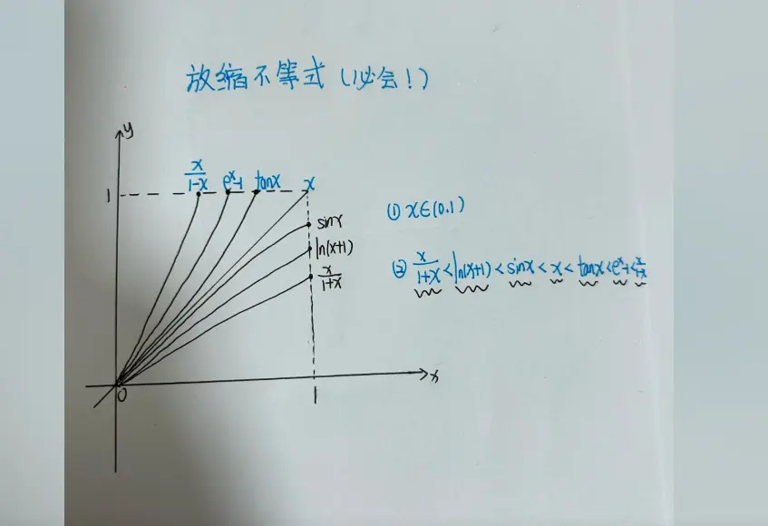
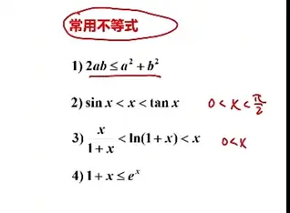

“基本不等式”通常指的是代数不等式中最核心的基石。在高等数学中，它们与前面提到的超越函数放缩（如 $e^x \ge 1+x$）互为补充，是解决**求最值、夹逼定理放缩、数列极限证明**的必备武器。

#
以下为你梳理必须要烂熟于心的基本代数不等式：  

## 1. 对数与指数放缩（核心高频）

这类不等式主要利用了 $y=e^x$ 和 $y=\ln(1+x)$ 在 $x=0$ 处的切线 $y=x+1$ 与 $y=x$ 进行放缩。它们是考研解答题的第一梯队工具。

- **指数核心：**
    
    对于任意实数 $x$：
    
    $$e^x \ge 1 + x$$
    
    _(等号仅在 $x=0$ 时成立)_
    
    > **实战进阶：** 当 $x \ge 0$ 时，还可以展开到二阶：$e^x \ge 1 + x + \frac{1}{2}x^2$。
    
- **对数核心：**
    
    对于 $x > -1$：
    
    $$\frac{x}{1+x} \le \ln(1+x) \le x$$
    
    _(等号仅在 $x=0$ 时成立)_
    

## 2. 三角函数放缩（夹逼定理常客）

三角函数的放缩主要在 $(0, \frac{\pi}{2})$ 区间内进行，常用于极限的夹逼定理和级数敛散性的判别。

- **基础三兄弟：**
    
    当 $x \in (0, \frac{\pi}{2})$ 时：
    
    $$\sin x < x < \tan x$$
    
- **绝对值放缩：**
    
    对于任意实数 $x$：
    
    $$|\sin x| \le |x|$$
    
    $$|1 - \cos x| \le \frac{1}{2}x^2$$
    
- **若尔当不等式 (Jordan's Inequality)：**
    
    当 $x \in (0, \frac{\pi}{2}]$ 时，正弦曲线始终在连接原点与点 $(\frac{\pi}{2}, 1)$ 的直线之上：
    
    $$\frac{2}{\pi}x \le \sin x \le x$$
    

## 3. 拉格朗日中值定理导出的放缩（距离放缩）

这类不等式用于衡量两个点之间的函数值差距，本质是利用了导数的最大值（即函数的最大变化率）。

由于 $(\sin x)' = \cos x \le 1$ 以及 $(\arctan x)' = \frac{1}{1+x^2} \le 1$，我们可以得到极其优美的距离放缩：

- **正弦距离：** 对于任意实数 $a, b$：
    
    $$|\sin a - \sin b| \le |a - b|$$
    
- **反正切距离：** 对于任意实数 $a, b$：
    
    $$|\arctan a - \arctan b| \le |a - b|$$
    
- **对数距离：** 若 $0 < a < b$：
    
    $$\frac{b-a}{b} < \ln b - \ln a < \frac{b-a}{a}$$

## 1. 均值不等式链 (The Mean Inequality Chain)

这是基本不等式的完全体，揭示了四种平均数（调和、几何、算术、平方平均）之间的绝对大小关系。

对于任意正实数 $a, b > 0$，恒有：

$$\frac{2}{\frac{1}{a} + \frac{1}{b}} \le \sqrt{ab} \le \frac{a+b}{2} \le \sqrt{\frac{a^2+b^2}{2}}$$

_(等号成立的充要条件是 $a=b$)_

这四个部分从左到右依次是：

- **调和平均 (Harmonic Mean)**
    
- **几何平均 (Geometric Mean)**
    
- **算术平均 (Arithmetic Mean)**
    
- **平方平均 (Quadratic Mean / RMS)**
    

## 2. 考研高频变体（实战变形）

在实际做题中，我们很少直接写出整条链，而是提取其中的片段进行变形。以下几个变体在化简和放缩时极其常用：

- **平方和与乘积的转换（无正负限制）：**
    
    对于任意实数 $a, b$：
    
    $$a^2 + b^2 \ge 2ab$$
    
    _(应用：遇到 $xy$ 乘积项想转为平方项，或做配方放缩时极有效。)_
    
- **和与积的极值（和定积最大，积定和最小）：**
    
    对于任意正数 $a, b$：
    
    $$ab \le \left(\frac{a+b}{2}\right)^2$$
    
- **对号函数放缩（倒数和）：**
    
    对于 $x > 0$：
    
    $$x + \frac{1}{x} \ge 2$$
    
    _(等号在 $x=1$ 时成立。如果是 $x < 0$，则 $x + \frac{1}{x} \le -2$。)_
    

## 3. 离散型柯西不等式 (Cauchy-Schwarz Inequality)

前面提到了柯西不等式的积分形式，它的代数（离散）形式同样重要，尤其在处理多变量和平方项时。

对于任意实数 $a_1, a_2, \dots, a_n$ 和 $b_1, b_2, \dots, b_n$：

$$\left( \sum_{i=1}^n a_i^2 \right) \left( \sum_{i=1}^n b_i^2 \right) \ge \left( \sum_{i=1}^n a_i b_i \right)^2$$

_(等号成立的条件是 $\frac{a_1}{b_1} = \frac{a_2}{b_2} = \dots = \frac{a_n}{b_n}$)_

**二维精简版（最常考）：**

$$(a^2 + b^2)(c^2 + d^2) \ge (ac + bd)^2$$

## 4. 绝对值不等式（三角不等式）

这是微积分严格证明（即 $\epsilon-\delta$ 语言）的基石，用于剥离或合并绝对值。

对于任意实数 $a, b$：

$$\big| |a| - |b| \big| \le |a \pm b| \le |a| + |b|$$

> **使用技巧：**
> 
> - 当需要把一整块式子**拆分成两块分别求极限**时，用右半边：$|a + b| \le |a| + |b|$。
>     
> - 当已知整体的界限，想要**推断其中一部分的界限**时，用左半边：$||a| - |b|| \le |a - b|$。
>