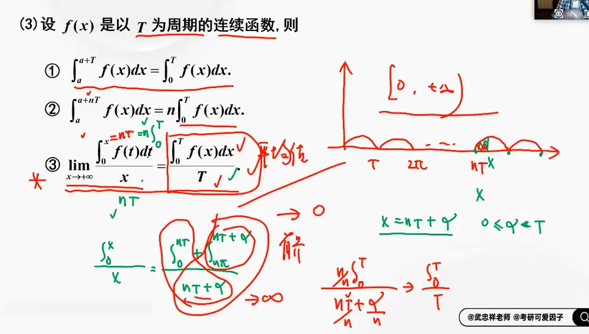

  

   
# 结论三的扩展  
你刚才给出的推导过程非常严密，这正是处理此类变限积分极限问题的核心逻辑。为了在做题时提高速度，确实有一个非常常用且可以直接记住的**一般性结论（定理）**，以及由此衍生出的一系列常见等价代换。

## 1. 核心一般性结论

对于任意连续的**周期函数** $f(x)$，设其周期为 $T > 0$，如果在单周期内的积分不为零，即 $\int_0^T f(t)dt = I \neq 0$，那么当 $x \to +\infty$ 时，有以下等价关系：

$$\int_0^x f(t)dt \sim \frac{I}{T} x$$

**也可以写成极限的形式：**

$$\lim_{x \to +\infty} \frac{\int_0^x f(t)dt}{x} = \frac{1}{T} \int_0^T f(t)dt$$

> **直观理解：** 当积分上限 $x$ 变得非常大时，函数局部的波动（有界的部分）可以忽略不计，整个积分的增长速度完全取决于函数在**一个周期内的平均值**。$\frac{1}{T} \int_0^T f(t)dt$ 就是这个平均值，所以积分值等价于 $\text{平均值} \times x$。

## 2. 必须记住的常见等价替换表

在微积分考试中，最常出现的周期函数往往是三角函数的绝对值或偶次幂。你可以直接把下表中的结果作为定理使用，在求 $x \to +\infty$ 的极限时直接进行等价替换：

| **被积函数 f(t)**                                    | **最小正周期 T** | **单周期积分 I=∫0 T​f(t)dt** | **当 x→+∞ 时的等价无穷大** |
| ------------------------------------------------ | ----------- | ----------------------- | ------------------ |
| $\vert{}\sin t\vert{}, \vert{}\cos t\vert{}$     | $\pi$       | $2$                     | $\frac{2}{\pi}x$   |
| $\sin^2 t, \cos^2 t$                             | $\pi$       | $\frac{\pi}{2}$         | $\frac{1}{2}x$     |
| $\vert{}\sin^3 t\vert{}, \vert{}\cos^3 t\vert{}$ | $\pi$       | $\frac{4}{3}$           | $\frac{4}{3\pi}x$  |
| $t - \lfloor t \rfloor$ (小数部分)                   | $1$         | $\frac{1}{2}$           | $\frac{1}{2}x$     |
[[定积分
## 3. 补充注意点：如果单周期积分为 0 怎么办？

如果遇到 $\int_0^T f(t)dt = 0$ 的情况（例如原函数就是普通的 $f(t) = \sin t$ 或 $\cos t$），此时不能用上面的等价替换。

**结论：**

如果周期函数在单周期内的积分为 $0$，那么它的变限积分 $F(x) = \int_0^x f(t)dt$ 是一个**有界函数**。

例如：$\int_0^x \sin t dt = 1 - \cos x$，它的值域在 $[0, 2]$ 之间，当 $x \to +\infty$ 时，它的增长量级是 $\mathcal{O}(1)$，即常量级。此时往往结合“有界函数 $\times$ 无穷小量 $= 0$”的性质来出题。

# 结论三的证明

这个公式描述的是**周期函数在无穷区间上的平均值，等于它在一个单周期内的平均值**。在考研数学或数学分析中，这是一个非常经典的结论。

证明这个公式的核心思想是“取整法（或叫周期分段法）”：当 $x$ 趋向于正无穷时，我们可以把区间 $[0, x]$ 拆分成 $n$ 个完整的周期 $T$，加上一个不足一个周期的“零头”。

以下是严谨的证明步骤：

### 📝 证明过程

**前提假设：** 设 $f(t)$ 是以 $T$ 为周期的连续函数（$T > 0$）。

**第一步：对变量 $x$ 进行“周期化”拆分**

对于任意给定的 $x > 0$，总存在一个正整数 $n$ 和一个实数 $r$，使得：

$$x = nT + r \quad (0 \le r < T)$$

当 $x \to +\infty$ 时，显然有 $n \to +\infty$。

**第二步：拆解分子（定积分）**

利用定积分的区间可加性，把 $[0, x]$ 上的积分拆分成“整数个周期”和“零头”两部分：

$$\int_0^x f(t)dt = \int_0^{nT+r} f(t)dt = \int_0^{nT} f(t)dt + \int_{nT}^{nT+r} f(t)dt$$

利用周期函数的性质：

1. **完整周期部分：** $\int_0^{nT} f(t)dt = n \int_0^T f(t)dt$
    
2. **零头部分：** 根据周期函数的平移性质，$\int_{nT}^{nT+r} f(t)dt = \int_0^r f(t)dt$
    

所以分子可以改写为：

$$\int_0^x f(t)dt = n \int_0^T f(t)dt + \int_0^r f(t)dt$$

**第三步：构造原极限式子**

将上面拆解后的分子和 $x = nT + r$ 代回原极限表达式中：

$$\lim_{x \to +\infty} \frac{\int_0^x f(t)dt}{x} = \lim_{n \to +\infty} \frac{n \int_0^T f(t)dt + \int_0^r f(t)dt}{nT + r}$$

**第四步：同除以 $n$ 求极限**

为了求出极限，我们将分子分母同时除以 $n$：

$$= \lim_{n \to +\infty} \frac{\int_0^T f(t)dt + \frac{1}{n}\int_0^r f(t)dt}{T + \frac{r}{n}}$$

现在我们来分析各项在 $n \to +\infty$ 时的状态：

- **常数项：** $\int_0^T f(t)dt$ 和 $T$ 都是与 $n$ 无关的常数。
    
- **分母的尾巴：** 因为 $0 \le r < T$，所以 $\lim_{n \to \infty} \frac{r}{n} = 0$。
    
- **分子的尾巴：** 因为 $f(t)$ 连续，所以在有限区间 $[0, T]$ 上必然有界。因此 $\int_0^r f(t)dt$ 必定是一个有限的常数（设不超过 $M$）。所以一个常数除以无穷大 $n$：$\lim_{n \to \infty} \frac{1}{n} \int_0^r f(t)dt = 0$。
    

将这些极限值代入：

$$= \frac{\int_0^T f(t)dt + 0}{T + 0} = \frac{1}{T} \int_0^T f(t)dt$$

由于定积分的结果与积分变量的符号无关，我们可以把虚拟变量 $t$ 换成图片中的 $x$：

$$= \frac{\int_0^T f(x)dx}{T}$$

**证明完毕。**

### 💡 直观理解（防遗忘）

你可以把 $f(t)$ 想象成一个工厂每天的耗电量曲线（周期 $T$ 是一天）。

左边的式子 $\lim_{x \to +\infty} \frac{\int_0^x f(t)dt}{x}$ 是在算**从开厂到无穷远未来的“历史日均耗电量”**。

无论工厂开多久，几十年还是几百年，无穷远后的总体平均值，最终一定等于它“随便哪一天的日均耗电量”，也就是右边的式子 $\frac{\int_0^T f(x)dx}{T}$。那一点点不足一天的“零头”在漫长的时间长河中被完全稀释，忽略不计了。