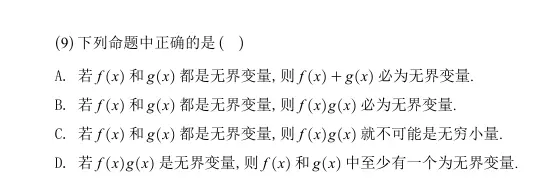
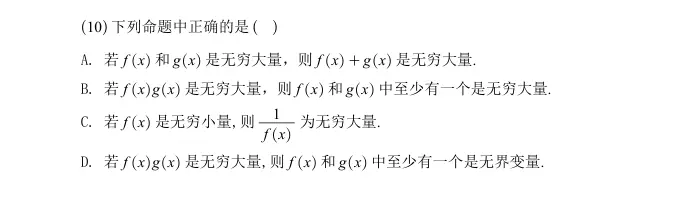
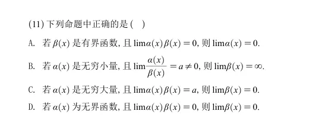
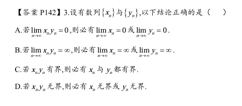

# 1
  
这道题考察的是**无界变量**的性质以及对相关概念的反例构造。

  

正确答案是 **D**。

  

下面为你逐一分析每个选项，并给出相应的证明或反例（以 $x \to \infty$ 为例）：

  

### 选项 A 分析：错误

**命题：** 若 $f(x)$ 和 $g(x)$ 都是无界变量，则 $f(x)+g(x)$ 必为无界变量。

**反例：**

令 $f(x) = x$，$g(x) = -x$。

当 $x \to \infty$ 时，$f(x)$ 和 $g(x)$ 显然都是无界变量。

但是它们的和 $f(x) + g(x) = x - x = 0$。常数函数 $0$ 显然是有界的。因此，两个无界变量的和可以是有界变量。

### 选项 B 分析：错误

**命题：** 若 $f(x)$ 和 $g(x)$ 都是无界变量，则 $f(x)g(x)$ 必为无界变量。

**反例：**

我们可以利用分段函数构造“交替取大值”的情况。

令 $f(x) = \begin{cases} x, & x \text{ 为整数} \\ 0, & x \text{ 不为整数} \end{cases}$

令 $g(x) = \begin{cases} 0, & x \text{ 为整数} \\ x, & x \text{ 不为整数} \end{cases}$

当 $x \to \infty$ 时，$f(x)$ 和 $g(x)$ 由于能不断取到任意大的整数值，因此都是无界变量。

但是，对于任意实数 $x$，$f(x)$ 和 $g(x)$ 中必然至少有一个为 $0$。因此它们的乘积 $f(x)g(x) \equiv 0$。常数 $0$ 是有界的，所以该命题错误。

  

### 选项 C 分析：错误

**命题：** 若 $f(x)$ 和 $g(x)$ 都是无界变量，则 $f(x)g(x)$ 就不可能是无穷小量。

**反例：**

在选项 B 的思路上稍作修改，将 $0$ 替换为衰减极快的项。

令 $f(x) = \begin{cases} x, & x \text{ 为整数} \\ \frac{1}{x^2}, & x \text{ 不为整数} \end{cases}$

令 $g(x) = \begin{cases} \frac{1}{x^2}, & x \text{ 为整数} \\ x, & x \text{ 不为整数} \end{cases}$

当 $x \to \infty$ 时，$f(x)$ 和 $g(x)$ 都能不断取到 $x$（趋于无穷），因此都是无界变量。

我们来看它们的乘积：不论 $x$ 是否为整数，总有 $f(x)g(x) = x \cdot \frac{1}{x^2} = \frac{1}{x}$。

当 $x \to \infty$ 时，$\lim_{x \to \infty} f(x)g(x) = \lim_{x \to \infty} \frac{1}{x} = 0$。

极限为 $0$，说明乘积 $f(x)g(x)$ 是一个无穷小量。该命题错误。

  

### 选项 D 分析：正确

**命题：** 若 $f(x)g(x)$ 是无界变量，则 $f(x)$ 和 $g(x)$ 中至少有一个为无界变量。

**证明：**

我们可以使用**反证法**。

假设 $f(x)$ 和 $g(x)$ **都不是**无界变量（即两者都是有界变量）。

根据有界变量的定义，存在正数 $M_1 > 0$ 和 $M_2 > 0$，使得在所讨论的定义域内，恒有：

$\vert{}f(x)\vert{} \le M_1$ 且 $\vert{}g(x)\vert{} \le M_2$

那么，对于它们的乘积的绝对值，有：

  

$$\vert{}f(x)g(x)\vert{} = \vert{}f(x)\vert{} \cdot \vert{}g(x)\vert{} \le M_1 \cdot M_2$$

因为 $M_1 \cdot M_2$ 是一个确定的正数，这说明乘积 $f(x)g(x)$ 也是有界变量。

这与题设条件“$f(x)g(x)$ 是无界变量”相矛盾。

因此，假设不成立，原命题正确：$f(x)$ 和 $g(x)$ 中必须至少有一个是无界变量。  
# 2  

  
这道题考察的是**无穷大量**、**无穷小量**以及**无界变量**的概念及其相互关系。

  

正确答案是 **D**。

  

下面为你详细分析每一个选项（我们以 $x \to \infty$ 为例进行探讨）：

  

### 选项 A 分析：错误

**命题：** 若 $f(x)$ 和 $g(x)$ 是无穷大量，则 $f(x)+g(x)$ 是无穷大量。

**反例：**

令 $f(x) = x$，$g(x) = -x+1$。

当 $x \to \infty$ 时，显然 $f(x) \to \infty$ 且 $g(x) \to \infty$，两者都是无穷大量。

但是它们的和 $f(x) + g(x) = x + (-x + 1) = 1$。

常数 $1$ 的极限是 $1$，并非无穷大，因此和不一定是无穷大量。

  

### 选项 B 分析：错误

**命题：** 若 $f(x)g(x)$ 是无穷大量，则 $f(x)$ 和 $g(x)$ 中至少有一个是无穷大量。

**反例：**

“无穷大量”要求变量的绝对值趋于正无穷，而不仅是无界。我们可以利用分段函数构造交替现象。

考虑当自然数 $n \to \infty$ 时的数列（函数的一种特例）：

令 $f(n) = \begin{cases} n, & n \text{ 为奇数} \\ 1, & n \text{ 为偶数} \end{cases}$

令 $g(n) = \begin{cases} 1, & n \text{ 为奇数} \\ n, & n \text{ 为偶数} \end{cases}$

它们的乘积 $f(n)g(n) = n$。当 $n \to \infty$ 时，$\lim_{n \to \infty} f(n)g(n) = \infty$，因此乘积是无穷大量。

但是，看 $f(n)$ 和 $g(n)$ 自身，由于它们交替取值 $1$，它们的极限都不存在，更不趋于无穷大。因此 $f(x)$ 和 $g(x)$ 都不是无穷大量。

  

### 选项 C 分析：错误

**命题：** 若 $f(x)$ 是无穷小量，则 $\frac{1}{f(x)}$ 为无穷大量。

**原因：**

这个命题忽略了分母不能为 $0$ 的隐藏条件。

无穷小量仅仅是指极限为 $0$ 的变量，即 $\lim f(x) = 0$。根据定义，常值函数 $f(x) \equiv 0$ 也是无穷小量。

如果 $f(x) \equiv 0$，那么表达式 $\frac{1}{f(x)}$ 就没有任何意义（分母为零），自然也就谈不上是不是无穷大量了。

只有补充条件“在极限点的去心邻域内 $f(x) \neq 0$”，该命题才成立。

  

### 选项 D 分析：正确

**命题：** 若 $f(x)g(x)$ 是无穷大量，则 $f(x)$ 和 $g(x)$ 中至少有一个是无界变量。

**证明：**

我们可以使用**反证法**。

首先需要明确一个基本定理：**无穷大量必定是无界变量**。既然 $f(x)g(x)$ 是无穷大量，那么 $f(x)g(x)$ 必然是无界变量。

假设 $f(x)$ 和 $g(x)$ **都不是**无界变量（即两者都是有界变量）。

根据有界变量的定义，存在正数 $M_1 > 0$ 和 $M_2 > 0$，使得：

$\vert{}f(x)\vert{} \le M_1$ 且 $\vert{}g(x)\vert{} \le M_2$

那么对于它们的乘积的绝对值，有：

  

$$\vert{}f(x)g(x)\vert{} = \vert{}f(x)\vert{} \cdot \vert{}g(x)\vert{} \le M_1 \cdot M_2$$

因为 $M_1 \cdot M_2$ 是一个确定的正数，这说明乘积 $f(x)g(x)$ 是有界变量。

这与题设条件推导出的“$f(x)g(x)$ 是无界变量”相矛盾。

因此，假设不成立，原命题正确。  

# 3  
  
B 和 C 是两个未定式  

这道题考察的是**极限的四则运算**、**无穷大量**、**无穷小量**以及**无界函数**的概念和相互转换关系。

  

正确答案是 **C**。

  

下面为你逐一分析每个选项：

  

### 选项 A 分析：错误

**命题：** 若 $\beta(x)$ 是有界函数，且 $\lim\alpha(x)\beta(x)=0$，则 $\lim\alpha(x)=0$。

**反例：**

令 $\beta(x) = 0$。常数函数 $0$ 显然是有界的。

令 $\alpha(x) = 1$。

此时，它们的乘积 $\alpha(x)\beta(x) = 1 \cdot 0 = 0$，所以 $\lim\alpha(x)\beta(x) = \lim 0 = 0$，满足题设条件。

但是 $\lim\alpha(x) = \lim 1 = 1 \neq 0$。因此原命题错误。

_(注：如果条件改为 $\beta(x)$ 是极限不为零的常数或有界且远离零的函数，则结论成立，但仅说“有界”是不够的，因为可能包含 $0$)_。

  

### 选项 B 分析：错误

**命题：** 若 $\alpha(x)$ 是无穷小量，且 $\lim\frac{\alpha(x)}{\beta(x)}=a \neq 0$，则 $\lim\beta(x)=\infty$。

**分析与证明：**

已知 $\lim\alpha(x) = 0$ 且 $\lim\frac{\alpha(x)}{\beta(x)} = a \neq 0$。

我们可以利用极限的四则运算法则来求解 $\lim\beta(x)$：

  

$$\lim\beta(x) = \lim \left( \alpha(x) \cdot \frac{\beta(x)}{\alpha(x)} \right) = \lim\alpha(x) \cdot \lim\frac{1}{\frac{\alpha(x)}{\beta(x)}} = 0 \cdot \frac{1}{a} = 0$$

所以，$\beta(x)$ 也必然是一个**无穷小量**，其极限为 $0$，而不是无穷大。该命题错误。

  

### 选项 C 分析：正确

**命题：** 若 $\alpha(x)$ 是无穷大量，且 $\lim\alpha(x)\beta(x)=a$，则 $\lim\beta(x)=0$。

**证明：**

因为 $\alpha(x)$ 是无穷大量（即 $\vert{}\alpha(x)\vert{} \to \infty$），根据无穷大量与无穷小量的关系，其倒数必然是无穷小量，即：

$\lim \frac{1}{\alpha(x)} = 0$

我们要考察 $\beta(x)$ 的极限，可以对其进行恒等变形：

  

$$\beta(x) = \frac{\alpha(x)\beta(x)}{\alpha(x)} = \left[ \alpha(x)\beta(x) \right] \cdot \frac{1}{\alpha(x)}$$

利用极限的乘法法则（已知两个因子的极限都存在）：

  

$$\lim\beta(x) = \lim \left( \left[ \alpha(x)\beta(x) \right] \cdot \frac{1}{\alpha(x)} \right) = \left( \lim\alpha(x)\beta(x) \right) \cdot \left( \lim\frac{1}{\alpha(x)} \right) = a \cdot 0 = 0$$

因此 $\lim\beta(x) = 0$，原命题正确。

  

### 选项 D 分析：错误

**命题：** 若 $\alpha(x)$ 为无界函数，且 $\lim\alpha(x)\beta(x)=0$，则 $\lim\beta(x)=0$。

**反例：**

“无界函数”不一定总是趋于无穷大，它可以在某些点变得无限大，而在其他地方为零。我们可以构造一个交替的分段函数（假设 $x \to \infty$）：

令 $\alpha(x) = \begin{cases} x, & x \text{ 为整数} \\ 0, & x \text{ 不为整数} \end{cases}$

令 $\beta(x) = \begin{cases} 0, & x \text{ 为整数} \\ 1, & x \text{ 不为整数} \end{cases}$

当 $x \to \infty$ 时，$\alpha(x)$ 能不断取到任意大的整数值，因此它是**无界函数**。

对于任意实数 $x$，$\alpha(x)$ 和 $\beta(x)$ 中总有一个为 $0$，所以它们的乘积 $\alpha(x)\beta(x) \equiv 0$，满足 $\lim\alpha(x)\beta(x)=0$。

但是，观察 $\beta(x)$ 的走势，它在 $0$ 和 $1$ 之间不断跳跃，当 $x \to \infty$ 时，其极限 **根本不存在**，更不可能等于 $0$。因此该命题错误。  

# 4  
