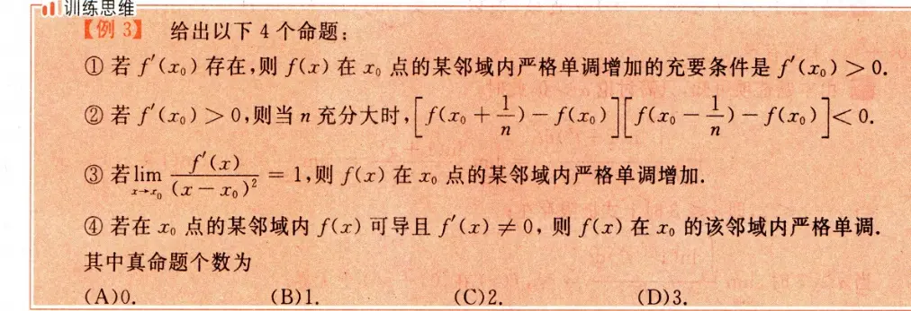

  

这道题的正确答案是 **(C)**。其中真命题共有 2 个，分别是命题 ② 和命题 ④。

下面为您逐一深度剖析这四个命题的真伪及背后的数学原理：

### 命题 ①：错误

**原命题：** 若 $f'(x_0)$ 存在，则 $f(x)$ 在 $x_0$ 点的某邻域内严格单调增加的充要条件是 $f'(x_0) > 0$。

**解析：** 这是一个非常经典的易错点，它的**充分性**和**必要性**都不成立。

- **必要性不成立：** 即使 $f(x)$ 在某邻域内严格单调增加，也只能推导出 $f'(x_0) \ge 0$。例如 $f(x) = x^3$，它在全集上严格单调增加，但在 $x_0 = 0$ 处，$f'(0) = 0$，并不满足大于 0。
    
- **充分性不成立：** $f'(x_0) > 0$ 只能说明函数在 $x_0$ 这一点的“瞬时趋势”是上升的，保证了存在一个局部的去心邻域，使得左边的值小于 $f(x_0)$，右边的值大于 $f(x_0)$。但这**不能保证**在这个邻域内部的任意两点之间也保持递增关系。
    
    - _经典反例：_ $f(x) = x + 2x^2 \sin(\frac{1}{x})$（当 $x \neq 0$ 时），$f(0) = 0$。此时 $f'(0) = 1 > 0$，但在 $x=0$ 的任何微小邻域内，导数 $f'(x)$ 都会在正负之间剧烈震荡，导致函数在局部并不是单调增加的。
        

### 命题 ②：正确（真命题）

**原命题：** 若 $f'(x_0) > 0$，则当 $n$ 充分大时，$\left[ f(x_0 + \frac{1}{n}) - f(x_0) \right] \left[ f(x_0 - \frac{1}{n}) - f(x_0) \right] < 0$。

**解析：** 根据导数定义及极限的局部保号性：

因为 $f'(x_0) = \lim_{x \to x_0} \frac{f(x) - f(x_0)}{x - x_0} > 0$，所以存在 $x_0$ 的一个邻域，当 $x$ 在该邻域内时：

- 当 $x > x_0$ 时，必有 $f(x) > f(x_0)$。
    
- 当 $x < x_0$ 时，必有 $f(x) < f(x_0)$。
    

当 $n$ 充分大时，$\frac{1}{n}$ 是一个非常小的正数：

1. $x_0 + \frac{1}{n}$ 落在 $x_0$ 的右侧，因此 $f(x_0 + \frac{1}{n}) - f(x_0) > 0$（正数）。
    
2. $x_0 - \frac{1}{n}$ 落在 $x_0$ 的左侧，因此 $f(x_0 - \frac{1}{n}) - f(x_0) < 0$（负数）。
    
    正数乘以负数，结果必然严格小于 0。命题成立。
    

### 命题 ③：错误

**原命题：** 若 $\lim_{x \to x_0} \frac{f'(x)}{(x - x_0)^2} = 1$，则 $f(x)$ 在 $x_0$ 点的某邻域内严格单调增加。

**解析：** 正如我们在上一个对话中详细讨论过的，这个命题缺少了 **“$f(x)$ 在 $x_0$ 处连续”** 这个致命的前提。

极限条件只能保证在 $x_0$ 的左、右去心邻域内都有 $f'(x) > 0$，即左边一段在涨，右边一段也在涨。但如果函数在 $x_0$ 点发生向下跳跃的间断，那么跨越 $x_0$ 时就不满足整体严格单调增加了。

### 命题 ④：正确（真命题）

**原命题：** 若在 $x_0$ 点的某邻域内 $f(x)$ 可导且 $f'(x) \neq 0$，则 $f(x)$ 在 $x_0$ 的该邻域内严格单调。

**解析：** 这是一个利用**达布定理（导数介值定理）**的正确推论。 如果一个函数在某个区间内处处可导，那么它的导函数 $f'(x)$ 即使不连续，也必然具备“介值特性”（即不能有跳跃间断点）。 既然已知在该邻域内 $f'(x) \neq 0$，意味着 $f'(x)$ 永远不可能穿过 $x$ 轴等于 0。根据介值定理，$f'(x)$ 在这个邻域内必然**恒为正**或**恒为负**（不可能一会正一会负，否则中间必有等于 0 的点）。

- 若恒为正，则原函数在该邻域内严格单调增加。
    
- 若恒为负，则原函数在该邻域内严格单调减少。
    
    无论哪种情况，原函数都保持严格单调。命题成立。