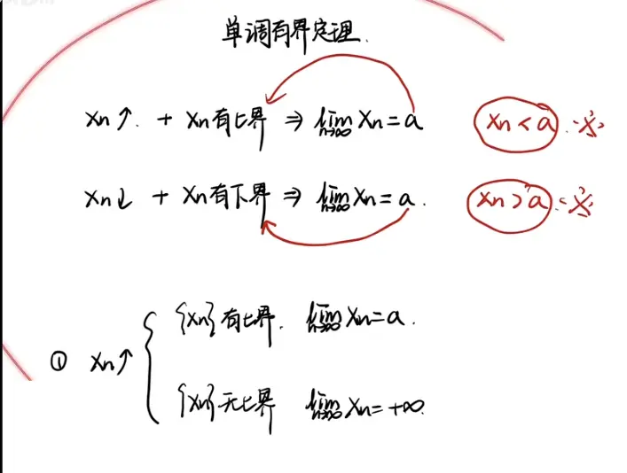
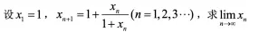
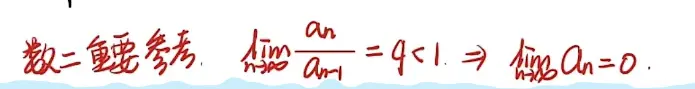

  

根据你提供的视频文案，针对图片中的经典数列极限问题

$$x_1 = 1, x_{n+1} = 1 + \frac{x_n}{1+x_n}$$

，文案中一共详细讲解了 **6 种顶级解法**（外加一个作为反面教材的“方法零”）。

这份整理已经将这道经典递推数列题目的“骨架”搭得非常完美了。为了达到考研数学（特别是备战 2027 年这样长线且要求严谨的考试）的实战标准，光有核心逻辑还不够，我们需要用**最严密的数学语言和 LaTeX 公式**将这 6 种方法的“血肉”彻底丰满起来。

以下是为你完善、补全后的全套详细推导过程，可以直接作为标准答案模板进行背诵和推演：

### 〇、 前期准备：证明数列的有界性（数学归纳法）

**目标：** 证明对于任意 $n \ge 1$，$0 < x_n < 2$。

**证明：**

1. 当 $n=1$ 时，$x_1 = 1 \in (0, 2)$，结论成立。
    
2. 假设当 $n=k$ 时，$0 < x_k < 2$ 成立。
    
3. 当 $n=k+1$ 时，对递推式进行恒等变形：
    
    $$x_{k+1} = 1 + \frac{x_k}{1+x_k} = 1 + 1 - \frac{1}{1+x_k} = 2 - \frac{1}{1+x_k}$$
    
    因为 $x_k > 0$，所以 $1+x_k > 1$，从而 $0 < \frac{1}{1+x_k} < 1$。
    
    因此 $x_{k+1} = 2 - \frac{1}{1+x_k} < 2$，且显然 $x_{k+1} > 1 > 0$。
    
4. 综上所述，由数学归纳法可知，对任意 $n \ge 1$，均有 $0 < x_n < 2$。
    

### 方法一：精准界 + 做差单调性

**完整推导过程：**

1. **求精准界（草稿纸操作）：** 设极限为 $A$，令 $A = 1 + \frac{A}{1+A}$，解得 $A^2 - A - 1 = 0$。舍去负根，得 $A = \frac{1+\sqrt{5}}{2}$。
    
2. **重证有界性：** 仿照前期准备的归纳法，证明 $x_n < \frac{1+\sqrt{5}}{2}$。
    
    （因为 $x_1 = 1 < \frac{1+\sqrt{5}}{2}$；若 $x_k < \frac{1+\sqrt{5}}{2}$，利用函数 $f(x)=2-\frac{1}{1+x}$ 的单调递增性，必然有 $x_{k+1} < f\left(\frac{1+\sqrt{5}}{2}\right) = \frac{1+\sqrt{5}}{2}$）。
    
3. **做差证单调：**
    
    $$x_{n+1} - x_n = 1 + \frac{x_n}{1+x_n} - x_n = \frac{1 + 2x_n - x_n^2}{1+x_n}$$
    
    考察分子 $1 + 2x_n - x_n^2$，其根为 $\frac{2 \pm \sqrt{4+4}}{2} = 1 \pm \sqrt{2}$。
    
    实际上，更稳妥的分解是利用极限值 $A$：
    
    分子可以写为 $-(x_n - A)(x_n - B)$。因为我们已经证明了 $x_n < A = \frac{1+\sqrt{5}}{2}$，所以分子恒大于 $0$。
    
    即 $x_{n+1} - x_n > 0$，数列单调递增。由单调有界定理，极限存在，且为 $\frac{1+\sqrt{5}}{2}$。
    

### 方法二：递推式同时变形做差（同号传递性）

**完整推导过程：**

直接对相邻两项做差并通分：

$$x_{n+1} - x_n = \left( 1 + \frac{x_n}{1+x_n} \right) - \left( 1 + \frac{x_{n-1}}{1+x_{n-1}} \right)$$

$$x_{n+1} - x_n = \frac{x_n(1+x_{n-1}) - x_{n-1}(1+x_n)}{(1+x_n)(1+x_{n-1})} = \frac{x_n - x_{n-1}}{(1+x_n)(1+x_{n-1})}$$

因为数列各项 $x_n > 0$，所以分母 $(1+x_n)(1+x_{n-1}) > 0$ 恒成立。

由此可得，$(x_{n+1} - x_n)$ 与 $(x_n - x_{n-1})$ **同号**。

又因为 $x_2 = 1 + \frac{1}{2} = \frac{3}{2} > x_1 = 1$，即 $x_2 - x_1 > 0$。

根据同号传递性，对任意 $n \ge 1$，均有 $x_{n+1} - x_n > 0$。

故数列单调递增，结合有界性，极限存在。

### 方法三：构造函数求导法 + 拉格朗日中值定理

**完整推导过程：**

构造函数 $f(x) = 1 + \frac{x}{1+x} = 2 - \frac{1}{1+x}$。

对其求导：

$$f'(x) = \frac{1}{(1+x)^2}$$

因为 $x_n > 0$，故在 $(0, +\infty)$ 上 $f'(x) > 0$ 恒成立。

由拉格朗日中值定理，存在 $\xi$ 介于 $x_n$ 与 $x_{n-1}$ 之间，使得：

$$x_{n+1} - x_n = f(x_n) - f(x_{n-1}) = f'(\xi)(x_n - x_{n-1})$$

因为 $f'(\xi) > 0$，所以 $(x_{n+1} - x_n)$ 与 $(x_n - x_{n-1})$ 同号。

同样由 $x_2 > x_1$ 确定初始符号为正，从而证明数列单调递增。结合有界性，极限存在。

### 方法四：压缩映射（$\vert{}x_n - A\vert{}$ 放缩夹逼准则）

**完整推导过程：**

设极限为 $A$，满足 $A = 1 + \frac{A}{1+A}$。

构造绝对值差并通分：

$$\vert{}x_{n+1} - A\vert{} = \left\vert{} \left( 1 + \frac{x_n}{1+x_n} \right) - \left( 1 + \frac{A}{1+A} \right) \right\vert{} = \left\vert{} \frac{x_n - A}{(1+x_n)(1+A)} \right\vert{} = \frac{\vert{}x_n - A\vert{}}{(1+x_n)(1+A)}$$

寻找放缩常数 $q$：

因为 $x_n > 0$，所以 $1+x_n > 1$。

因为 $A = \frac{1+\sqrt{5}}{2} > 1$，所以 $1+A > 2$。

故分母 $(1+x_n)(1+A) > 1 \times 2 = 2$。

从而得到递推不等式：

$$\vert{}x_{n+1} - A\vert{} < \frac{1}{2} \vert{}x_n - A\vert{}$$

不断向下递推：

$$\vert{}x_n - A\vert{} < \frac{1}{2} \vert{}x_{n-1} - A\vert{} < \left(\frac{1}{2}\right)^2 \vert{}x_{n-2} - A\vert{} < \dots < \left(\frac{1}{2}\right)^{n-1} \vert{}x_1 - A\vert{}$$

因为 $\lim_{n \to \infty} \left(\frac{1}{2}\right)^{n-1} = 0$，由夹逼准则可知：

$$\lim_{n \to \infty} \vert{}x_n - A\vert{} = 0 \implies \lim_{n \to \infty} x_n = A$$

### 方法五：无穷级数比值判别法处理 $\vert{}x_n - A\vert{}$

**完整推导过程：**

承接方法四的化简步骤，得到：

$$\vert{}x_{n+1} - A\vert{} = \frac{\vert{}x_n - A\vert{}}{(1+x_n)(1+A)}$$

将其转化为比值形式（注意这里严格来说应保证 $x_n \neq A$）：

$$\frac{\vert{}x_{n+1} - A\vert{}}{\vert{}x_n - A\vert{}} = \frac{1}{(1+x_n)(1+A)}$$

同理，由于 $(1+x_n)(1+A) > 2$，有：

$$\lim_{n \to \infty} \frac{\vert{}x_{n+1} - A\vert{}}{\vert{}x_n - A\vert{}} \le \frac{1}{2} < 1$$

根据无穷级数的达朗贝尔（比值）判别法，正项级数 $\sum_{n=1}^{\infty} \vert{}x_n - A\vert{}$ 收敛。

由级数收敛的**必要条件**（通项必趋于 $0$），直接得出：

$$\lim_{n \to \infty} \vert{}x_n - A\vert{} = 0 \implies \lim_{n \to \infty} x_n = A$$

### 方法六：构造差分级数 $\sum (x_n - x_{n-1})$

**完整推导过程：**

承接方法二的化简步骤，取绝对值：

$$\vert{}x_{n+1} - x_n\vert{} = \frac{\vert{}x_n - x_{n-1}\vert{}}{(1+x_n)(1+x_{n-1})}$$

转化为比值形式：

$$\frac{\vert{}x_{n+1} - x_n\vert{}}{\vert{}x_n - x_{n-1}\vert{}} = \frac{1}{(1+x_n)(1+x_{n-1})}$$

由于 $x_n > 0$ 且 $x_{n-1} > 0$，显然 $\frac{1}{(1+x_n)(1+x_{n-1})} < 1$。

（为了更严密，可利用 $x_n \ge 1$ 证明比值 $\le \frac{1}{4} < 1$）。

由比值判别法，正项级数 $\sum_{n=2}^{\infty} \vert{}x_n - x_{n-1}\vert{}$ 收敛。

由于绝对收敛必推一般收敛，故级数 $\sum_{n=2}^{\infty} (x_n - x_{n-1})$ 收敛。

写出该级数的部分和 $S_n$：

$$S_n = \sum_{k=2}^{n} (x_k - x_{k-1}) = (x_2 - x_1) + (x_3 - x_2) + \dots + (x_n - x_{n-1}) = x_n - x_1$$

既然级数收敛，即 $\lim_{n \to \infty} S_n$ 存在，这意味着 $\lim_{n \to \infty} (x_n - x_1)$ 存在。

由于 $x_1$ 为常数，故 $\lim_{n \to \infty} x_n$ 必然存在。最后设极限为 $A$ 解方程即可。

# 适用范围  
**在考研数学二的试卷上，这 6 种方法绝不能全部直接套用。**

考研阅卷不仅看最终结果和逻辑是否自洽，更看重是否使用了超纲工具，以及所谓的“秒杀技巧”是否有严密的底层推导过程。以下为你精准拆解这 6 种方法在考场上的“合法性”与得分策略：

### 一、 绝对禁区：直接判零的分数陷阱

- **涵盖方法：** 方法五、方法六
    
- **判定结果：** **完全不能使用。**
    
- **核心原因：** 这两种方法的核心支撑是“无穷级数”（无论是比值判别法还是级数收敛的必要条件）。**无穷级数根本不属于考研数学二的考查范围。** 如果你试图在卷面上用级数收敛来证明数列极限存在，阅卷人会直接按照“使用超纲知识”或“逻辑断裂”处理，该步骤及其后续步骤通常会直接被判零分。
    
- **应对策略：** 直接将这两种方法从你的实战武器库中删除，它们是专门为考查级数部分的试卷准备的。
    

### 二、 风险地带：需打“补丁”才能拿满分的二级结论

- **涵盖方法：** 方法三（构造函数求导法）
    
- **判定结果：** **可以使用，但必须手写过渡步骤，不可直接当定理用。**
    
- **核心原因：** “$f'(x)>0 \implies \{x_n\}$ 单调”是一个极其好用的教辅二级结论，但它并非官方教材里的原始定理。如果在试卷上直接写“因为 $f'(x)>0$，故数列单调”，极大概率会被扣掉关键步骤分。
    
- **满分写法（补丁）：**
    
    在求导得出 $f'(x)>0$ 后，必须加上这段拉格朗日中值定理的推导：
    
    > “由拉格朗日中值定理，存在 $\xi$ 介于 $x_n$ 与 $x_{n-1}$ 之间，使得 $x_{n+1}-x_n = f(x_n)-f(x_{n-1}) = f'(\xi)(x_n-x_{n-1})$。因 $f'(x)>0$，故 $f'(\xi)>0$，所以 $(x_{n+1}-x_n)$ 与 $(x_n-x_{n-1})$ 同号，由此可知数列 $\{x_n\}$ 单调。”
    
    加上这几句话，方法三就变成了完美无瑕的标准答案。
    

### 三、 黄金通法：可直接放心使用的拿分利器

- **涵盖方法：** 方法一、方法二、方法四
    
- **判定结果：** **完全合法，极力推荐。**
    
- **核心优势：**
    
    - **方法一（精准界+做差）与方法二（同号传递）：** 基于初等代数变形与单调有界定理的最正统写法，是阅卷人最习惯看到的标准过程。只要你保证“数学归纳法”的书写严密（初始项验证、假设项推导缺一不可），绝对拿满分。
        
    - **方法四（放缩与夹逼准则）：** 俗称“压缩映射法”。全过程只用到绝对值不等式放缩和夹逼定理，属于大纲内的核心重点。一旦遇到求导后 $f'(x)<0$（即震荡逼近）的递推数列，单调有界定理彻底失效，此时**方法四是考场上唯一合法的救命稻草**。
        

**总结性实战建议**

在时间紧迫的冲刺与模考阶段，不需要把精力均分给这 6 种方法。建议你将核心练习点聚焦在方法三（求导+拉格朗日推导）**和**方法四（绝对值放缩夹逼）上。这两种方法分别代表了解决“单调型”和“震荡型”递推数列的最优解，掌握这两个底层逻辑，足以通杀所有此类大题，且能最大限度节约考场上的试错时间。