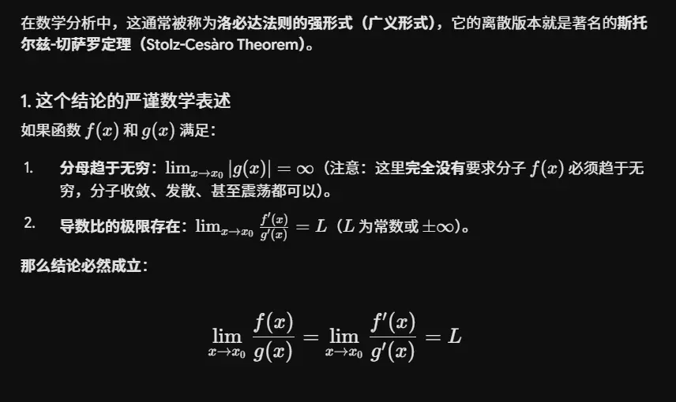
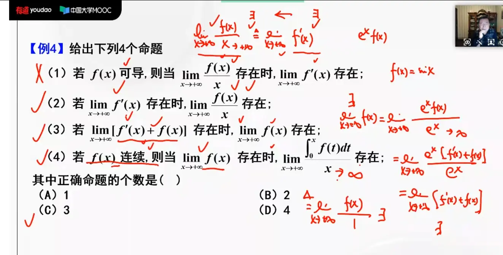

# 适用情况  
### ## 一、 使用洛必达定理的三个绝对前提

当且仅当以下三个条件**同时满足**时，才能使用洛必达定理：

#### 1. 必须是 “$\frac{0}{0}$” 或 “$\frac{\infty}{\infty}$” 型未定式  无穷比无穷型  分子可以不趋向

这是最核心的出发点。当 $x \to x_0$（或 $x \to \infty$）时，分子函数 $f(x)$ 和分母函数 $g(x)$ 的极限必须同时为 $0$，或者同时为 $\infty$。

- 如果极限是 $\frac{0}{\text{常数}}$、$\frac{\text{常数}}{0}$ 或 $\frac{\text{常数}}{\text{常数}}$，直接代入即可，**绝对不能**求导。
    

#### 2. 在该去心邻域内，分子分母必须可导，且分母导数不为 0

在 $x_0$ 的某个去心邻域内（或者当 $x$ 充分大时）：

- $f(x)$ 和 $g(x)$ 必须是**可导的**。
    
- 分母的导数 ** $g'(x) \neq 0$ **（保证分母不会由于求导而变成 0 导致无意义）。
    

#### 3. 导数比值的极限必须存在（或是 $\infty$）

这是最容易被忽略的条件！求导之后的极限 ** $\lim \frac{f'(x)}{g'(x)}$ 必须存在**（可以是一个常数，也可以是 $+\infty$ 或 $-\infty$）。

- 如果求导后的极限**震荡不存在**，说明洛必达定理**失效**。但这**并不意味着**原极限不存在，此时必须放弃洛必达定理，改用定义法、夹逼定理或等价无穷小等其他方法求解。
    

### ## 二、 一个关键注意：不能“套娃”死算

在实际做题时，如果求导一次后得到的依然是 “$\frac{0}{0}$” 或 “$\frac{\infty}{\infty}$” 型，只要满足上述条件，是可以**连续使用**洛必达定理的。但是，一定要在每一次求导后**重新验证**是否依然是未定式。

导数之比极限存在   则可推原函数之比极限存在  

