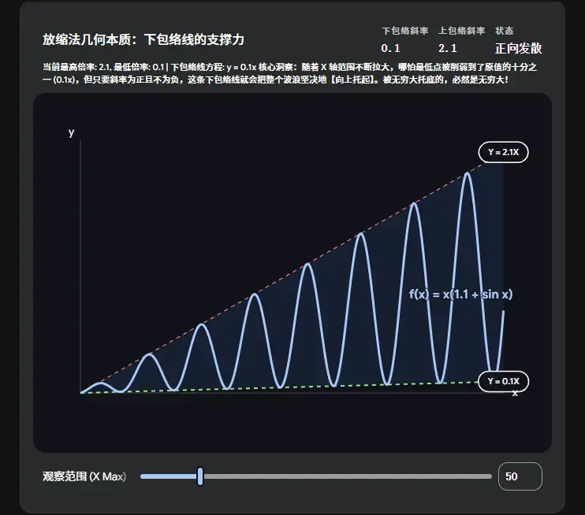
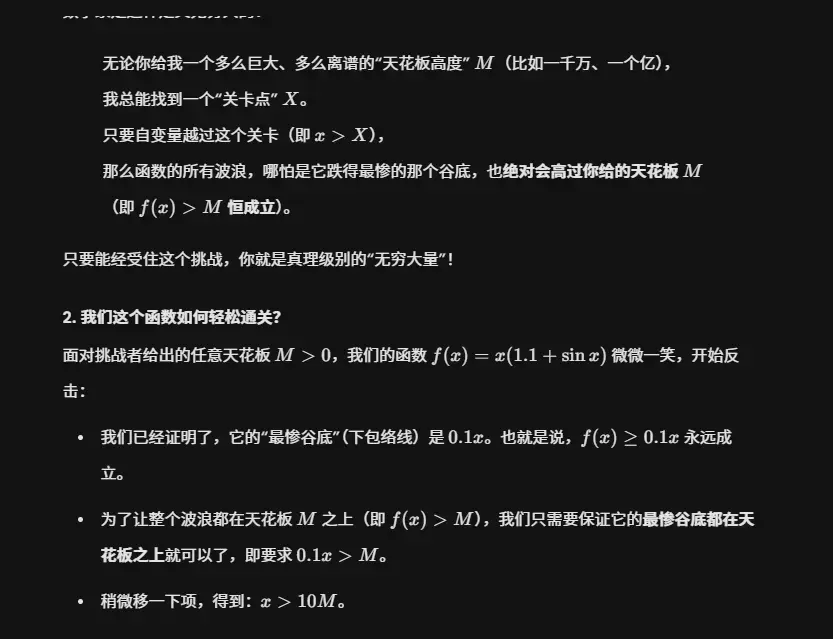

# 函数**无界** 和 **无穷大** 本质区别    
用严格的数学符号（即 $\epsilon-N$ 或 $M-X$ 语言）来描述，能让你瞬间看透这两个概念在逻辑层面的本质差异。差异仅仅在量词（存在 $\exists$ 还是 任意 $\forall$）的使用上。

为了方便对比，我们以自变量趋向于正无穷（$x \to +\infty$）的过程为例。

## 1. 无界（Unbounded）的数学语言定义

**定义：**

设函数 $f(x)$ 在区间 $D = (a, +\infty)$ 内有定义。如果：

$$\forall M > 0, \exists x_0 \in D, \text{ 使得 } |f(x_0)| > M$$

则称函数 $f(x)$ 在区间 $D$ 上是无界的。

**符号拆解（重点看这）：**

- $\forall M > 0$：**任给**一个正数 $M$（无论这堵墙有多高）。
    
- $\exists x_0 \in D$：在定义域里总能存在（找到至少一个）点 $x_0$。
    
- $|f(x_0)| > M$：在这个点上的函数值，绝对值大过了 $M$。
    

> **大白话翻译：** 你随便定一个多高的天花板 $M$，我只要能在后面找到**哪怕一个**点 $x_0$ 突破了天花板，我就是无界的。（对应 $x \sin x$ 那个偶尔窜上去的波峰）。

## 2. 无穷大（Infinity）的数学语言定义

**定义：**

设函数 $f(x)$ 在区间 $(a, +\infty)$ 内有定义。如果：

$$\forall M > 0, \exists X > 0, \text{ 当 } \forall x > X \text{ 时, 都有 } |f(x)| > M$$

则称当 $x \to +\infty$ 时，函数 $f(x)$ 是无穷大，记作 $\lim_{x \to +\infty} f(x) = \infty$。

**符号拆解（寻找不同点）：**

- $\forall M > 0$：**任给**一个正数 $M$（无论墙有多高）。
    
- $\exists X > 0$：总能**存在**一个位置阈值 $X$。
    
- ** $\forall x > X$ **：这是最核心的区别！要求一旦跨过这个位置 $X$ 之后，后面的**任意一个** $x$。
    
- $|f(x)| > M$：对应的函数值必须**全部**大过 $M$。
    

> **大白话翻译：** 你随便定一个天花板 $M$，我总能划定一条起跑线 $X$，只要越过这条线，后面的**所有点**都必须永远待在天花板上面，不允许掉下来。（对应 $x \sin x$ 跌回 0 就不满足 $\forall x > X$ 这个条件了）。

## 核心逻辑对比表

在做极限证明题（如利用定义证明某极限不存在）时，死死盯住最后一步是对**一个点**负责，还是对**一段区间的所有点**负责：

|**概念**|**逻辑量词链条**|**核心要求**|
|---|---|---|
|**无界**| $\forall M \dots \mathbf{\exists} x_0 \dots$ |只要求**存在某一点**突破限制|
|**无穷大**| $\forall M \dots \exists X \dots \mathbf{\forall} x > X \dots$ |要求 $X$ 之后的**所有点**突破限制|

从这两个严格定义就可以完美推导我们之前的结论：

因为“所有点都大于 $M$”**必然包含**“存在某一点大于 $M$”**，所以**无穷大必定无界；

但“存在某一点大于 $M$”**推不出**“所有点都大于 $M$”**，所以**无界推不出无穷大。

先给结论：

**无穷大一定无界；但无界不一定是无穷大。**  

---

  
