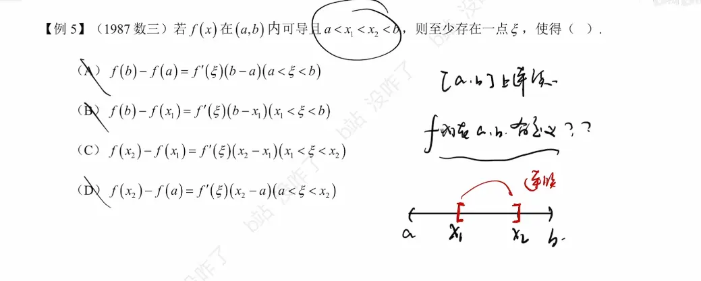

在考研数学二中，“连续”这一章虽然不像导数与微分那样有大量复杂的计算，但它是整个微积分的**地基**。尤其是“闭区间上连续函数的性质”，是你后续做所有存在性证明题（包括我们刚讨论过的零点定理和罗尔定理）的直接法理依据。

为了保持你笔记体系的连贯性，我依然按照**核心内容**与**证明实战场景**为你梳理，方便你直接导入 Obsidian。

### 一、 闭区间上连续函数的四大基本性质（证明题的绝对基石）

这四个定理的前提条件极其严格，必须是**闭区间 $[a, b]$ ** 且 **连续**。缺一不可（如果是开区间或有间断点，结论立刻失效）。

#### 1. 有界性定理 (Boundedness Theorem)

- **内容**：若函数 $f(x)$ 在闭区间 $[a, b]$ 上连续，则 $f(x)$ 在 $[a, b]$ 上必定有界。即存在常数 $M > 0$，使得对于任意 $x \in [a, b]$，都有 $|f(x)| \le M$。
    
- **实战场景**：通常作为隐性条件使用。在证明定积分的相关不等式，或者分析函数列的收敛性时，用来保证函数值不会跑向无穷大。
    

#### 2. 最大值与最小值定理 (Extreme Value Theorem)

- **内容**：若函数 $f(x)$ 在闭区间 $[a, b]$ 上连续，则 $f(x)$ 在该区间上必定能取得最大值 $M$ 和最小值 $m$。即存在 $x_1, x_2 \in [a, b]$，使得 $f(x_1) = m$，$f(x_2) = M$。
    
- **实战场景**：
    
    - 用于放缩法证明积分不等式：$m(b-a) \le \int_a^b f(x)dx \le M(b-a)$。
        
    - 配合介值定理，用来证明存在某点使得函数值等于区间内的某个平均状态。
        

#### 3. 介值定理 (Intermediate Value Theorem)

- **内容**：若函数 $f(x)$ 在闭区间 $[a, b]$ 上连续，设其最大值为 $M$，最小值为 $m$。则对于介于 $m$ 和 $M$ 之间的**任意**实数 $C$（$m \le C \le M$），至少存在一点 $\xi \in [a, b]$，使得 $f(\xi) = C$。
    
- **实战场景（极高频）**：
    
    - 证明“存在 $\xi$，使得 $f(\xi) =$ 某个特定值”。
        
    - **考研常见套路（积分中值定理的内核）**：当你算出某个表达式的值介于函数的最大值 $M$ 和最小值 $m$ 之间时（例如算术平均数 $\frac{f(x_1)+f(x_2)}{2}$），直接引用介值定理，断言必定存在 $\xi$ 使 $f(\xi) = \frac{f(x_1)+f(x_2)}{2}$。
        

#### 4. 零点定理 (Zero Point Theorem / Bolzano's Theorem)

- **内容**：若函数 $f(x)$ 在闭区间 $[a, b]$ 上连续，且 $f(a) \cdot f(b) < 0$（即区间两端点函数值异号），则在开区间 $(a, b)$ 内至少存在一点 $\xi$，使得 $f(\xi) = 0$。
    
- **实战场景**：这是介值定理当 $C=0$ 时的特例。**它是证明方程根的存在性的首选武器**。正如我们在罗尔定理推论中复盘的那样，用来完成“保底至少有 $n$ 个根”的第一步。
    

### 二、 连续性的基本运算法则

这部分定理主要用于判断一个复杂函数在某一点或某区间是否连续，常见于选择题或大题的第一步（声明函数的连续性）。

#### 1. 四则运算的连续性定理

- **内容**：若函数 $f(x)$ 和 $g(x)$ 在点 $x_0$ 处连续，则它们的和 $f(x) \pm g(x)$、差、积 $f(x) \cdot g(x)$ 在点 $x_0$ 处也连续；当 $g(x_0) \neq 0$ 时，它们的商 $\frac{f(x)}{g(x)}$ 在点 $x_0$ 处也连续。
    

#### 2. 复合函数的连续性定理

- **内容**：设函数 $u = \varphi(x)$ 在点 $x_0$ 处连续，且 $\varphi(x_0) = u_0$，而函数 $y = f(u)$ 在点 $u_0$ 处连续。则复合函数 $y = f[\varphi(x)]$ 在点 $x_0$ 处也连续。
    
- **实战场景**：用于求极限时的“极限符号内移”。因为连续，所以 $\lim_{x \to x_0} f[\varphi(x)] = f[\lim_{x \to x_0} \varphi(x)] = f[\varphi(x_0)]$。
    

#### 3. 反函数的连续性定理

- **内容**：若函数 $y = f(x)$ 在某区间上单调递增（或递减）且连续，则它的反函数 $x = f^{-1}(y)$ 在对应的取值区间上也是单调递增（或递减）且连续的。
    

### 三、 初等函数的连续性结论（免证金牌）

在考研解答题中，你不需要从定义出发去证明 $\sin x$ 或 $e^x$ 是连续的，只需直接引用以下两个结论即可作为大前提：

1. **基本初等函数**（幂函数、指数函数、对数函数、三角函数、反三角函数）在它们的**定义域**内是连续的。
    
2. **一切初等函数**（由基本初等函数经过有限次四则运算和复合步骤构成，且能用一个式子表示的函数）在其**定义区间**（包含在定义域内的区间）内都是连续的。
    

> **笔记避坑提示**：注意“定义域”与“定义区间”的咬文嚼字。例如 $f(x) = \frac{1}{x}$，它的定义域是 $(-\infty, 0) \cup (0, +\infty)$。它在定义区间 $(-\infty, 0)$ 和 $(0, +\infty)$ 内是连续的，但你不能说它在整个定义域上连续（因为在 $x=0$ 处有间断点，尽管 $0$ 不在定义域内，但描述整体连续性时需谨慎划分区间）。  

# 例题  
要使用拉格朗日中值定理，目标区间必须满足两个极其严格的前提条件：

1. 在**闭区间**上连续（保证有头有尾）。
    
2. 在**开区间**内可导（保证中间平滑不折断）。