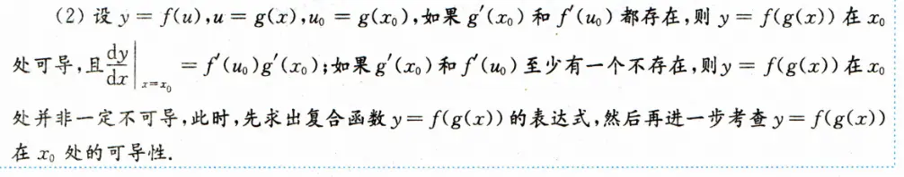
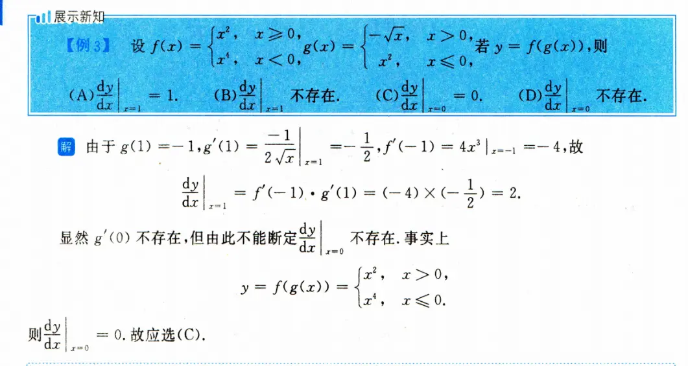
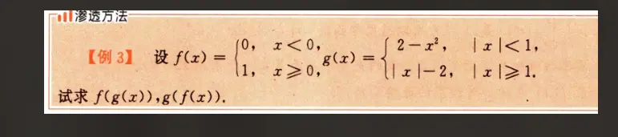

  

  

# 求复合函数表达式的规范化  
  

我为你总结了一个标准化的三步解题法，我们直接用这道题来实战演示：

### 分段函数复合标准化三步法

#### 第一步：外层铺框架（搭骨架）

**核心动作：完全无视内层函数的具体内容，直接把内层函数的符号（整体）代入外层函数中。**

**求 $f(g(x))$ 演示：**

外层函数是 $f(u)$，我们将 $u$ 整体替换为 $g(x)$：

$$f(g(x)) = \begin{cases} 0, & g(x) < 0 \\ 1, & g(x) \ge 0 \end{cases}$$

_这一步做完，外层骨架就搭好了，目标立刻变得清晰：我们只需要分别去解 $g(x) < 0$ 和 $g(x) \ge 0$ 这两个不等式即可。_

#### 第二步：内层代入并求交集（填血肉）

**核心动作：针对外层框架的每一个条件，分别把内层函数的所有分支代入，求出不等式的解集，并与内层自身的定义域取交集（逻辑 AND）。**

**针对外层条件一：$g(x) < 0$ **

依次代入 $g(x)$ 的两个分支：

1. **代入分支 1：** 当 $\vert{}x\vert{} < 1$ 时，$g(x) = 2 - x^2$。
    
    令 $2 - x^2 < 0 \implies x^2 > 2 \implies x < -\sqrt{2}$ 或 $x > \sqrt{2}$。
    
    **取交集：** $(\vert{}x\vert{} < 1) \cap (\vert{}x\vert{} > \sqrt{2}) = \emptyset$（空集）。
    
2. **代入分支 2：** 当 $\vert{}x\vert{} \ge 1$ 时，$g(x) = \vert{}x\vert{} - 2$。
    
    令 $\vert{}x\vert{} - 2 < 0 \implies \vert{}x\vert{} < 2 \implies -2 < x < 2$。
    
    **取交集：** $(\vert{}x\vert{} \ge 1) \cap (-2 < x < 2) \implies 1 \le \vert{}x\vert{} < 2$（或者写成 $x \in (-2, -1] \cup [1, 2)$）。
    

**综合条件一得出：** 只有当 $1 \le \vert{}x\vert{} < 2$ 时，$f(g(x)) = 0$。

**针对外层条件二：$g(x) \ge 0$ **

同样依次代入 $g(x)$ 的分支：

1. **代入分支 1：** 当 $\vert{}x\vert{} < 1$ 时，$g(x) = 2 - x^2$。
    
    令 $2 - x^2 \ge 0 \implies x^2 \le 2 \implies -\sqrt{2} \le x \le \sqrt{2}$。
    
    **取交集：** $(\vert{}x\vert{} < 1) \cap (\vert{}x\vert{} \le \sqrt{2}) \implies \vert{}x\vert{} < 1$。
    
2. **代入分支 2：** 当 $\vert{}x\vert{} \ge 1$ 时，$g(x) = \vert{}x\vert{} - 2$。
    
    令 $\vert{}x\vert{} - 2 \ge 0 \implies \vert{}x\vert{} \ge 2$。
    
    **取交集：** $(\vert{}x\vert{} \ge 1) \cap (\vert{}x\vert{} \ge 2) \implies \vert{}x\vert{} \ge 2$。
    

**综合条件二得出：** 当 $\vert{}x\vert{} < 1$ 或 $\vert{}x\vert{} \ge 2$ 时，$f(g(x)) = 1$。

#### 第三步：合并输出（收尾）

**核心动作：把第二步求出的有效区间，对应回第一步的骨架中，写出最终的分段表达式。**

$$f(g(x)) = \begin{cases} 0, & 1 \le \vert{}x\vert{} < 2 \\ 1, & \vert{}x\vert{} < 1 \text{ 或 } \vert{}x\vert{} \ge 2 \end{cases}$$

### 特殊情况：内层输出为离散值时的降维打法

当你求 $g(f(x))$ 时，虽然也可以用上面的三步法，但观察一下内层函数 $f(x)$，你会发现它**只输出离散的常量**（0 或 1）。这种情况下，我们可以改变策略，直接以**内层函数的定义域**作为分类标准，这相当于逻辑上的“短路求值”，会快很多。

**求 $g(f(x))$ 演示：**

1. **当 $x < 0$ 时：**
    
    内层 $f(x) = 0$。
    
    外层 $g(f(x)) = g(0)$。
    
    判断 $0$ 属于外层的哪个区间：显然 $\vert{}0\vert{} < 1$，所以代入第一分支：$g(0) = 2 - 0^2 = 2$。
    
2. **当 $x \ge 0$ 时：**
    
    内层 $f(x) = 1$。
    
    外层 $g(f(x)) = g(1)$。
    
    判断 $1$ 属于外层的哪个区间：显然 $\vert{}1\vert{} \ge 1$，所以代入第二分支：$g(1) = \vert{}1\vert{} - 2 = -1$。
    

**直接写出结果：**

$$g(f(x)) = \begin{cases} 2, & x < 0 \\ -1, & x \ge 0 \end{cases}$$

按照这套流程在草稿纸上划分布局，左边写骨架，右边写交集计算，绝对不会乱。

在后续应对更复杂的综合题时，你是倾向于坚持这种严密的代数推演，还是更喜欢画出函数草图（数形结合）来辅助判断交集呢？