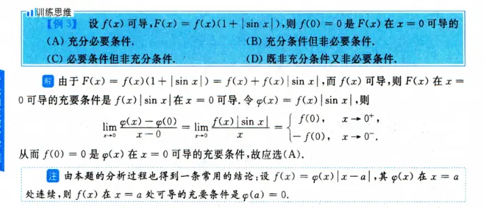
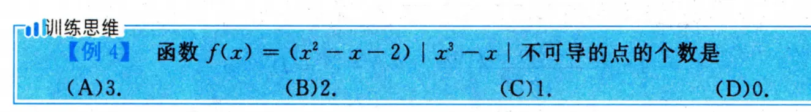
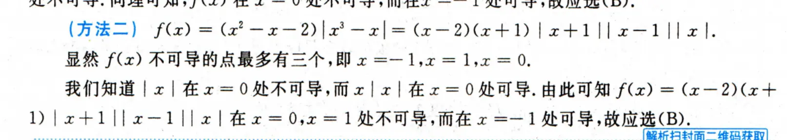
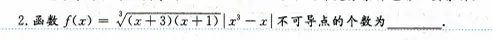
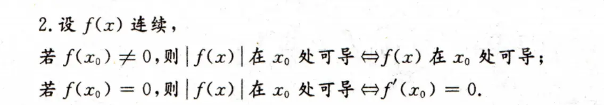
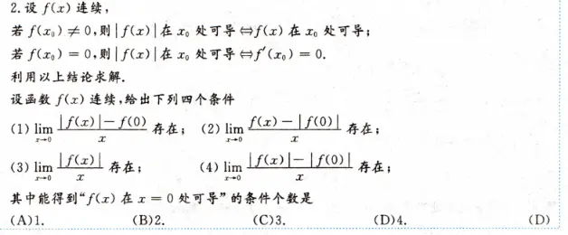

# fx*|gx|形式的题型
  

  
  
这里有一个  基本操作   |gx * fx| 可拆为 |gx| * |fx|

  

### 1. 寻找“可疑点”

函数 $f(x) = \sqrt[3]{(x+3)(x+1)} \vert{}x^3 - x\vert{}$ 包含两种可能导致不可导的结构：

- **绝对值结构** $\vert{}x^3 - x\vert{}$：当绝对值内部为 $0$ 时，可能会产生尖点，导致左右导数不相等。
    
    令 $x^3 - x = x(x-1)(x+1) = 0$，得到可疑点：** $x = 0, x = 1, x = -1$ **。
    
- **根号结构** $\sqrt[3]{(x+3)(x+1)}$：即 $(x+3)^{\frac{1}{3}}(x+1)^{\frac{1}{3}}$，指数小于 $1$。当底数为 $0$ 时，导数趋于无穷大（垂直切线）。
    
    令 $(x+3)(x+1) = 0$，得到可疑点：** $x = -3, x = -1$ **。
    

综合两部分，我们需要重点排查的点有四个：** $x = 0, 1, -3, -1$ **。  
对于根号确定的可疑点使用   结论  
对于根式中的可疑点  

**根号结构** $\sqrt[3]{(x+3)(x+1)}$：即 $(x+3)^{\frac{1}{3}}(x+1)^{\frac{1}{3}}$，指数小于 $1$。当底数为 $0$ 时，导数趋于无穷大（垂直切线）。 令 $(x+3)(x+1) = 0$，得到可疑点：** $x = -3, x = -1$ **。

**验证 $x = -3$ **

此处是根式导致的可能不可导。我们直接使用导数定义考察其差商的极限：

$$\lim_{x\to -3} \frac{f(x) - f(-3)}{x - (-3)} = \lim_{x\to -3} \frac{(x+3)^{\frac{1}{3}}(x+1)^{\frac{1}{3}}\vert{}x^3 - x\vert{}}{x+3} = \lim_{x\to -3} \frac{(x+1)^{\frac{1}{3}}\vert{}x^3 - x\vert{}}{(x+3)^{\frac{2}{3}}}$$

当 $x \to -3$ 时，分子趋于一个非零常数 $( (-2)^{\frac{1}{3}} \cdot \vert{}-24\vert{} \neq 0 )$，而分母趋于 $0^+$。

因此该极限为无穷大，导数不存在。

所以，$f(x)$ 在 ** $x=-3$ 处不可导**。

# fx 和|fx|的关系判断  

我们可以将这个结论分为两种情况来详细证明和解释：

### 情况一：当 $f(x_0) \neq 0$ 时

**结论：** $\vert{}f(x)\vert{}$ 在 $x_0$ 处可导 $\iff$ $f(x)$ 在 $x_0$ 处可导。

**原理解析：**

这里利用了连续函数的**局部保号性**。

由于 $f(x)$ 在 $x_0$ 处连续，且 $f(x_0) \neq 0$，这意味着在 $x_0$ 的某一个足够小的邻域内，$f(x)$ 的正负号与 $f(x_0)$ 保持一致，不会发生改变。

- **若 $f(x_0) > 0$：** 在 $x_0$ 的邻域内，$f(x) > 0$，此时去掉绝对值符号，有 $\vert{}f(x)\vert{} = f(x)$。两个函数在局部完全一样，可导性自然等价。
    
- **若 $f(x_0) < 0$：** 在 $x_0$ 的邻域内，$f(x) < 0$，此时去掉绝对值符号，有 $\vert{}f(x)\vert{} = -f(x)$。乘以一个常数 $-1$ 不会影响函数导数的存在性，因此可导性依然等价。
    

**总结：** 只要函数在某点不为 $0$，套上绝对值只是可能把图像整体翻折，在局部的平滑程度（可导性）不会受影响。

### 情况二：当 $f(x_0) = 0$ 时

**结论：** $\vert{}f(x)\vert{}$ 在 $x_0$ 处可导 $\iff$ $f'(x_0) = 0$。

**原理解析：**

当 $f(x_0) = 0$ 时，我们直接使用导数定义来分析 $\vert{}f(x)\vert{}$ 在 $x_0$ 处的导数：

$$\lim_{x \to x_0} \frac{\vert{}f(x)\vert{} - \vert{}f(x_0)\vert{}}{x - x_0} = \lim_{x \to x_0} \frac{\vert{}f(x)\vert{}}{x - x_0}$$

1. **充分性（若 $f'(x_0) = 0$，则 $\vert{}f(x)\vert{}$ 可导）：**
    
    已知 $f'(x_0) = \lim_{x \to x_0} \frac{f(x) - f(x_0)}{x - x_0} = \lim_{x \to x_0} \frac{f(x)}{x - x_0} = 0$。
    
    根据极限性质，一个函数的极限为 $0$，那么它绝对值的极限也必为 $0$：
    
    $$\lim_{x \to x_0} \left\vert{} \frac{f(x)}{x - x_0} \right\vert{} = 0 \implies \lim_{x \to x_0} \frac{\vert{}f(x)\vert{}}{\vert{}x - x_0\vert{}} = 0$$
    
    无论是从左侧逼近（分母为负）还是右侧逼近（分母为正），整体极限必然也是 $0$。因此 $\vert{}f(x)\vert{}$ 在 $x_0$ 处可导，且导数为 $0$。
    
2. **必要性（若 $\vert{}f(x)\vert{}$ 在 $x_0$ 处可导，则 $f'(x_0) = 0$）：**
    
    假设 $\vert{}f(x)\vert{}$ 在 $x_0$ 处可导，设其导数为 $A$。则：
    
    $$\lim_{x \to x_0} \frac{\vert{}f(x)\vert{}}{x - x_0} = A$$
    
    - 当 $x \to x_0^+$ 时（从右侧趋近），分母 $x - x_0 > 0$，分子 $\vert{}f(x)\vert{} \ge 0$，因此右极限 $\ge 0$，即 $A \ge 0$。
        
    - 当 $x \to x_0^-$ 时（从左侧趋近），分母 $x - x_0 < 0$，分子 $\vert{}f(x)\vert{} \ge 0$，因此左极限 $\le 0$，即 $A \le 0$。
        
        要使极限存在，左右极限必须相等，因此只能是 $A = 0$。
        
        既然 $\lim_{x \to x_0} \frac{\vert{}f(x)\vert{}}{x - x_0} = 0$，去掉分母外的绝对值限制，原函数的变化率 $\lim_{x \to x_0} \frac{f(x)}{x - x_0}$ 也必然只能是 $0$。因此 $f'(x_0) = 0$。
        

**总结：** 当函数跨越 $x$ 轴（即 $f(x_0)=0$）时，套上绝对值会强行把下面的图像翻折上来，极易产生尖点（不可导）。**唯一能避免产生尖点的方法，就是原函数穿过 $x$ 轴时，必须是“平躺”着过去的**，也就是它在这一点的切线斜率必须是 $0$（即 $f'(x_0) = 0$）。  

# 例题  
这道题的正确答案是 **(D) 4**。这四个条件都能推导出 $f(x)$ 在 $x=0$ 处可导。

题目要求“利用以上结论求解”，这里给出的结论是关于绝对值函数可导性的定理：

- 若 $f(x_0) \neq 0$，则 $\vert{}f(x)\vert{}$ 可导 $\iff f(x)$ 可导。
    
- 若 $f(x_0) = 0$，则 $\vert{}f(x)\vert{}$ 可导 $\iff f'(x_0) = 0$（这也意味着 $f(x)$ 在此处可导，且导数为 0）。
    

综合这两点，我们可以得出一个极其有用的**核心推论**：**只要 $\vert{}f(x)\vert{}$ 在某点可导，那么 $f(x)$ 在该点必定可导。**

接下来，我们利用“极限存在，分母趋于 0，则分子必趋于 0”的性质，以及上述核心推论，逐一拆解这四个条件：

### 条件 (4) 分析：最直接的应用

极限式为 $\lim_{x \to 0} \frac{\vert{}f(x)\vert{} - \vert{}f(0)\vert{}}{x}$ 存在。

这个极限式恰好就是函数 $g(x) = \vert{}f(x)\vert{}$ 在 $x=0$ 处的**导数定义**。

所以，条件 (4) 的等价含义是：** $\vert{}f(x)\vert{}$ 在 $x=0$ 处可导**。

根据前面的核心推论，只要 $\vert{}f(x)\vert{}$ 可导，$f(x)$ 就一定可导。

**结论：条件 (4) 成立。**

### 条件 (1) 分析：转化为条件 (4)

极限式为 $\lim_{x \to 0} \frac{\vert{}f(x)\vert{} - f(0)}{x}$ 存在。

因为分母 $x \to 0$ 时极限存在，所以分子必须趋于 0：

$$\lim_{x \to 0} (\vert{}f(x)\vert{} - f(0)) = 0 \implies \vert{}f(0)\vert{} - f(0) = 0 \implies f(0) \ge 0$$

既然 $f(0) \ge 0$，那么 $f(0)$ 在数值上完全等于 $\vert{}f(0)\vert{}$。

我们将极限分子中的 $f(0)$ 替换为 $\vert{}f(0)\vert{}$，原条件就变成了：

$\lim_{x \to 0} \frac{\vert{}f(x)\vert{} - \vert{}f(0)\vert{}}{x}$ 存在。

这完全等同于条件 (4)，由前文可知 $f(x)$ 必可导。

**结论：条件 (1) 成立。**  

### 条件 (3) 分析：条件 (4) 的特例

极限式为 $\lim_{x \to 0} \frac{\vert{}f(x)\vert{}}{x}$ 存在。

同理，分子趋于 0：

$$\lim_{x \to 0} \vert{}f(x)\vert{} = 0 \implies f(0) = 0$$

既然 $f(0) = 0$，那么显然也有 $\vert{}f(0)\vert{} = 0$。

我们可以在原极限式的分子减去一个 $0$（即减去 $\vert{}f(0)\vert{}$），原条件变为：

$\lim_{x \to 0} \frac{\vert{}f(x)\vert{} - \vert{}f(0)\vert{}}{x}$ 存在。

这再次等同于条件 (4)，$f(x)$ 必可导（此时结合定理可知 $f'(0) = 0$）。

**结论：条件 (3) 成立。**

### 条件 (2) 分析：直接回归导数定义

极限式为 $\lim_{x \to 0} \frac{f(x) - \vert{}f(0)\vert{}}{x}$ 存在。

分子趋于 0：

$$\lim_{x \to 0} (f(x) - \vert{}f(0)\vert{}) = 0 \implies f(0) - \vert{}f(0)\vert{} = 0 \implies f(0) \ge 0$$

既然 $f(0) \ge 0$，那么 $\vert{}f(0)\vert{}$ 在数值上完全等于 $f(0)$。

我们将极限分子中的 $\vert{}f(0)\vert{}$ 替换回 $f(0)$，原条件变成了：

$$\lim_{x \to 0} \frac{f(x) - f(0)}{x} \text{ 存在}$$

这个极限式正是函数 $f(x)$ 在 $x=0$ 处的**导数定义**！它直接表明 $f'(0)$ 存在。

**结论：条件 (2) 成立。**