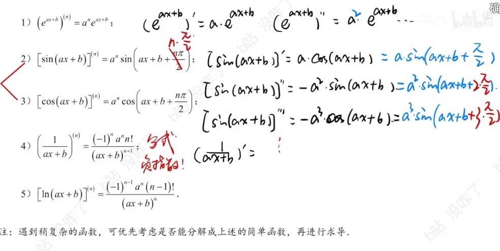
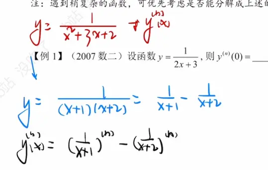
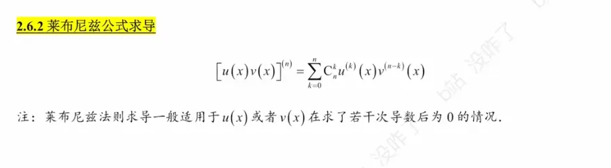
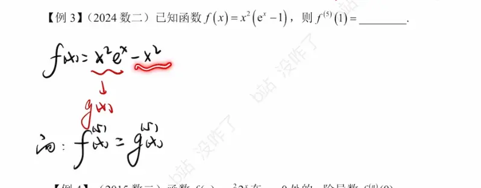
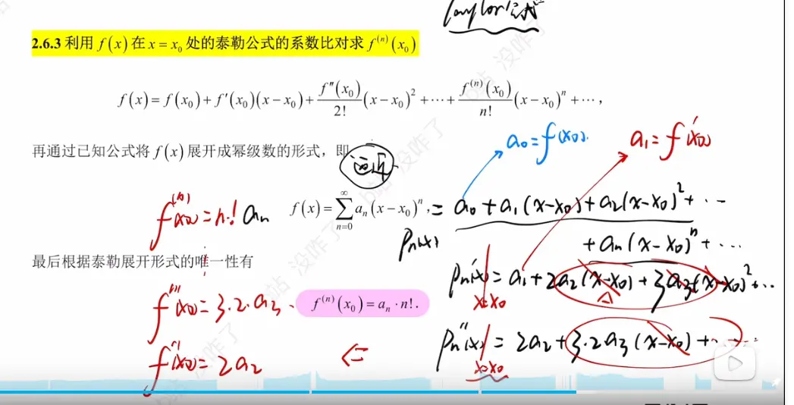
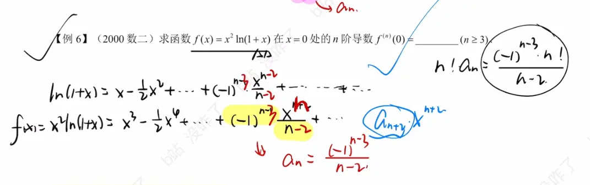

https://www.bilibili.com/video/BV1oVoNYZECx/?spm_id_from=333.337.search-card.all.click&vd_source=00e9babc4deca9e64ec25dd54e7bfe0c

# 归纳法  

遇到复杂的函数  可以优先考虑往这几个上靠 
第 4 和 5 可以结合起来一起看   
 

## 变形的例子
比如  
使用**分离常数法**（第一种方法）来求解 $y = \frac{x}{2x+3}$ 的 $n$ 阶导数，思路非常清晰。我们的核心目标是**把分子中的 $x$ 消掉**，将其变成常数与基本分式的组合。

以下是具体的推导步骤：

### 第一步：代数变形（分离常数）

为了在分子中凑出分母 $2x+3$ 的结构，我们需要先将分子的 $x$ 乘上 $2$，为了保持等式不变，外面再除以 $2$：

$$y = \frac{1}{2} \cdot \frac{2x}{2x+3}$$

接着，在分子里“无中生有”地加 $3$ 再减 $3$：

$$y = \frac{1}{2} \cdot \frac{(2x+3) - 3}{2x+3}$$

把分子拆开成两项：

$$y = \frac{1}{2} \left( \frac{2x+3}{2x+3} - \frac{3}{2x+3} \right)$$

$$y = \frac{1}{2} \left( 1 - \frac{3}{2x+3} \right)$$

将其展开，得到最终的变形结果：

$$y = \frac{1}{2} - \frac{3}{2(2x+3)}$$

### 第二步：套用基础公式求导

现在对等式两边同时求 $n$ 阶导数（前提是 $n \ge 1$）。

1. **第一项**：$\frac{1}{2}$ 是常数，求导一次就变成 $0$ 了，所以它的 $n$ 阶导数为 $0$。
    
2. **第二项**：提取出常数系数 $-\frac{3}{2}$，剩下部分 $\frac{1}{2x+3}$ 直接套用基础公式 $y^{(n)} = (-1)^n \frac{n! b^n}{(a+bx)^{n+1}}$ （此处 $a=3, b=2$）。
    

将它们组合起来：

$$y^{(n)} = 0 - \frac{3}{2} \cdot \left[ (-1)^n \frac{n! \cdot 2^n}{(2x+3)^{n+1}} \right]$$

### 第三步：化简结果

最后一步是整理系数。

把外面的负号合并到 $(-1)^n$ 中，变成 $(-1)^{n+1}$（或者写成 $(-1)^{n-1}$ 也可以，两者奇偶性相同）。

外面的分母 $2$ 与分子中的 $2^n$ 约分，变成 $2^{n-1}$：

$$y^{(n)} = (-1)^{n+1} \frac{3 \cdot n! \cdot 2^{n-1}}{(2x+3)^{n+1}}$$

---

第二中的是    将复杂分子  分解   [有理式拆分方法](../../4不定积分/做题方法/积分方法/有理式拆分方法.md) 
  

# 莱布尼兹公式  （幂函数和 ex 的指数函数）
  
尤其是幂函数与其他函数的组合  因为这里的幂函数 在求几次导之后等于 0 了  

## 例题  

# 泰勒公式  （直接在某一点的高阶导）

  
## 推导过程  
图片 **image_b 18334.png** 中展示的是利用“幂级数展开的唯一性”来间接求解函数在某一点的 $n$ 阶导数值 $f^{(n)}(x_0)$ 的推导过程。

这种方法在考研数学（如 408 涉及的高数部分）或日常微积分题目中非常常见，主要用于避免直接进行繁琐的高阶求导。

以下是详细的推导步骤：

### 1. 泰勒级数展开的定义

如果函数 $f(x)$ 在点 $x_0$ 处具有任意阶导数，那么它可以展开为泰勒级数。根据定义，泰勒级数的标准形式为：

$$f(x) = f(x_0) + f'(x_0)(x - x_0) + \frac{f''(x_0)}{2!}(x - x_0)^2 + \cdots + \frac{f^{(n)}(x_0)}{n!}(x - x_0)^n + \cdots$$

在这个标准形式中，$(x - x_0)^n$ 这一项前面的系数是固定的，即 $\frac{f^{(n)}(x_0)}{n!}$。

### 2. 一般幂级数展开

在实际解题中，我们往往不需要老老实实地去求 $n$ 阶导数，而是利用已知的基本初等函数（如 $e^x$, $\sin x$, $\frac{1}{1-x}$ 等）的麦克劳林公式或泰勒公式，通过代数变形（如四则运算、变量代换、逐项求导或积分），将 $f(x)$ 凑成一个一般的幂级数形式：

$$f(x) = \sum_{n=0}^{\infty} a_n (x - x_0)^n = a_0 + a_1(x - x_0) + a_2(x - x_0)^2 + \cdots + a_n(x - x_0)^n + \cdots$$

这里的 $a_n$ 是我们通过已知公式计算出来的具体数值。

### 3. 根据“展开的唯一性”进行系数比对

数学上有一个重要的定理：**如果一个函数在 $x_0$ 的某个邻域内可以展开为幂级数，那么这个展开式是唯一的，且必定是该函数的泰勒级数。**

这意味着，我们在第 2 步中通过各种技巧求得的一般幂级数，本质上和第 1 步中的泰勒级数是**完全一样**的。既然两个多项式完全相等，那么它们同次幂项的系数也必须完全相等。

我们取出这两个级数中 $(x - x_0)^n$ 这一项的系数进行对比：

- 泰勒级数中 $(x - x_0)^n$ 的系数是：$\frac{f^{(n)}(x_0)}{n!}$
    
- 我们求出的幂级数中 $(x - x_0)^n$ 的系数是：$a_n$
    

令这两个系数相等，即可得到等式：

$$a_n = \frac{f^{(n)}(x_0)}{n!}$$

### 4. 得出最终结论

将上述等式两边同时乘以 $n!$，即可推导出图片中的最终结论，直接求得 $n$ 阶导数的值：

$$f^{(n)}(x_0) = a_n \cdot n!$$

**总结：**

这个推导的核心思想就是“偷梁换柱”。直接求 $f^{(n)}(x_0)$ 很难，我们就先利用已知公式把 $f(x)$ 展开成 $a_n(x-x_0)^n$ 的形式找到 $a_n$，然后再乘以 $n!$，就可以直接得到 $n$ 阶导数的值。
## 例题  

  

  

# 利用函数的奇偶性和周期性  

在微积分（尤其是考研数学这样的选拔性考试）中，直接“硬算”导数往往会陷入极大的计算量。**利用函数的性质来求导数，本质上是一种“降维打击”**——通过观察函数在全局的结构特征（奇偶性、周期性、对称性等），直接得出某一点的导数值或导函数的结构。

以下为你总结利用函数性质求导的**四大核心规律与实战套路**：

---

### 一、 奇偶性（Parity）：消灭原点导数的利器

这是考频最高的一个性质，主要用于处理与 $x=0$ 相关的导数问题。

**1. 基本规律：求导一次，奇偶互换**

- **偶**函数的导数是**奇**函数。
    
    - _推导：_ $f(-x) = f(x) \implies -f'(-x) = f'(x) \implies f'(-x) = -f'(x)$。
        
- **奇**函数的导数是**偶**函数。
    
    - _推导：_ $f(-x) = -f(x) \implies -f'(-x) = -f'(x) \implies f'(-x) = f'(x)$。
        

**2. 进阶规律（高阶导数）：**

- $f(x)$ 是偶函数 $\implies$ 它的所有**奇数阶**导数 $f^{(2k-1)}(x)$ 都是奇函数。
    
- $f(x)$ 是奇函数 $\implies$ 它的所有**偶数阶**导数 $f^{(2k)}(x)$ 都是奇函数。
    

> **核心结论（考场秒杀技巧）：**
> 
> - 如果 $f(x)$ 是**偶函数**，且在 $x=0$ 处存在奇数阶导数，则必然有：**$f^{(2k-1)}(0) = 0$**。
>     
> - 如果 $f(x)$ 是**奇函数**，且在 $x=0$ 处存在偶数阶导数，则必然有：**$f^{(2k)}(0) = 0$**。（特别地，$f(0)=0$）。
>     

**实战场景：** 遇到求 $f^{(n)}(0)$ 的填空题，第一反应必须是检查 $f(x)$ 的奇偶性。如果是匹配的奇偶性，直接填 $0$，无需任何计算。

---

### 二、 对称性（Symmetry）：奇偶性的平移推广

奇偶性本质上是关于 $y$ 轴（即 $x=0$）对称，如果对称轴平移到 $x=a$，规律依然成立。

**1. 轴对称（关于直线 $x=a$ 对称）**

- **代数表达：** $f(a+x) = f(a-x)$ （或写为 $f(x) = f(2a-x)$）
    
- **求导规律：** 两边同时对 $x$ 求导得 $f'(a+x) = -f'(a-x)$。
    
- **几何意义：** 导函数关于点 $(a, 0)$ 中心对称。
    

> **核心结论：** 轴对称函数在其对称轴处的导数为 $0$。即如果 $f(x)$ 可导，则 **$f'(a) = 0$**。

**2. 中心对称（关于点 $(a, b)$ 对称）**

- **代数表达：** $f(a+x) + f(a-x) = 2b$
    
- **求导规律：** 两边同时对 $x$ 求导得 $f'(a+x) - f'(a-x) = 0 \implies f'(a+x) = f'(a-x)$。
    
- **几何意义：** 导函数关于直线 $x=a$ 轴对称。
    

> **总结：** 原函数的**轴对称**会变成导函数的**中心对称**；原函数的**中心对称**会变成导函数的**轴对称**。

---

### 三、 周期性（Periodicity）：形状复制器

周期函数在宏观上是无限重复的，它的切线斜率变化自然也是无限重复的。

**1. 基本规律：**

- 如果 $f(x)$ 具有周期 $T$（即 $f(x+T) = f(x)$），那么**它的导函数 $f'(x)$ 也必然具有周期 $T$**。
    
    - _推导：_ 对 $f(x+T) = f(x)$ 两边求导，根据复合函数求导法则，内层 $x+T$ 的导数为 $1$，所以直接得到 $f'(x+T) = f'(x)$。
        

**2. 易错点对比（与积分结合）：**

- **导数：** 周期函数的导数**绝对是**周期函数，周期不变。
    
- **积分：** 周期函数的积分**不一定**是周期函数！只有当它在一个周期内的积分值为 $0$（即 $\int_0^T f(x)dx = 0$）时，它的变上限积分函数才是周期函数。
    

---

### 四、 反函数性质（Inverse Function）： $x$ 与 $y$ 的地位反转

这往往不涉及图像宏观的对称平移，而是代数关系上的深刻性质。考研大题或填空压轴题极度喜欢考察**反函数的二阶导数**。

设 $y = f(x)$ 存在单调可导的反函数 $x = \varphi(y)$（即 $x = f^{-1}(y)$）。

**1. 一阶导数关系：互为倒数**

> **公式：** $\frac{dx}{dy} = \frac{1}{\frac{dy}{dx}}$ （即 $x'_y = \frac{1}{y'_x}$）

**2. 二阶导数关系：必须死记硬背的考点**

很多时候，题目已知原函数 $y=f(x)$ 的关系，却要求你算反函数的二阶导数 $\frac{d^2x}{dy^2}$。

- _推导过程：_
    
    $$ \frac{d^2x}{dy^2} = \frac{d}{dy}\left( \frac{dx}{dy} \right) = \frac{d}{dx}\left( \frac{1}{y'} \right) \cdot \frac{dx}{dy} $$
    
    $$ = \left( -\frac{y''}{(y')^2} \right) \cdot \frac{1}{y'} = -\frac{y''}{(y')^3} $$
    

> **核心结论（公式）：** **$x'' = -\frac{y''}{(y')^3}$**
> 
> （注意：这里的负号极其容易遗漏，分母是原函数一阶导的三次方）。

---

### 全局思维总结

下次拿到一道求导题，特别是**求某一个具体点的导数值**或**高阶导数值**时，请在大脑中按以下顺序过一遍安检：

1. 看点：是不是求 $x=0$ 的导数？ $\to$ 查**奇偶性**。
    
2. 看点：是不是求 $x=a$ 的导数？且式子存在 $(x-a)$ 的结构？ $\to$ 查**对称性**。
    
3. 看式：式子里是不是只有正余弦等周期结构？ $\to$ 查**周期性**。
    
4. 看变量：是不是让你求 $\frac{d^2x}{dy^2}$？ $\to$ 默写**反函数二阶导公式**。

| **函数性质** | **代数前提 (原函数特征)**                                                             | **导函数的核心演变规律**                                                                                  | **考场秒杀结论 / 实战应用**                                                                                         |
| -------- | ---------------------------------------------------------------------------- | ----------------------------------------------------------------------------------------------- | --------------------------------------------------------------------------------------------------------- |
| **奇偶性**  | **偶函数:** $f(-x) = f(x)$      **奇函数:** $f(-x) = -f(x)$            | **求导一次，奇偶互换。**      • 偶函数的奇数阶导数为奇函数      • 奇函数的偶数阶导数为奇函数                | **若 $f(x)$ 为偶函数：** $f^{(2k-1)}(0) = 0$      **若 $f(x)$ 为奇函数：** $f^{(2k)}(0) = 0$ _(常用于填空题秒杀)_ |
| **对称性**  | **轴对称:** $f(a+x) = f(a-x)$      **中心对称:** $f(a+x) + f(a-x) = 2b$ | **对称方式互换。**      • 轴对称 $\implies$ 导函数中心对称      • 中心对称 $\implies$ 导函数轴对称 | **若 $f(x)$ 存在对称轴 $x=a$：**      在其对称轴处的导数必为 0，即 **$f'(a) = 0$**。                               |
| **周期性**  | **周期为 $T$:**      $f(x+T) = f(x)$                                | **导函数绝对保持原周期。**      $f'(x+T) = f'(x)$                                              | 遇到三角函数等周期结构，直接利用周期性平移区间。      _(防坑提醒：导数必周期，但周期函数的积分不一定周期)_                                    |
|          |                                                                              |                                                                                                 |                                                                                                           |
|          |                                                                              |                                                                                                 |                                                                                                           |
## 例题  
  
**fx =gx + g(-x)   偶函数**  
**fx =gx -g(-x)  奇函数**  
