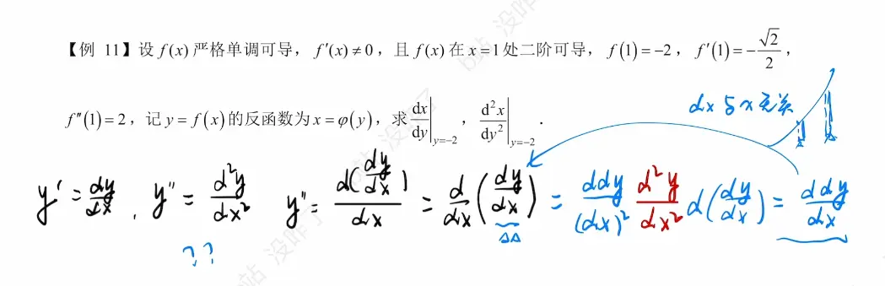

反函数、参数方程与二阶导数结合是微积分中的高频考点。在处理这类问题时，最容易犯的错误是在求二阶导数时**忘记对内层变量应用链式法则**。

以下是它们的核心公式与推导逻辑：

## 一、 二阶导数基础

二阶导数本质上是“导数的导数”。如果函数 $y = f(x)$ 的导数 $y' = f'(x)$ 仍然可导，那么对 $y'$ 再求一次导数就是二阶导数。

- **记法：** $y''$ ， $f''(x)$ ，或者莱布尼茨记法 $\frac{d^2y}{dx^2}$。
    
- **几何意义：** 描述曲线的**凹凸性**。若 $f''(x) > 0$，曲线是凹的（开口向上）；若 $f''(x) < 0$，曲线是凸的（开口向下）。二阶导数等于 $0$ 的点可能是拐点。
    

## 二、 反函数的导数与二阶导数

假设 $y = f(x)$ 单调可导，且 $f'(x) \neq 0$，其反函数为 $x = \varphi(y)$。
