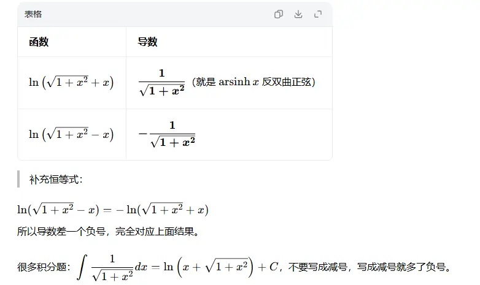

### 1. 基本初等函数导数公式（基石）

这是所有求导计算的“九九乘法表”，必须形成肌肉记忆：

- **常数函数：** $(C)' = 0$
    
- **幂函数：** $(x^\mu)' = \mu x^{\mu-1}$
    
- **指数函数：** $(e^x)' = e^x$，一般形式 $(a^x)' = a^x \ln a$ $(a>0, a \neq 1)$
    
- **对数函数：** $(\ln x)' = \frac{1}{x}$，一般形式 $(\log_a x)' = \frac{1}{x \ln a}$ $(a>0, a \neq 1)$
    
- **三角函数：**
    
    - $(\sin x)' = \cos x$
        
    - $(\cos x)' = -\sin x$
        
    - $(\tan x)' = \sec^2 x$
        
    - $(\cot x)' = -\csc^2 x$
        
    - $(\sec x)' = \sec x \tan x$
        
    - $(\csc x)' = -\csc x \cot x$
        
- **反三角函数：**
    
    - $(\arcsin x)' = \frac{1}{\sqrt{1 - x^2}}$
        
    - $(\arccos x)' = -\frac{1}{\sqrt{1 - x^2}}$
        
    - $(\arctan x)' = \frac{1}{1 + x^2}$
        
    - $(\text{arccot}\, x)' = -\frac{1}{1 + x^2}$
        
考研常考的  

### 2. 四则运算法则（组合）

设函数 $u = u(x)$ 和 $v = v(x)$ 都在点 $x$ 处可导：

- **加减法：** $(u \pm v)' = u' \pm v'$
    
- **乘法法则（积的导数）：** $(uv)' = u'v + uv'$
    
    - _推论（常数提取）：_ $(Cu)' = Cu'$
        
- **除法法则（商的导数）：** $\left(\frac{u}{v}\right)' = \frac{u'v - uv'}{v^2}$ （前提 $v \neq 0$）
    

### 3. 复合函数求导法则（链式法则 Chain Rule）

这是求导中最常用、也是最容易漏项的法则。核心思想是“由外向内，逐层求导，相乘相连”。

如果 $y = f(u)$，且 $u = g(x)$，那么 $y$ 针对 $x$ 的导数为：

$$ \frac{dy}{dx} = \frac{dy}{du} \cdot \frac{du}{dx} $$

或者写为：

$$ y' = f'(g(x)) \cdot g'(x) $$

> **示例：** 求 $y = \sin(x^2)$ 的导数。
> 
> 外层是 $\sin(u)$，内层是 $u = x^2$。
> 
> $y' = \cos(x^2) \cdot (x^2)' = \cos(x^2) \cdot 2x = 2x\cos(x^2)$  

