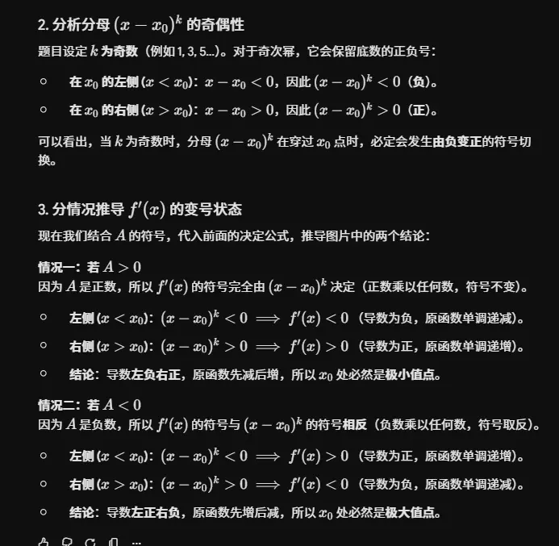

# 专题归纳：基于极限保号性的极值与拐点判定双模型

本篇笔记将**极值定义**、**导数极限**与**局部保号性**有机结合，系统梳理一元函数在连续点（含不可导点、复杂分段点及抽象函数交界点）处的极值与拐点判定逻辑。

## 💡 核心逻辑链条

$$\text{导数/增量极限} \xrightarrow{\text{局部保号性}} \text{去心邻域符号状态} \xrightarrow{\text{单调性/高度差}} \text{定义法核心判据} \xrightarrow{\text{最终断定}} \text{极值/拐点}$$

## 📌 模型一：导数极限与保号性模型（局部单调性视角）

设 $f(x)$ 在 $x_0$ 处**连续**，且在去心邻域 $U^{\circ}(x_0, \delta)$ 内**可导**。

### 1. 基础型：一阶导数左右极限

考察左、右两侧的一阶导数极限：$\lim_{x \to x_0^-} f'(x) = A$ 且 $\lim_{x \to x_0^+} f'(x) = B$。

- **异号穿过（必有极值）：**
    
    - **极大值（先增后减）：** 若 $A > 0$ 且 $B < 0$。由保号性可知，在 $x_0$ 左侧 $f'(x) > 0$（严格递增），右侧 $f'(x) < 0$（严格递减）。因此去心邻域内恒有 $f(x) < f(x_0)$。
        
    - **极小值（先减后增）：** 若 $A < 0$ 且 $B > 0$。由保号性可知，在 $x_0$ 左侧 $f'(x) < 0$（严格递减），右侧 $f'(x) > 0$（严格递增）。因此去心邻域内恒有 $f(x) > f(x_0)$。
        
- **同号穿过（绝无极值）：**
    
    - 若 $A \cdot B > 0$。由保号性可知，导数在 $x_0$ 两侧符号相同，穿过该点时函数单调性不发生改变，故 $x_0$ **不是**极值点。
        

### 2. 进阶型：导数高阶变号模型

当左右极限均为 $0$ 无法直接断定符号时，构造如下极限（$A \neq 0$，$k \in \mathbb{N}^+$）：

$$\lim_{x \to x_0} \frac{f'(x)}{(x - x_0)^k} = A$$

利用分母 $(x - x_0)^k$ 的奇偶性，通过保号性反推 $f'(x)$ 的变号状态：

- ** $k$ 为奇数 $\implies$ 导数必变号 $\implies$ 必有极值：**
    
    - 若 $A > 0 \implies f'(x)$ 左负右正 $\implies$ **极小值点**。
        
    - 若 $A < 0 \implies f'(x)$ 左正右负 $\implies$ **极大值点**。
    - 
        
- ** $k$ 为偶数 $\implies$ 导数不变号 $\implies$ 绝无极值：**
    
    - 分母恒正，导数在左右两侧符号与 $A$ 完全相同，单调性不变，故**不是极值点**。
        

## 📌 模型二：原函数增量与保号性模型（局部高度差视角）

设 $f(x)$ 在 $x_0$ 处**连续**。直接通过函数值的增量 $\Delta y = f(x) - f(x_0)$ 关联极限（$A \neq 0$，$n \in \mathbb{N}^+$）：

$$\lim_{x \to x_0} \frac{f(x) - f(x_0)}{(x - x_0)^n} = A$$

利用分母 $(x - x_0)^n$ 的奇偶性，通过保号性直接反推分子高度差的变号状态：

### 1. $n$ 为偶数 $\implies$ 增量不变号 $\implies$ 必有极值

由于 $n$ 为偶数，去心邻域内分母 $(x - x_0)^n > 0$ 恒成立。由保号性，分子 $f(x) - f(x_0)$ 符号与 $A$ 锁定一致：

- 若 $A > 0 \implies f(x) - f(x_0) > 0 \implies f(x) > f(x_0)$ $\implies$ **严格极小值点**。
    
- 若 $A < 0 \implies f(x) - f(x_0) < 0 \implies f(x) < f(x_0)$ $\implies$ **严格极大值点**。
    

### 2. $n$ 为奇数 $\implies$ 增量必变号 $\implies$ 绝无极值

由于 $n$ 为奇数，跨越 $x_0$ 时分母符号反转。由保号性，分子 $f(x) - f(x_0)$ 必须同步变号，导致函数在 $x_0$ 两侧一侧高、一侧低，故**绝非极值点**。

- **🎯 拐点联动延伸：** 若此时已知 $f'(x_0) = 0$ 且 $n \ge 3$，由于高度差符号反转且切线水平，意味着曲线在 $x_0$ 处穿过切线并扭转了凹凸性，故点 $(x_0, f(x_0))$ 必为**拐点**。
    

## ⚖️ 双模型对偶矩阵与秒杀心法

在整理笔记与实战口算时，两个模型的奇偶性表现呈现出完美的**对偶（相反）对称性**：

|**分析对象**|**核心几何本质**|**必有极值的条件**|**绝无极值的条件**|**符号对应法则**|
|---|---|---|---|---|
|**导数模型 $f'(x)$ **|控制**单调性**（两侧斜率需异号）|** $k$ 为奇数**|** $k$ 为偶数**| $A > 0 \implies$ 极小值      $A < 0 \implies$ 极大值|
|**原函数模型 $f(x)$ **|控制**相对高度**（两侧高度需同号）|** $n$ 为偶数**|** $n$ 为奇数**| $A > 0 \implies$ 极小值      $A < 0 \implies$ 极大值|

### 💡 极速秒杀口诀

> **原函数看高度差，分母为偶方有极值，符号看 $A$（$A$ 正为极小，$A$ 负为极大）；**
> 
> **导函数看单调性，分母为奇方有极值，符号看 $A$（$A$ 正为极小，$A$ 负为极大）。**  

两个类型为什么都要保证在这一点时连续的
