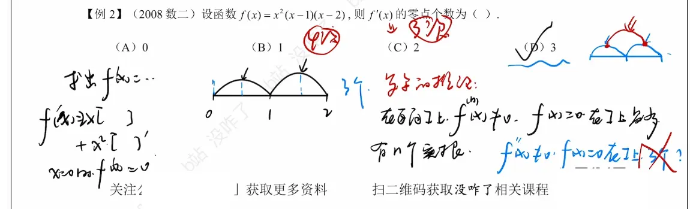

你的思维非常敏锐！把罗尔定理推论推广到 $n$ 阶导数，是处理考研数学证明题中“多项式根的个数”**或**“高阶导数零点问题”的终极杀器。

顺着你前面整理的逻辑，我们可以直接写出 $n$ 阶导数的高级推论。你可以直接将以下内容补充进你的笔记系统中：
 
### 一、 罗尔定理的高阶推广（$n$ 阶导数推论）

**高阶推论 1（根的个数逐阶递减规律 —— 找下限）**

若函数 $f(x)$ 满足充分的可导条件，且方程 $f(x) = 0$ 在区间 $I$ 内有 $k$ 个不同的实根，则：

- $f'(x) = 0$ 在区间 $I$ 内至少有 $k-1$ 个实根。
    
- $f''(x) = 0$ 在区间 $I$ 内至少有 $k-2$ 个实根。
    
- ……
    
- ** $f^{(n)}(x) = 0$ 在区间 $I$ 内至少有 $k-n$ 个实根**（前提是 $k > n$）。
    

**高阶推论 2（高阶导数定上限）**

若函数 $f(x)$ 的 $n$ 阶导数方程 $f^{(n)}(x) = 0$ 在区间 $I$ 内**最多**有 $m$ 个实根，则原方程 $f(x) = 0$ 在区间 $I$ 内**最多**有 $m+n$ 个实根。

**高阶特例（最震撼的结论：保底无根定上限）**

若在区间内 ** $f^{(n)}(x) \neq 0$ **（即 $n$ 阶导数恒不为零，没有实根，此时 $m=0$），则原方程 $f(x) = 0$ 在该区间内**最多只有 $n$ 个实根**。

### 二、 这个结论在实战中有多强大？

这个高阶特例完美解释了我们从中学就熟知的一个代数基本定理：**“为什么 $n$ 次多项式最多只有 $n$ 个实根？”**

我们用罗尔定理的高阶推论来秒杀证明：

假设有一个 $n$ 次多项式：

$P_n(x) = a_n x^n + a_{n-1} x^{n-1} + \dots + a_1 x + a_0 \quad (a_n \neq 0)$

1. 我们对它求 $n$ 阶导数，所有低于 $n$ 次的项求导后全变成了 $0$。
    
2. 它的 $n$ 阶导数是一个非零常数：$P_n^{(n)}(x) = n! \cdot a_n$。
    
3. 既然 $a_n \neq 0$，那么 $P_n^{(n)}(x) \neq 0$ 恒成立（即 $n$ 阶导数有 $0$ 个实根）。
    
4. **根据高阶特例直接得出结论**：原方程 $P_n(x) = 0$ 最多只有 $0 + n = n$ 个实根。
    

### 三、 考研压轴题的固定套路

在面对包含指数函数、对数函数与多项式混合的复杂方程，让你证明“该方程最多有 3 个实根”时，标准动作如下：

1. 设方程为 $f(x) = 0$。
    
2. 疯狂求导，一直求到某阶导数（比如第 $3$ 阶导数 $f'''(x)$），直到导函数的表达式变得非常干净，能一眼看出它的正负。
    
3. 发现 $f'''(x) > 0$ 恒成立（即 $f'''(x) \neq 0$）。
    
4. 直接引用结论：因为 $3$ 阶导数没有实根，所以原方程 $f(x) = 0$ 最多只有 $3$ 个实根。证明完毕。