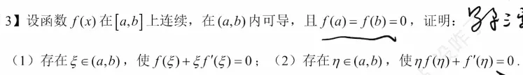

在考研数学中，利用罗尔定理证明“存在 $\xi \in (a, b)$ 使得某个关于 $\xi$ 的导数等式成立”时，最核心、最难的一步就是**构造辅助函数 $F(x)$ **。我们的目标是找到一个函数 $F(x)$，使得对它求导后，令 $F'(x) = 0$ 的形式恰好就是题目要证明的结论。

构造辅助函数不是靠凭空想象，而是有一套高度程式化的“逆推法”（即从结论出发，倒推原函数）。以下为你梳理考研中最常用的 4 种核心构造方法及内在逻辑：

### 一、 核心构造方法分类

#### 1. 观察还原法（最基础）

若结论的形式可以直接看作是某个函数的导数，则直接积分还原。

- **目标结论**：$f'(\xi) = g'(\xi)$ $\implies$ 移项得 $f'(\xi) - g'(\xi) = 0$。
    
- **构造思想**：直接把 $\xi$ 换成 $x$ 并求不定积分。
    
- **辅助函数**：$F(x) = f(x) - g(x)$。
    

#### 2. 一阶线性微分方程法（最常用、常考）

当结论中同时出现 $f'(\xi)$ 和 $f(\xi)$，且它们呈线性组合形式时，将其视为一阶线性齐次微分方程 $y' + P(x)y = 0$。利用**积分因子** $e^{\int P(x)dx}$ 来捆绑复合求导。

- **型①：$f'(\xi) + k f(\xi) = 0 \quad (k\text{为常数})$ **
    
    - 倒推：$y' + ky = 0 \implies \frac{y'}{y} = -k \implies \ln|y| = -kx \implies y e^{kx} = C$。
        
    - **辅助函数**：$F(x) = f(x)e^{kx}$
        
    - _验证_：$F'(x) = [f'(x) + k f(x)]e^{kx}$，因为 $e^{kx} \neq 0$，所以 $F'(\xi)=0 \iff f'(\xi) + k f(\xi) = 0$。
        
- **型②：$f'(\xi) + g'(x) f(\xi) = 0 \quad (g(x)\text{为具体函数})$ **
    
    - **辅助函数**：$F(x) = f(x)e^{g(x)}$
        
- **型③：$\xi f'(\xi) + n f(\xi) = 0 \quad (n\text{为常数})$ **
    
    - 倒推：两边同除以 $\xi$（假设 $\xi \neq 0$），得 $f'(\xi) + \frac{n}{\xi}f(\xi) = 0$。积分因子为 $e^{\int \frac{n}{x}dx} = e^{n\ln x} = x^n$。
        
    - **辅助函数**：$F(x) = x^n f(x)$
        
    - _验证_：$F'(x) = x^{n-1}[x f'(x) + n f(x)]$。
        

#### 3. 分离变量法（对数求导法逆推）

当结论中 $f'(\xi)$、$f(\xi)$ 与自变量 $\xi$ 交织在一起，无法直接看出积分因子时，尝试将含 $f$ 的项和含 $x$ 的项分离开。

- **目标结论**：$f'(\xi) + \xi f(\xi) = 0$
    
    - 倒推：分离开得 $\frac{f'(\xi)}{f(\xi)} = -\xi$ $\implies$ 两边积分得 $\ln|f(x)| = -\frac{1}{2}x^2 + C$ $\implies$ $f(x)e^{\frac{1}{2}x^2} = C$。
        
    - **辅助函数**：$F(x) = f(x)e^{\frac{1}{2}x^2}$。
        
- **目标结论**：$f'(\xi) \ln \xi + \frac{1}{\xi} f(\xi) = 0$
    
    - 观察得知这符合乘积求导法则 $(u v)' = u'v + u v'$，其中 $u=f(x), v=\ln x$。
        
    - **辅助函数**：$F(x) = f(x) \ln x$。
        

#### 4. 变限积分项处理法

当题目条件或结论中含有 $\int_{a}^{x} f(t)dt$ 时，通常将该积分整体视为一个新函数。

- **目标结论**：涉及 $\int_{a}^{\xi} f(t)dt$ 与 $f(\xi)$ 的关系。
    
- **构造思想**：令 $G(x) = \int_{a}^{x} f(t)dt$，则 $G'(x) = f(x)$。将原式转化为关于 $G'(x)$ 和 $G(x)$ 的关系，再套用上述一阶线性微分方程法。
    

### 二、 记忆与思维口诀

> 见导数与函数，指数因子（$e^{g(x)}$）上场凑；
> 
> 见自变量（$x$）乘导数，幂函数（$x^n$）在前头；
> 
> 公式一开反向看，乘商法则心中留。

为了帮助你更直观地理解这些抽象的微分方程倒推机制，并实时验证不同参数变化对辅助函数结构的影响，下面为你生成一个**罗尔定理辅助函数交互式推导与验证工具**。你可以在工具中选择考研中常见的结论形式，并调整参数，实时观察其“微分方程转化-积分因子推导-最终辅助函数生成-导数逆向验证”的全过程，方便你加深逻辑印象。  

# 例题  
这道题简直是为你刚才学的“辅助函数构造大法”**量身定制的完美实战！它涵盖了我们刚才总结的最经典的两种构造模型：**乘积导数逆向**和**一阶微分方程积分因子法。

这份解答我已经按照非常严谨的格式为你整理好了，你可以直接将其录入到你的 Obsidian 笔记中作为典型例题。

### 【证明题实战解析】

**已知条件**：函数 $f(x)$ 在 $[a,b]$ 上连续，在 $(a,b)$ 内可导，且 $f(a) = f(b) = 0$。

#### 证明 (1)：存在 $\xi \in (a,b)$，使 $f(\xi) + \xi f'(\xi) = 0$

**【思维草稿：如何想到辅助函数】**

- **观察法**：看到 $f(\xi) + \xi f'(\xi)$，这实际上是两个函数乘积的导数展开式。因为 $(x \cdot f(x))' = 1 \cdot f(x) + x \cdot f'(x)$。
    
- **微分方程法验证**：令 $y' + \frac{1}{x}y = 0 \implies \frac{y'}{y} = -\frac{1}{x} \implies \ln|y| = -\ln|x| \implies y \cdot x = C$。
    
- 两种思路殊途同归，锁定辅助函数为 $F(x) = x f(x)$。
    

**【规范证明过程】**

构造辅助函数：

$$F(x) = x f(x)$$

1. 因为 $f(x)$ 在 $[a,b]$ 上连续，在 $(a,b)$ 内可导，而函数 $y = x$ 显然在全实数域上连续且可导。所以两者的乘积 $F(x)$ 满足：
    
    - 在闭区间 $[a,b]$ 上连续；
        
    - 在开区间 $(a,b)$ 内可导。
        
2. 代入端点值，由题意 $f(a) = f(b) = 0$ 可得：
    
    - $F(a) = a \cdot f(a) = 0$
        
    - $F(b) = b \cdot f(b) = 0$
        
        即 $F(a) = F(b)$。
        
3. 满足罗尔定理的三个条件。由罗尔定理可知，至少存在一点 $\xi \in (a,b)$，使得 $F'(\xi) = 0$。
    
4. 对 $F(x)$ 求导得 $F'(x) = f(x) + x f'(x)$，将 $x = \xi$ 代入 $F'(\xi) = 0$，即得：
    
    $$f(\xi) + \xi f'(\xi) = 0$$
    
    **证毕。**
    

#### 证明 (2)：存在 $\eta \in (a,b)$，使 $\eta f(\eta) + f'(\eta) = 0$

**【思维草稿：如何想到辅助函数】**

这题很难一眼看穿，必须启动我们刚才推导的“分离变量倒推法”：

1. 令式子等于 $0$ 并替换变量：$x y + y' = 0$。
    
2. 分离变量：$\frac{y'}{y} = -x$。
    
3. 两边积分：$\int \frac{1}{y} dy = \int -x dx \implies \ln|y| = -\frac{1}{2}x^2 + C_1$。
    
4. 去对数并移项：$y = C e^{-\frac{1}{2}x^2} \implies y e^{\frac{1}{2}x^2} = C$。
    
5. 锁定辅助函数：含有指数因子的 $G(x) = f(x) e^{\frac{1}{2}x^2}$。
    

**【规范证明过程】**

构造辅助函数：

$$G(x) = f(x) e^{\frac{1}{2}x^2}$$

1. 因为 $f(x)$ 在 $[a,b]$ 连续、在 $(a,b)$ 可导，且指数函数 $e^{\frac{1}{2}x^2}$ 处处连续且可导，所以复合函数 $G(x)$ 满足：
    
    - 在闭区间 $[a,b]$ 上连续；
        
    - 在开区间 $(a,b)$ 内可导。
        
2. 代入端点值计算，因为 $f(a) = f(b) = 0$，可得：
    
    - $G(a) = f(a) e^{\frac{1}{2}a^2} = 0$
        
    - $G(b) = f(b) e^{\frac{1}{2}b^2} = 0$
        
        即 $G(a) = G(b)$。
        
3. 满足罗尔定理的三个条件。由罗尔定理可知，至少存在一点 $\eta \in (a,b)$，使得 $G'(\eta) = 0$。
    
4. 对 $G(x)$ 使用乘积求导法则计算导数：
    
    $$G'(x) = f'(x) e^{\frac{1}{2}x^2} + f(x) \cdot \left(e^{\frac{1}{2}x^2} \cdot x\right) = e^{\frac{1}{2}x^2} [f'(x) + x f(x)]$$
    
5. 将 $x = \eta$ 代入，得到：
    
    $$G'(\eta) = e^{\frac{1}{2}\eta^2} [f'(\eta) + \eta f(\eta)] = 0$$
    
    因为对于任意实数 $\eta$，指数函数 $e^{\frac{1}{2}\eta^2} > 0$（恒不为零），故必定有括号内的部分为零：
    
    $$f'(\eta) + \eta f(\eta) = 0$$
    
    **证毕。**

# 问题  
去对数并移项：$y = C e^{-\frac{1}{2}x^2} \implies y e^{\frac{1}{2}x^2} = C$。
锁定辅助函数：含有指数因子的 $G(x) = f(x) e^{\frac{1}{2}x^2}$。
【规范证明过程】
构造辅助函数：
$$G(x) = f(x) e^{\frac{1}{2}x^2}$$
因为 $f(x)$ 在 $[a,b]$ 连续、在 $(a,b)$ 可导，且指数函数 $e^{\frac{1}{2}x^2}$ 处处连续且可导，所以复合函数 $G(x)$ 满足：
在闭区间 $[a,b]$ 上连续；
在开区间 $(a,b)$ 内可导。
代入端点值计算，因为 $f(a) = f(b) = 0$，可得：
$G(a) = f(a) e^{\frac{1}{2}a^2} = 0$
$G(b) = f(b) e^{\frac{1}{2}b^2} = 0$
即 $G(a) = G(b)$。
满足罗尔定理的三个条件。由罗尔定理可知，至少存在一点 $\eta \in (a,b)$，使得 $G'(\eta) = 0$。既然这个辅助函数为 C 一个常数，我还需要使用罗尔定理吗  

你问到了一个**极其核心且非常容易混淆**的逻辑痛点！很多人在刚接触这种“逆推法”时，都会产生和你一模一样的疑问。

直接回答你的问题：**你必须使用罗尔定理，因为 $G(x)$ 在真实情况下绝对不是一个常数 $C$。**

为了解开这个心结，我们需要把“草稿纸上的逻辑”和“答题纸上的逻辑”严格区分开：

### 1. 草稿纸上的“美丽误会”（寻找灵感）

在草稿纸上倒推时，你写下了这一步：

> “令式子等于 0 并替换变量：$x y + y' = 0$”

注意这个“令”**字！当你写下 $x y + y' = 0$ 并去解微分方程时，你在大脑中其实做了一个**极其暴力的假设：你假设这个等式在区间内的**每一个点**都成立。

既然你假设它的导数处处为 0，你解出来的结果当然是 $y e^{\frac{1}{2}x^2} = C$（处处为常数）。

**但是，题目并没有给你这个条件！** 题目并没有说这个式子永远等于 0，只是让你证明“存在**某一个点 $\eta$ **”使它等于 0。

所以，草稿纸上解微分方程，纯粹是我们为了“骗”出辅助函数 $G(x)$ 的**长相**（即那个指数因子 $e^{\frac{1}{2}x^2}$），所使用的一种“假戏真做”的手段。

### 2. 答题纸上的“残酷现实”（严谨证明）

一旦你在草稿纸上找到了 $G(x) = f(x) e^{\frac{1}{2}x^2}$ 这个长相，草稿纸的使命就结束了。我们回到真实的题目中：

真实的 $f(x)$ 是一条未知的、可能上下波动的曲线。因此，真实的 $G(x) = f(x) e^{\frac{1}{2}x^2}$ 也是一条跟着波动的曲线，它**根本不是一条水平的直线**（不是常数）。

既然 $G(x)$ 不是常数，你就不能理直气壮地说 $G'(x) = 0$。你该怎么找到导数为 0 的点呢？

**这时候，罗尔定理就必须闪亮登场了！**

罗尔定理告诉你：虽然我不知道 $G(x)$ 中间是怎么波动的，但我算出了它的两头：

- 起点高度：$G(a) = 0$
    
- 终点高度：$G(b) = 0$
    

一条连续平滑的曲线，从高度 0 出发，中间不管怎么上下翻飞，最后又必须回到高度 0。那它中间必定至少有一次“掉头”（最高点或最低点）。在那个掉头的地方，切线必然是水平的。

这就是罗尔定理给我们的底气：它强行担保了**至少存在那么一个点 $\eta$ **，使得 $G'(\eta) = 0$。

### 总结你的逻辑闭环

1. **为什么用微分方程？** 答：为了强行构造出一个新的函数 $G(x)$，使得 $G'(x)$ 展开后的**骨架形状**恰好等于题目要证的等式。
    
2. **为什么 $G(x)$ 不是常数？** 答：因为题目没说那个等式处处为 0，那是我们在草稿纸上一厢情愿的假设。
    
3. **为什么必须用罗尔定理？** 答：因为 $G(x)$ 是一条波动的曲线，我们只能依靠 $G(a)=G(b)$ 这一端点特性，借罗尔定理的威力去“捕捉”那个导数为 0 的瞬间。

# 例题  
构造辅助函数的本质，其实就是一次“逆向工程”（Reverse Engineering）。

在考研数学中，题目往往会让你证明一个含有未知点 $\xi$ 的等式，比如 $f'(\xi) + 2f(\xi) = 0$。而罗尔定理的标准结论是 $F'(\xi) = 0$。

为了用上罗尔定理，我们必须把题目给的那个“长相奇怪”的等式，当成是某个神秘函数 $F(x)$ 求导后的结果。

**“寻找这个神秘函数 $F(x)$ 的过程，就是构造辅助函数。”** 只要找到了 $F(x)$，并且证明它在区间两端的值相等（$F(a) = F(b)$），罗尔定理的逻辑链条就彻底闭环了。

为了应对考研，你不需要死记硬背，只需要掌握几种最常见的“设计模式”（即求导法则的逆运算）。下面为你拆解几道经典的考研题型和构造套路：

### 1. 指数因子型（最常考的核心套路）

**特征：** 结论中出现 $f'(\xi) + k f(\xi) = 0$ 或 $f'(\xi) + g'(\xi)f(\xi) = 0$ 这种“导数 + 原函数”的加法结构。

**逆向思维：** 利用 $(e^{kx}f(x))' = e^{kx}f'(x) + ke^{kx}f(x)$。

> **经典考题（类似历年真题改编）：**
> 
> 设 $f(x)$ 在 $[0, 1]$ 上连续，在 $(0, 1)$ 内可导，且 $f(0) = f(1) = 0$。
> 
> 证明：存在 $\xi \in (0, 1)$，使得 $f'(\xi) + 2\xi f(\xi) = 0$。

- **分析与构造：**
    
    观察目标等式 $f'(x) + 2x f(x) = 0$。我们把它看作某个一阶线性微分方程，两边同时乘以一个积分因子 $e^{x^2}$。
    
    这就提示我们构造辅助函数：
    
    $$F(x) = e^{x^2} f(x)$$
    
- **证明逻辑：**
    
    1. $F(x)$ 在 $[0, 1]$ 连续，在 $(0, 1)$ 可导。
        
    2. 代入端点：$F(0) = e^0 f(0) = 0$，$F(1) = e^1 f(1) = 0$，满足 $F(0) = F(1)$。
        
    3. 由罗尔定理，$\exists \xi \in (0, 1)$，使得 $F'(\xi) = 0$。
        
    4. 对 $F(x)$ 求导：$F'(x) = e^{x^2} \cdot 2x \cdot f(x) + e^{x^2} f'(x) = e^{x^2}(2x f(x) + f'(x))$。
        
    5. 因为 $e^{\xi^2} \neq 0$，所以必然有 $f'(\xi) + 2\xi f(\xi) = 0$。
        

### 2. 幂函数乘积型

**特征：** 结论中出现 $x f'(\xi) + n f(\xi) = 0$ 的结构。

**逆向思维：** 看到前面的系数 $x$ 和 $n$，联想多项式乘积的求导公式 $(x^n f(x))' = n x^{n-1} f(x) + x^n f'(x)$。

> **经典考题：**
> 
> 设 $f(x)$ 在 $[a, b]$ 上连续，在 $(a, b)$ 内可导（$a > 0$），且 $f(a) = f(b) = 0$。
> 
> 证明：存在 $\xi \in (a, b)$，使得 $\xi f'(\xi) + 2f(\xi) = 0$。

- **分析与构造：**
    
    目标等式为 $x f'(x) + 2f(x) = 0$。为了凑出乘积求导的结构，我们给等式同乘 $x$（因为 $x>0$），变成 $x^2 f'(x) + 2x f(x) = 0$。
    
    这恰好是 $(x^2 f(x))'$ 的展开。所以构造辅助函数：
    
    $$F(x) = x^2 f(x)$$
    
- **证明逻辑：**
    
    利用 $F(a) = a^2 f(a) = 0$，$F(b) = b^2 f(b) = 0$，直接对 $F(x)$ 使用罗尔定理即可得出结论。
    

### 3. 商的求导逆推型

**特征：** 结论中出现 $f'(\xi)g(\xi) - f(\xi)g'(\xi) = 0$ 这种带有**减号**的结构。

**逆向思维：** 减号是除法求导法则 $\left(\frac{f(x)}{g(x)}\right)' = \frac{f'(x)g(x) - f(x)g'(x)}{g^2(x)}$ 的典型标志。

> **经典考题：**
> 
> 设 $f(x), g(x)$ 在 $[a, b]$ 连续，在 $(a, b)$ 可导，且 $g(x) \neq 0$，$f(a)g(b) = f(b)g(a)$。
> 
> 证明：存在 $\xi \in (a, b)$，使得 $\frac{f'(\xi)}{f(\xi)} = \frac{g'(\xi)}{g(\xi)}$。

- **分析与构造：**
    
    将目标等式移项通分，就是 $f'(\xi)g(\xi) - f(\xi)g'(\xi) = 0$。看到这个形式，立刻构造辅助函数：
    
    $$F(x) = \frac{f(x)}{g(x)}$$
    
- **证明逻辑：**
    
    由已知条件 $f(a)g(b) = f(b)g(a)$，两边同除以 $g(a)g(b)$，得到 $\frac{f(a)}{g(a)} = \frac{f(b)}{g(b)}$，即 $F(a) = F(b)$。
    
    满足罗尔定理条件，必然存在 $\xi$ 使 $F'(\xi) = 0$，分子为 0 即得证。
    

掌握了这三种“正向求导法则，逆向构造函数”的模式，你就能拆解考研中 80% 以上的中值定理基础证明题。

我们要不要找一个形式稍微复杂一点的结构（比如含有两个函数乘积的变形），你来试着推导一下它的辅助函数应该长什么样？