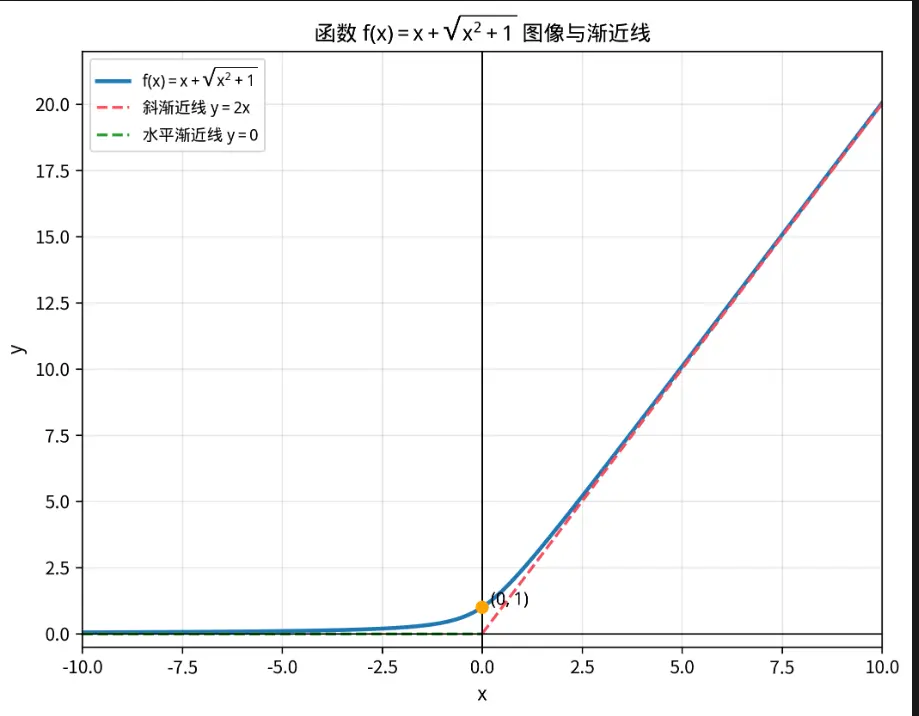

  

[严格单调与非严格（导数）](../../1-1函数/2函数的性态（强化）/严格单调与非严格（导数）.md)
拐点的第三充分条件中  
如果三阶导>0  由凸到凹  
如果三阶导<0  由凹到凸  

（水平渐近线就是斜率为 0 的一条特殊的）
对于一个单值函数 $y = f(x)$ 来说，无论是水平渐近线还是斜渐近线，**每种最多都只能有 2 条**。不仅如此，**水平渐近线和斜渐近线的总数加起来，最多也只能有 2 条**。

根本原因在于：水平和斜渐近线都是研究 $x \to \infty$ 时的行为，而自变量 $x$ 趋于无穷大的方向只有两个：**正无穷方向 ($x \to +\infty$)** 和 **负无穷方向 ($x \to -\infty$)**。

因为极限具有**唯一性**，函数在每一个具体的方向上，最多只能有一种确定的极限行为（要么趋于常数，要么趋于斜线，要么发散）。
### 1. 同侧互斥性（最重要）

在**同一个方向**上（比如同为 $x \to +\infty$），一个函数**不可能同时**拥有水平渐近线和斜渐近线。

- **原因**：在同一个方向上，$k = \lim_{x \to \infty} \frac{f(x)}{x}$ 的极限值是唯一的。如果极限为 $0$，它只可能有水平渐近线；如果极限为一个非零常数，它只可能有斜渐近线。
    

### 2. 异侧共存性

一个函数在**不同方向**上（即 $x \to +\infty$ 和 $x \to -\infty$）完全可以拥有不同类型的渐近线。

- **典型例子**：$f(x) = x + \sqrt{x^2 + 1}$
    
    - 当 $x \to +\infty$ 时，有斜渐近线 $y = 2x$。
        
    - 当 $x \to -\infty$ 时，有水平渐近线 $y = 0$。

# 第三充分条件的证明  
在考研数学的复习中，极值与拐点判定的“第三充分条件”（即高阶导数判定法）是一个非常重要的考点。这两个定理的本质其实是一致的，**核心思想都是利用带有皮亚诺（Peano）余项的泰勒公式（Taylor Formula），分析函数在某点邻域内的局部符号变化。**

下面为您进行这两个第三充分条件的详细证明。

## 一、 极值判定的第三充分条件

**【定理内容】**

设函数 $f(x)$ 在点 $x_0$ 处具有 $n$ 阶导数，且满足：

$$f'(x_0) = f''(x_0) = \dots = f^{(n-1)}(x_0) = 0, \quad f^{(n)}(x_0) \neq 0$$

- 当 $n$ 为**偶数**时，$f(x)$ 在 $x_0$ 处取得极值。其中，若 $f^{(n)}(x_0) < 0$ 则取极大值；若 $f^{(n)}(x_0) > 0$ 则取极小值。
    
- 当 $n$ 为**奇数**时，$f(x)$ 在 $x_0$ 处不取极值。
    

**【证明过程】**

因为 $f(x)$ 在 $x_0$ 处具有 $n$ 阶导数，我们在 $x_0$ 处展开带有皮亚诺余项的泰勒公式：

$$f(x) = f(x_0) + f'(x_0)(x - x_0) + \frac{f''(x_0)}{2!}(x - x_0)^2 + \dots + \frac{f^{(n)}(x_0)}{n!}(x - x_0)^n + o((x - x_0)^n)$$

由于前 $n-1$ 阶导数均为 $0$，上式化简为：

$$f(x) - f(x_0) = \frac{f^{(n)}(x_0)}{n!}(x - x_0)^n + o((x - x_0)^n)$$

提取公因式 $(x - x_0)^n$，可得：

$$f(x) - f(x_0) = (x - x_0)^n \left[ \frac{f^{(n)}(x_0)}{n!} + \frac{o((x - x_0)^n)}{(x - x_0)^n} \right]$$

令 $\alpha(x) = \frac{o((x - x_0)^n)}{(x - x_0)^n}$，由高阶无穷小的定义可知，$\lim_{x \to x_0} \alpha(x) = 0$。

根据极限的保号性，当 $x$ 充分接近 $x_0$（即在 $x_0$ 的去心邻域内）时，括号内式子 $\left[ \frac{f^{(n)}(x_0)}{n!} + \alpha(x) \right]$ 的符号完全由 $\frac{f^{(n)}(x_0)}{n!}$ 的符号决定，即与 $f^{(n)}(x_0)$ 同号。

此时，我们只需看 $(x - x_0)^n$ 的符号：

1. **若 $n$ 为偶数**：对于 $x_0$ 去心邻域内的任意 $x$，恒有 $(x - x_0)^n > 0$。
    
    - 如果 $f^{(n)}(x_0) > 0$，则 $f(x) - f(x_0) > 0$，即 $f(x) > f(x_0)$，$x_0$ 是极小值点。
        
    - 如果 $f^{(n)}(x_0) < 0$，则 $f(x) - f(x_0) < 0$，即 $f(x) < f(x_0)$，$x_0$ 是极大值点。
        
2. **若 $n$ 为奇数**：当 $x > x_0$ 时 $(x - x_0)^n > 0$；当 $x < x_0$ 时 $(x - x_0)^n < 0$。
    
    这说明在 $x_0$ 的左右两侧，$f(x) - f(x_0)$ 的符号是相反的（即函数值一半比 $f(x_0)$ 大，一半比 $f(x_0)$ 小），因此 $x_0$ 不是极值点。
    

## 二、 拐点判定的第三充分条件

**【定理内容】**

设函数 $f(x)$ 在点 $x_0$ 处具有 $n$ 阶导数，且满足：

$$f''(x_0) = f'''(x_0) = \dots = f^{(n-1)}(x_0) = 0, \quad f^{(n)}(x_0) \neq 0$$

- 当 $n$ 为**奇数**时，点 $(x_0, f(x_0))$ 是曲线 $y = f(x)$ 的拐点。
    
- 当 $n$ 为**偶数**时，点 $(x_0, f(x_0))$ 不是曲线 $y = f(x)$ 的拐点。
    

**【证明过程】**

要判断 $(x_0, f(x_0))$ 是否为拐点，最本质的几何定义是：**看曲线在点 $x_0$ 处是否穿过其切线**。

切线方程为 $y = f(x_0) + f'(x_0)(x - x_0)$。我们构造函数与切线的纵坐标之差：

$$F(x) = f(x) - [f(x_0) + f'(x_0)(x - x_0)]$$

如果 $F(x)$ 在 $x_0$ 左右两侧变号，说明曲线穿过切线，$(x_0, f(x_0))$ 是拐点；如果不变号，则曲线始终在切线同侧，不是拐点。

同样将 $f(x)$ 在 $x_0$ 处展开为带有皮亚诺余项的泰勒公式：

$$f(x) = f(x_0) + f'(x_0)(x - x_0) + \frac{f''(x_0)}{2!}(x - x_0)^2 + \dots + \frac{f^{(n)}(x_0)}{n!}(x - x_0)^n + o((x - x_0)^n)$$

由于已知从二阶导数到 $n-1$ 阶导数均为 $0$，代入 $F(x)$ 的表达式中，得：

$$F(x) = \frac{f^{(n)}(x_0)}{n!}(x - x_0)^n + o((x - x_0)^n)$$

$$F(x) = (x - x_0)^n \left[ \frac{f^{(n)}(x_0)}{n!} + \alpha(x) \right]$$

其中 $\lim_{x \to x_0} \alpha(x) = 0$。

同理，根据保号性，括号内的符号由 $f^{(n)}(x_0)$ 决定。$F(x)$ 是否变号，完全取决于 $(x - x_0)^n$ 是否变号：

1. **若 $n$ 为奇数**：当 $x$ 穿过 $x_0$ 时，$(x - x_0)^n$ 发生变号。因此纵坐标差 $F(x)$ 也会变号，这意味着曲线在 $x_0$ 处穿过了切线，故 $(x_0, f(x_0))$ **是拐点**。
    
2. **若 $n$ 为偶数**：当 $x \neq x_0$ 时，$(x - x_0)^n > 0$。纵坐标差 $F(x)$ 在 $x_0$ 左右两侧符号相同，曲线始终位于切线的同一侧，故 $(x_0, f(x_0))$ **不是拐点**。
    

> **核心总结：** 无论是判断极值（函数值与 $f(x_0)$ 比较）还是拐点（函数值与切线值比较），在泰勒展开消除掉低阶项后，主导局部性质的都是**第一个不为零的高阶导数项 $(x-x_0)^n$ **。奇次幂会穿透变号，偶次幂则保持同号。  

# 高数基础 pdf  
