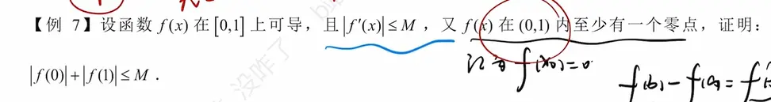
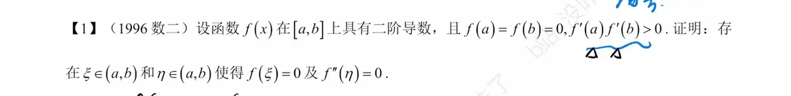
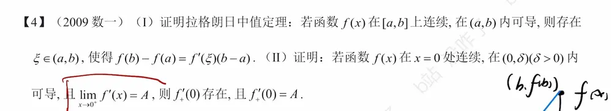
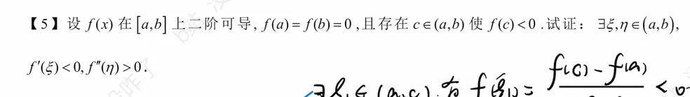

这道题非常经典！而且从图片中你写的笔记 `$f(x_0)=0$` 和 `$f(b)-f(a)=f'(\xi)$` 可以看出，你已经完全抓住了这道题的破局关键点。

这完美契合我们刚才总结的“拉格朗日中值定理”的第二种应用场景：已知导数的有界性（$|f'(x)| \le M$），要求证明函数绝对值的不等式。

下面是严密的标准证明过程，你可以直接参考这个逻辑链条来规范书写：

### 证明过程

**第一步：利用已知条件设定零点**

已知 $f(x)$ 在 $(0,1)$ 内至少有一个零点。

不妨设该零点为 $x_0$，其中 $x_0 \in (0,1)$，则有：

$$f(x_0) = 0$$

以 $x_0$ 为界，将原区间 $[0,1]$ 拆分为两个子区间：$[0, x_0]$ 和 $[x_0, 1]$。

**第二步：在左侧区间 $[0, x_0]$ 应用拉格朗日中值定理**

因为 $f(x)$ 在 $[0, 1]$ 上可导，所以在闭区间 $[0, x_0]$ 上连续，在开区间 $(0, x_0)$ 内可导。根据拉格朗日中值定理，存在一点 $\xi_1 \in (0, x_0)$，使得：

$$f(x_0) - f(0) = f'(\xi_1)(x_0 - 0)$$

将 $f(x_0) = 0$ 代入：

$$-f(0) = f'(\xi_1)x_0$$

等式两边同时取绝对值：

$$|-f(0)| = |f'(\xi_1)| \cdot x_0$$

即 $|f(0)| = |f'(\xi_1)| x_0$。

因为题干已知对任意 $x \in [0,1]$ 都有 $|f'(x)| \le M$，所以 $|f'(\xi_1)| \le M$。进行不等式放缩：

$$|f(0)| \le M x_0 \quad \text{—— (式 1)}$$

**第三步：在右侧区间 $[x_0, 1]$ 应用拉格朗日中值定理**

同理，在区间 $[x_0, 1]$ 上应用拉格朗日中值定理，存在一点 $\xi_2 \in (x_0, 1)$，使得：

$$f(1) - f(x_0) = f'(\xi_2)(1 - x_0)$$

将 $f(x_0) = 0$ 代入：

$$f(1) = f'(\xi_2)(1 - x_0)$$

等式两边同时取绝对值：

$$|f(1)| = |f'(\xi_2)| \cdot (1 - x_0)$$

因为 $1-x_0 > 0$，且 $|f'(\xi_2)| \le M$，进行不等式放缩：

$$|f(1)| \le M (1 - x_0) \quad \text{—— (式 2)}$$

**第四步：合并收尾**

将（式 1）和（式 2）相加，可得：

$$|f(0)| + |f(1)| \le M x_0 + M(1 - x_0)$$

提取右侧的公因式 $M$：

$$|f(0)| + |f(1)| \le M(x_0 + 1 - x_0)$$

化简即得最终结论：

$$|f(0)| + |f(1)| \le M$$

**证明完毕。**

> **💡 解题复盘：**
> 
> 这种题目的核心套路就是**“分区间 + 拼凑法”**。只要看到已知条件里有“零点（或者某点的值已知）”，就立刻把该点作为分割点（这道题是 $x_0$），在左右两边分别用一次拉格朗日。最后把得到的两个式子（通常是取绝对值后）相加，中间用来分割的未知数 $x_0$ 往往会神奇地被消掉。

  
这是一道非常经典的考研真题（1996 年数学二），这道题完美契合了我们之前讨论的“零点定理”**结合**“罗尔定理及其高阶推论”的应用。

证明过程分为两个层次：首先利用导数的极限保号性结合零点定理证明 $\xi$ 的存在；然后利用罗尔定理证明 $\eta$ 的存在。

以下是严密的证明过程：

### 证明过程

#### 第一部分：证明存在 $\xi \in (a,b)$，使得 $f(\xi)=0$

已知条件为 $f'(a)f'(b) > 0$，这意味着 $f'(a)$ 与 $f'(b)$ 同号。我们分两种情况讨论：

**情况 1：假设 $f'(a) > 0$ 且 $f'(b) > 0$ **

1. 根据导数在端点的定义：
    
    $$f'(a) = \lim_{x \to a^+} \frac{f(x) - f(a)}{x - a} = \lim_{x \to a^+} \frac{f(x)}{x - a} > 0$$
    
    因为当 $x \to a^+$ 时，$x - a > 0$，根据**极限的局部保号性**，在 $a$ 的右侧附近必定存在一点 $x_1 \in (a, b)$，使得 $f(x_1) > 0$。
    
2. 同理，在端点 $b$ 处：
    
    $$f'(b) = \lim_{x \to b^-} \frac{f(x) - f(b)}{x - b} = \lim_{x \to b^-} \frac{f(x)}{x - b} > 0$$
    
    因为当 $x \to b^-$ 时，$x - b < 0$，根据**极限的局部保号性**，在 $b$ 的左侧附近必定存在一点 $x_2 \in (a, b)$（且可以取 $x_1 < x_2$），使得 $f(x_2) < 0$。
    
3. 现在我们考察闭区间 $[x_1, x_2]$。因为 $f(x)$ 具有二阶导数，所以 $f(x)$ 在 $[x_1, x_2]$ 上必然连续。
    
    又因为 $f(x_1) > 0$ 且 $f(x_2) < 0$（异号），根据**闭区间上连续函数的零点定理**，至少存在一点 $\xi \in (x_1, x_2) \subset (a, b)$，使得：
    
    $$f(\xi) = 0$$
    

**情况 2：假设 $f'(a) < 0$ 且 $f'(b) < 0$ **

同理可证：

1. 由 $f'(a) < 0$ 可推得在 $a$ 的右侧附近存在 $x_1$，使得 $f(x_1) < 0$。
    
2. 由 $f'(b) < 0$ 可推得在 $b$ 的左侧附近存在 $x_2$，使得 $f(x_2) > 0$。
    
3. 根据零点定理，在 $(x_1, x_2)$ 内同样至少存在一点 $\xi$，使得 $f(\xi) = 0$。
    

综上所述，**第一部分得证**。

#### 第二部分：证明存在 $\eta \in (a,b)$，使得 $f''(\eta)=0$

这一步直接应用我们之前总结的**高阶推论 1（根的个数逐阶递减规律）**，或者通过两次罗尔定理即可轻松拿下。

1. 由已知条件和第一部分的结论可知，原函数 $f(x) = 0$ 在闭区间 $[a, b]$ 上至少有 **3 个** 不同的零点：
    
    $x=a$, $x=\xi$, $x=b$
    
    即 $f(a) = f(\xi) = f(b) = 0$。
    
2. 在区间 $[a, \xi]$ 上对 $f(x)$ 应用罗尔定理：
    
    存在一点 $c_1 \in (a, \xi)$，使得 $f'(c_1) = 0$。
    
3. 在区间 $[\xi, b]$ 上对 $f(x)$ 应用罗尔定理：
    
    存在一点 $c_2 \in (\xi, b)$，使得 $f'(c_2) = 0$。
    
4. 现在，导函数 $f'(x) = 0$ 在区间 $[c_1, c_2]$ 上有了两个端点零点（$f'(c_1) = f'(c_2) = 0$）。
    
    对一阶导数 $f'(x)$ 在闭区间 $[c_1, c_2]$ 上再次应用罗尔定理：
    
    因为 $f(x)$ 存在二阶导数，所以 $f'(x)$ 连续且可导。
    
    必然存在一点 $\eta \in (c_1, c_2) \subset (a, b)$，使得：
    
    $$[f'(\eta)]' = f''(\eta) = 0$$
    

**第二部分得证。全题证明完毕。**

> **💡 解题逻辑复盘：**
> 
> 看到题目给出“二阶导数”以及寻找 $f''(\eta)=0$，第一反应就应该是**“找原函数的 3 个零点”**。
> 
> 题目已经大方地给了 $a$ 和 $b$ 两个零点，剩下的任务就是利用剩下的条件（$f'(a)f'(b)>0$）去“榨”出第三个零点 $\xi$。这往往需要借助极限的保号性与零点定理的联动。

  
这是一道非常经典的考研真题（2009 年数一）。这道题的设计非常精妙，第一问要求证明拉格朗日中值定理，第二问则是拉格朗日中值定理结合导数定义的一个极佳的应用场景（导数极限定理）。

以下是这道题的完整、严密的证明过程，非常适合作为复习笔记的标准解答整理下来。

### （I）证明拉格朗日中值定理

**证明过程：**

为了使用罗尔定理，我们需要构造一个辅助函数。几何上看，拉格朗日中值定理表明曲线上存在一点的切线平行于连接端点 $(a, f(a))$ 和 $(b, f(b))$ 的割线。

割线的方程为：

$$y = f(a) + \frac{f(b) - f(a)}{b - a}(x - a)$$

构造辅助函数 $F(x)$，令其等于原函数与割线方程之差：

$$F(x) = f(x) - \left[ f(a) + \frac{f(b) - f(a)}{b - a}(x - a) \right]$$

验证 $F(x)$ 在区间 $[a, b]$ 上是否满足罗尔定理的三个条件：

1. 因为 $f(x)$ 在 $[a, b]$ 上连续，多项式也连续，所以 $F(x)$ 在 $[a, b]$ 上连续。
    
2. 因为 $f(x)$ 在 $(a, b)$ 内可导，多项式也可导，所以 $F(x)$ 在 $(a, b)$ 内可导。
    
3. 计算端点值：
    
    $$F(a) = f(a) - f(a) = 0$$
    
    $$F(b) = f(b) - \left[ f(a) + f(b) - f(a) \right] = 0$$
    
    即 $F(a) = F(b) = 0$。
    

由于 $F(x)$ 满足罗尔定理的全部条件，因此至少存在一点 $\xi \in (a, b)$，使得 $F'(\xi) = 0$。

对 $F(x)$ 求导：

$$F'(x) = f'(x) - \frac{f(b) - f(a)}{b - a}$$

将 $x = \xi$ 代入并令其等于 0：

$$F'(\xi) = f'(\xi) - \frac{f(b) - f(a)}{b - a} = 0$$

移项并整理，即可得到：

$$f(b) - f(a) = f'(\xi)(b - a)$$

**第一问证明完毕。**

### （II）证明导数极限定理

**证明过程：**

题目要求证明右导数 $f'_+(0)$ 存在且等于 $A$。我们必须回到**右导数的定义**出发：

$$f'_+(0) = \lim_{x \to 0^+} \frac{f(x) - f(0)}{x - 0}$$

在取极限的过程中，$x > 0$ 且趋近于 $0$。因此，我们可以在闭区间 $[0, x]$ 上考察函数 $f(t)$ （这里使用 $t$ 作为自变量以避免符号混淆，其中 $0 < x < \delta$）。

根据已知条件：

1. $f(t)$ 在 $t=0$ 处连续，在 $(0, \delta)$ 内可导，因此 $f(t)$ 在闭区间 $[0, x]$ 上连续。
    
2. $f(t)$ 在开区间 $(0, x)$ 内可导。
    

这就满足了**拉格朗日中值定理**（即第一问的结论）的条件。对 $f(t)$ 在区间 $[0, x]$ 上应用拉格朗日中值定理：

必定存在一点 $\xi \in (0, x)$，使得：

$$f(x) - f(0) = f'(\xi)(x - 0)$$

即：

$$\frac{f(x) - f(0)}{x} = f'(\xi)$$

接下来，对等式两边同时取 $x \to 0^+$ 的极限：

$$\lim_{x \to 0^+} \frac{f(x) - f(0)}{x} = \lim_{x \to 0^+} f'(\xi)$$

注意观察 $\xi$ 的范围：$0 < \xi < x$。

根据**夹逼定理（Squeeze Theorem）**，当 $x \to 0^+$ 时，必然有 $\xi \to 0^+$。

因为已知条件给定了 $\lim_{x \to 0^+} f'(x) = A$，所以当自变量 $\xi \to 0^+$ 时，其导数的极限也必然是 $A$，即：

$$\lim_{\xi \to 0^+} f'(\xi) = A$$

将这个结果代回极限等式中：

$$f'_+(0) = \lim_{x \to 0^+} \frac{f(x) - f(0)}{x} = A$$

**第二问证明完毕。**

> **💡 核心考点复盘：**
> 
> 第二问的结论其实揭示了微积分中一个非常重要的性质：**导函数不能有第一类间断点**（即跳跃间断点或可去间断点）。
> 
> 只要函数在某点连续，且该点附近的导数极限存在，那么该点的导数必定等于这个极限值。在考研大题中，遇到类似“已知导数极限求某点导数值”或“分段函数在分界点处的导数计算”时，**“导数定义 + 拉格朗日中值定理放缩”**是标准的破题范式。  

从你图片下方手写的一小段笔记来看，你的思路非常精准，已经完全抓住了这道题的破局关键点！你利用拉格朗日中值定理在区间 $[a, c]$ 上构造出的 $\xi_1$，正是题目要求的第一步。

这道题是典型的“多次使用拉格朗日中值定理”的题型，几何直观非常强。函数从 0 开始，中间掉到了负数，最后又得回到 0。这意味着它必须先往下走（导数为负），再往上走（导数为正），而从往下变成往上的过程，曲线必然是“开口向上”的（二阶导数为正）。

下面是完整且严密的证明过程，你可以直接参考这个逻辑链条来规范书写：

### 证明过程

**第一步：证明存在 $\xi \in (a, b)$，使得 $f'(\xi) < 0$ **

正如你笔记中所写，我们在子区间 $[a, c]$ 上应用拉格朗日中值定理。

因为 $f(x)$ 在 $[a, b]$ 上二阶可导，所以在 $[a, c]$ 上必定连续，在 $(a, c)$ 内可导。

根据拉格朗日中值定理，存在一点 $\xi_1 \in (a, c)$，使得：

$$f'(\xi_1) = \frac{f(c) - f(a)}{c - a}$$

因为已知 $f(a) = 0$，且 $f(c) < 0$，所以分子 $f(c) - f(a) = f(c) < 0$。

又因为 $c \in (a, b)$，所以 $c > a$，分母 $c - a > 0$。

因此：

$$f'(\xi_1) = \frac{f(c)}{c - a} < 0$$

我们只需取 $\xi = \xi_1$，即证明了存在 $\xi \in (a, b)$ 使得 $f'(\xi) < 0$。

**第二步：证明存在 $\eta \in (a, b)$，使得 $f''(\eta) > 0$ **

为了得到二阶导数 $f''(\eta)$ 的信息，我们需要对一阶导数 $f'(x)$ 再次使用拉格朗日中值定理。为此，我们需要在另一个区间上再找一个一阶导数的值。

我们在右侧的子区间 $[c, b]$ 上应用拉格朗日中值定理。

同理，存在一点 $\xi_2 \in (c, b)$，使得：

$$f'(\xi_2) = \frac{f(b) - f(c)}{b - c}$$

因为已知 $f(b) = 0$，且 $f(c) < 0$，所以分子 $f(b) - f(c) = -f(c) > 0$。

又因为 $b > c$，分母 $b - c > 0$。

因此：

$$f'(\xi_2) = \frac{-f(c)}{b - c} > 0$$

现在，我们得到了两个关于一阶导数的重要信息：

1. 在 $\xi_1$ 处，$f'(\xi_1) < 0$ （且 $a < \xi_1 < c$）
    
2. 在 $\xi_2$ 处，$f'(\xi_2) > 0$ （且 $c < \xi_2 < b$）
    

最后，我们在区间 $[\xi_1, \xi_2]$ 上，对**一阶导函数 $f'(x)$ ** 应用拉格朗日中值定理。

因为 $f(x)$ 二阶可导，所以 $f'(x)$ 在 $[\xi_1, \xi_2]$ 上连续，在 $(\xi_1, \xi_2)$ 内可导。

必然存在一点 $\eta \in (\xi_1, \xi_2)$，使得：

$$f''(\eta) = \frac{f'(\xi_2) - f'(\xi_1)}{\xi_2 - \xi_1}$$

根据我们刚才的推导：

- 分子：$f'(\xi_2) > 0$ 且 $f'(\xi_1) < 0$，所以 $f'(\xi_2) - f'(\xi_1) > 0$（正数减负数等于正数）。
    
- 分母：因为 $\xi_2 > c > \xi_1$，所以 $\xi_2 - \xi_1 > 0$。
    

因此，分子分母皆为正，得出结论：

$$f''(\eta) > 0$$

又因为 $\eta \in (\xi_1, \xi_2) \subset (a, b)$，证明完毕。

> **💡 解题复盘：**
> 
> 遇到证明 $f''(\eta)$ 的符号（或者求 $f''(\eta)$ 的值）时，最稳妥的套路就是**“切分区间，找两个一阶导数”**。
> 
> 只要题目给了一个中间点 $c$ 且带有函数值的大小关系，立刻以 $c$ 为界，左右各用一次拉格朗日，分别得出两个一阶导数 $\xi_1$ 和 $\xi_2$ 的符号，最后在这两个 $\xi$ 之间再用一次拉格朗日，二阶导数自然就水落石出了。