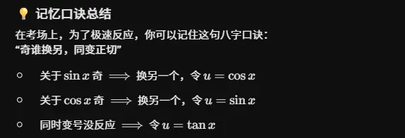

                                                                                                                                                                        # 常规方法  
第一种也叫万能方法  

![[assets/三角有理式积分/file-20260524164025324.webp]]

这三条法则是考研和高数中极其强大的“奇偶性探测器”。它们背后的核心逻辑是：探测被积函数中谁是“落单的（奇数次）”或者“整体同次的”，从而精准地抽出对应的微分 $d(\cos x)$、$d(\sin x)$ 或 $d(\tan x)$，把复杂的三角函数降维成纯代数的有理函数积分。

为了让你体会这三条法则在面对考研级别难题时的“摧枯拉朽”之势，我为你精心挑选了三个极具代表性的综合型复杂例子：

### ① 法则一：令 $u = \cos x$

**判定标准：** $R(-\sin x, \cos x) = -R(\sin x, \cos x)$ （即关于 $\sin x$ 是奇函数）

**【实战例题】** 求不定积分：

$$\int \frac{\sin^3 x}{1 + \cos x + \cos^2 x} dx$$

- **第一步：法则验证**
    
    把式子里的 $\sin x$ 换成 $-\sin x$，分子变成 $(-\sin x)^3 = -\sin^3 x$，分母不变。整体多了一个负号，完美符合法则 ①！
    
- **第二步：凑微分与换元**
    
    既然关于 $\sin x$ 是奇函数，说明必定能剥离出一个单身的 $\sin x$ 去凑微分：$d(\cos x) = -\sin x dx$。
    
    $$\int \frac{\sin^2 x}{1 + \cos x + \cos^2 x} (\sin x dx) = -\int \frac{1 - \cos^2 x}{1 + \cos x + \cos^2 x} d(\cos x)$$
    
    此时，令 $u = \cos x$，彻底转化为代数积分：
    
    $$-\int \frac{1 - u^2}{u^2 + u + 1} du = \int \frac{u^2 - 1}{u^2 + u + 1} du$$
    
- **第三步：有理函数积分（多项式除法与配方）**
    
    分子分母同次，先做多项式除法：$\frac{u^2 + u + 1 - u - 2}{u^2 + u + 1} = 1 - \frac{u + 2}{u^2 + u + 1}$。
    
    $$\int \left( 1 - \frac{u + 2}{u^2 + u + 1} \right) du = u - \int \frac{u + 2}{u^2 + u + 1} du$$
    
    处理后半部分，凑分母的导数 $2u+1$：
    
    $$\int \frac{u + 2}{u^2 + u + 1} du = \frac{1}{2} \int \frac{2u + 1 + 3}{u^2 + u + 1} du = \frac{1}{2} \ln(u^2 + u + 1) + \frac{3}{2} \int \frac{1}{(u + \frac{1}{2})^2 + \frac{3}{4}} du$$
    
- **第四步：得出最终结果**
    
    套用 $\arctan$ 公式并把 $u = \cos x$ 代回：
    
    $$\cos x - \frac{1}{2} \ln(\cos^2 x + \cos x + 1) - \sqrt{3} \arctan\left(\frac{2\cos x + 1}{\sqrt{3}}\right) + C$$
    

### ② 法则二：令 $u = \sin x$

**判定标准：** $R(\sin x, -\cos x) = -R(\sin x, \cos x)$ （即关于 $\cos x$ 是奇函数）

**【实战例题】** 求不定积分：

$$\int \frac{\cos^3 x}{\sin^3 x + \sin x} dx$$

- **第一步：法则验证**
    
    把 $\cos x$ 换成 $-\cos x$，分子变成 $(-\cos x)^3 = -\cos^3 x$，分母全是 $\sin x$ 不变。整体多了一个负号，完美符合法则 ②！
    
- **第二步：凑微分与换元**
    
    强行剥离出一个 $\cos x$ 去凑微分：$d(\sin x) = \cos x dx$。剩下的全变成 $\sin x$。
    
    $$\int \frac{\cos^2 x}{\sin^3 x + \sin x} (\cos x dx) = \int \frac{1 - \sin^2 x}{\sin^3 x + \sin x} d(\sin x)$$
    
    令 $u = \sin x$，转化为：
    
    $$\int \frac{1 - u^2}{u^3 + u} du = \int \frac{1 - u^2}{u(u^2 + 1)} du$$
    
- **第三步：有理函数积分（待定系数法拆项）**
    
    分母可以因式分解，我们设：
    
    $$\frac{1 - u^2}{u(u^2 + 1)} = \frac{A}{u} + \frac{Bu + C}{u^2 + 1}$$
    
    通分合并分子：$A(u^2 + 1) + u(Bu + C) = (A+B)u^2 + Cu + A$。
    
    对比原分子 $1 - u^2$，得到方程组：$A=1$, $C=0$, $A+B=-1 \implies B=-2$。
    
    所以积分被完美拆解：
    
    $$\int \left( \frac{1}{u} - \frac{2u}{u^2 + 1} \right) du = \ln|u| - \ln(u^2 + 1)$$
    
- **第四步：得出最终结果**
    
    利用对数减法合并，并代回 $u = \sin x$：
    
    $$\ln\left| \frac{\sin x}{\sin^2 x + 1} \right| + C$$
    

### ③ 法则三：令 $u = \tan x$

**判定标准：** $R(-\sin x, -\cos x) = R(\sin x, \cos x)$ （即关于 $\sin x$ 和 $\cos x$ 同步反号时，整体不变，通常暗示它们是二次齐次式）

**【实战例题】** 求不定积分：

$$\int \frac{1}{2\sin^2 x - 3\sin x \cos x + \cos^2 x} dx$$

- **第一步：法则验证**
    
    同时把 $\sin x$ 和 $\cos x$ 变成负的，所有的平方项以及乘积项 $(-\sin x)(-\cos x)$ 的负号都会互相抵消，式子完全不变。完美符合法则 ③！
    
- **第二步：提取 $\sec^2 x$ 凑微分（最精妙的一步）**
    
    这类题的核心技巧是：**分子分母同除以 $\cos^2 x$ **。分子会产生 $\sec^2 x$（正好用来凑 $d(\tan x)$），分母的 $\sin/\cos$ 全变成 $\tan x$。
    
    $$\int \frac{\frac{1}{\cos^2 x}}{2\frac{\sin^2 x}{\cos^2 x} - 3\frac{\sin x \cos x}{\cos^2 x} + 1} dx = \int \frac{\sec^2 x}{2\tan^2 x - 3\tan x + 1} dx$$
    
    令 $u = \tan x$ 且 $du = \sec^2 x dx$：
    
    $$\int \frac{1}{2u^2 - 3u + 1} du$$
    
- **第三步：有理函数积分（分式裂项）**
    
    分母因式分解：$2u^2 - 3u + 1 = (2u - 1)(u - 1)$。
    
    使用裂项法：
    
    $$\frac{1}{(2u - 1)(u - 1)} = \frac{1}{u - 1} - \frac{2}{2u - 1}$$
    
    进行积分：
    
    $$\int \left( \frac{1}{u - 1} - \frac{2}{2u - 1} \right) du = \ln|u - 1| - \ln|2u - 1|$$
    
- **第四步：得出最终结果**
    
    代回 $u = \tan x$：
    
    $$\ln\left| \frac{\tan x - 1}{2\tan x - 1} \right| + C$$

# 奇偶判断关于不同对象的不同  
这是一个非常棒的灵魂拷问！你敏锐地抓住了复合函数中“外层结构”和“内层变量”的本质区别。

直接回答你的问题：**这个函数关于 $\cos x$ 是奇函数，但关于 $x$ 并不是奇函数（它是偶函数）。**

我们来把这两层逻辑彻底拆解开：

### 1. 关于 $\cos x$ 是奇函数吗？—— **是的**

当我们说“关于 $\cos x$ 是奇函数”时，意思是把 $\cos x$ 整体看作一个独立的变量（比如令 $u = \cos x$），然后只看外层的代数结构。

- 把原式写成关于 $u$ 的函数：$g(u) = (-u)^3 = -u^3$。
    
- 现在我们用奇函数的定义来测试，把 $u$ 换成 $-u$：
    
    $$g(-u) = -(-u)^3 = -(-u^3) = u^3$$
    
- 比较一下发现：$g(-u) = -g(u)$。
    

所以，如果把 $\cos x$ 当作一个整体变量，它确实是一个奇函数。这就是为什么它完美符合我们上一节讨论的积分法则 $R(\sin x, -\cos x) = -R(\sin x, \cos x)$，因为那个法则**只检测外层的代数结构**是否会吐出一个负号。

### 2. 关于 $x$ 是奇函数吗？—— **不是，它是偶函数**

当我们说“关于 $x$ 的奇偶性”时，我们就不能再把 $\cos x$ 当作黑盒了，必须直接对最底层的自变量 $x$ 进行测试（把 $x$ 换成 $-x$）。

设原函数为 $f(x) = (-\cos x)^3 = -\cos^3 x$。

我们来测试 $f(-x)$：

$$f(-x) = -\cos^3(-x) = -[\cos(-x)]^3$$

**最关键的一步来了：**

因为 $\cos x$ 本身是一个**偶函数**，所以它会把内部的负号直接“吃掉”，即 $\cos(-x) = \cos x$。

代回原式：

$$f(-x) = -[\cos x]^3 = -\cos^3 x = f(x)$$

因为 $f(-x) = f(x)$，所以从整体来看，**这个函数关于 $x$ 是一个标准的偶函数**。它的图像关于 Y 轴完美对称。

### 💡 核心总结：复合函数的奇偶性传递

产生这种直觉冲突的原因，是因为这是一个复合函数。你可以记住一个非常实用的法则：**“内偶必偶”**。

- **外层结构：** $y = -u^3$ （奇函数）
    
- **内层函数：** $u = \cos x$ （偶函数）
    

当自变量 $x$ 变成 $-x$ 时，内层函数 $\cos x$ 作为一道“防火墙”，直接把负号抵消掉了，导致外层函数根本感觉不到 $x$ 发生了变化。所以，只要**最内层是偶函数**，不管外面套了多少层奇函数，最终的整体函数一定是**偶函数**。

# 组合积分法 
![[assets/三角有理式积分/file-20260524164025325 1.webp]] 

![[assets/三角有理式积分/file-20260524164025323.webp]]
![[assets/三角有理式积分/file-20260524164025325.webp]]  

![[assets/三角有理式积分/file-20260524164025329.webp]]

a(分母)+b(分母的导数)   根据分子系数求积分 待定系数

# 引入辅助角公式  
![[assets/三角有理式积分/file-20260524164025324 1.webp]] ![[assets/三角有理式积分/file-20260524164025326.webp]]  ![[assets/三角有理式积分/file-20260524164025327.webp]]

# 凑二倍角简化分母  
![[assets/三角有理式积分/file-20260524164025328.webp]] ![[assets/三角有理式积分/file-20260524164025327 1.webp]]  

![[assets/三角有理式积分/file-20260524164025328 1.webp]]