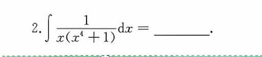

这道题 $\int \frac{1}{x(x^4+1)} dx$ 是积分中非常经典的“降维打击”题型。针对它，目前最高效的解法共有三种，核心目的都是**避开复杂的因式分解，直接凑出基本积分公式**：

### 1. 分子分母同乘 $x^3$（最推荐的通用套路）

- **核心操作**：上下同乘 $x^3$，为了强行凑出分母括号里 $x^4$ 的微分。
    
- **变形过程**：
    
    $$\int \frac{x^3}{x^4(x^4+1)} dx = \frac{1}{4} \int \frac{1}{x^4(x^4+1)} d(x^4)$$
    
- **收尾**：把 $x^4$ 视作一个整体（隐式换元），直接使用基础裂项 $\frac{1}{x^4} - \frac{1}{x^4+1}$，转化为两个 $\ln$ 的积分。
    

### 2. 分子“无中生有”（代数直觉法）

- **核心操作**：利用分母现有的结构，把分子上的常数 $1$ 巧妙地改写为 $(x^4+1) - x^4$。
    
- **变形过程**：
    
    $$\int \frac{(x^4+1) - x^4}{x(x^4+1)} dx = \int \left(\frac{1}{x} - \frac{x^3}{x^4+1}\right) dx$$
    
- **收尾**：原式被瞬间劈成两半，第一项直接积出 $\ln|x|$，第二项通过凑 $d(x^4)$ 同样积出 $\ln$。
    

### 3. 倒代换（专门克制高次分母）

- **核心操作**：针对分母 $x$ 的高次幂，直接令 $x = \frac{1}{t}$，利用 $dx = -\frac{1}{t^2} dt$ 把高次项翻转到分子上。
    
- **变形过程**：
    
    $$\int \frac{1}{\frac{1}{t} \left( \frac{1}{t^4} + 1 \right)} \left( -\frac{1}{t^2} \right) dt$$
    
    繁分式化简后，极度舒适地变成了：$-\int \frac{t^3}{1+t^4} dt$
    
- **收尾**：分子恰好是分母求导的一部分，直接凑微分 $-\frac{1}{4} \int \frac{1}{1+t^4} d(t^4)$，算出结果后再把 $t = \frac{1}{x}$ 代回去。
    

**最终结论：**

以后只要遇到形如 $\int \frac{1}{x(x^n \pm a)} dx$ 的通用结构，**解法 1（同乘 $x^{n-1}$）** 和 **解法 3（倒代换）** 是绝对的通解。掌握这两个套路，这类题型在考场上就是纯粹的送分题。