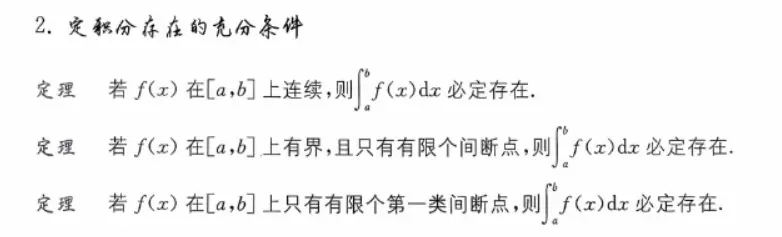
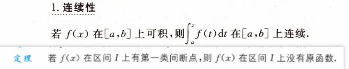

# 不定积分 

  

# 定积分
  

  

变上限积分函数是被积函数的原函数吗

这个问题的答案是：**不一定。这完全取决于被积函数是否连续。**

变上限积分函数 Φ(x)=∫ax​f(t)dt 与原函数 F(x) 之间有着密切的联系，但它们在数学定义上并不能完全划等号。我们可以分两种情况来看：

### 1. 当被积函数 f(x) 连续时：**是**

根据**微积分基本定理**，如果函数 f(x) 在某区间上连续，那么它的变上限积分函数 Φ(x)=∫ax​f(t)dt 在该区间内不仅处处可导，而且其导数恰好等于被积函数本身，即：

Φ′(x)=f(x)

此时，变上限积分函数 Φ(x) 就是被积函数 f(x) 的一个**原函数**。更准确地说，它是无穷多个原函数家族中，刚好满足在起点处值为零（即 Φ(a)=0）的那一个特例。

### 2. 当被积函数 f(x) 不连续时：**不是**

如果 f(x) 含有间断点（例如跳跃间断点或可去间断点），情况就截然不同了。

- **积分存在且必定连续：** 只要 f(x) 满足可积条件（比如在区间内有界且只有有限个第一类间断点），它的变上限积分 Φ(x) 依然是存在的，并且 Φ(x) 自身一定是一条**连续**的曲线。
    
- **在间断点处不可导：** 在 f(x) 发生跳跃或断开的那个点上，变上限积分函数 Φ(x) 虽然连在一起，**但往往会出现“尖角”，这意味着它在该点不可导。**
    
- **结论：** 既然 Φ(x) 无法做到在区间内处处可导且导数处处等于 f(x)，它自然就不符合原函数的严格定义。
    

> **核心总结：**
> 
> - 只有**连续函数**的变上限积分，才是它的原函数。
>     
> - 含有**第一类间断点**的函数，可以求变上限积分（积分算得出来面积），但这种函数**绝对不存在原函数**（受限于导数介值定理/达布定理）。
>     

因此，变上限积分函数是一个代表“面积累积”的几何概念，门槛较低；而原函数是一个代表“反向求导”的分析概念，门槛极高（要求处处平滑可导）。只有当被积函数处处连续时，这两者才会完美重合。  
