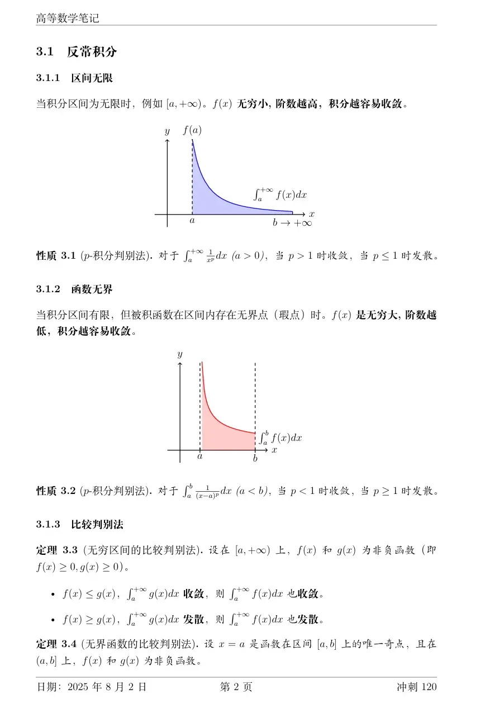
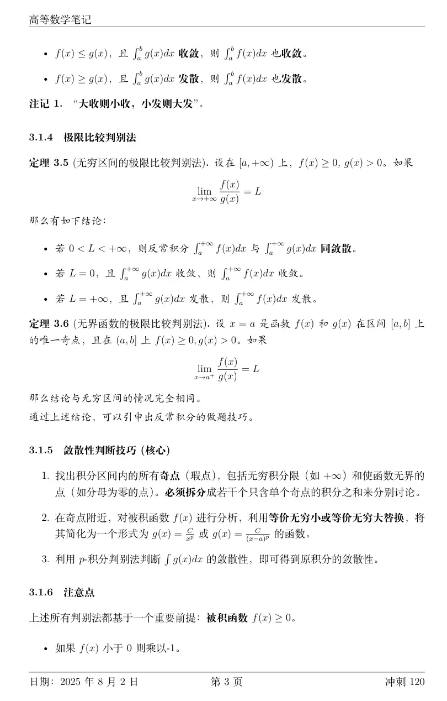
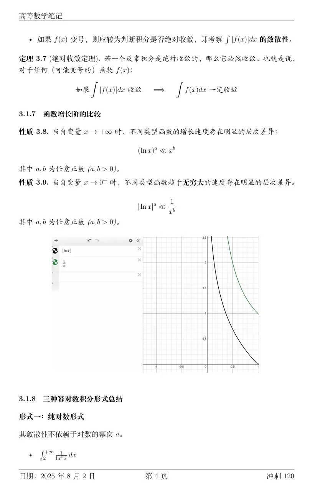
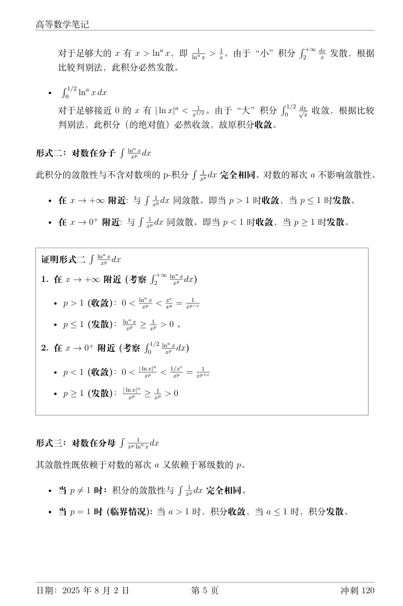
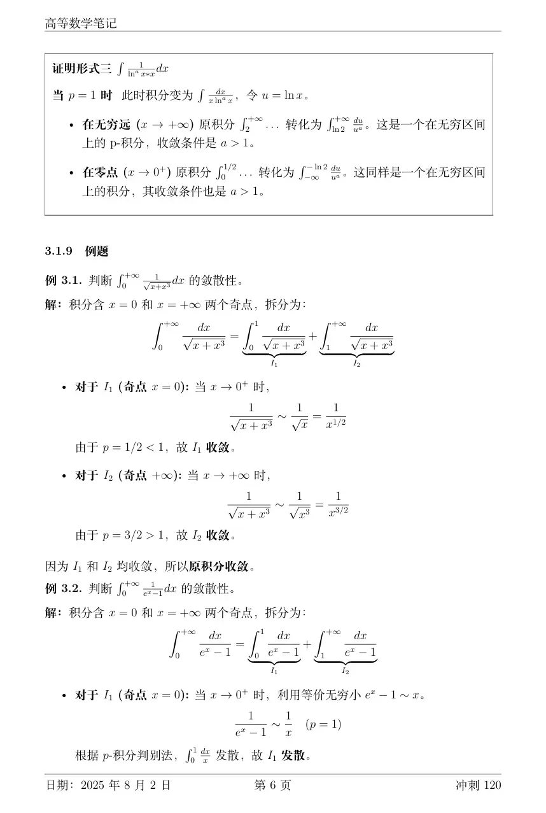
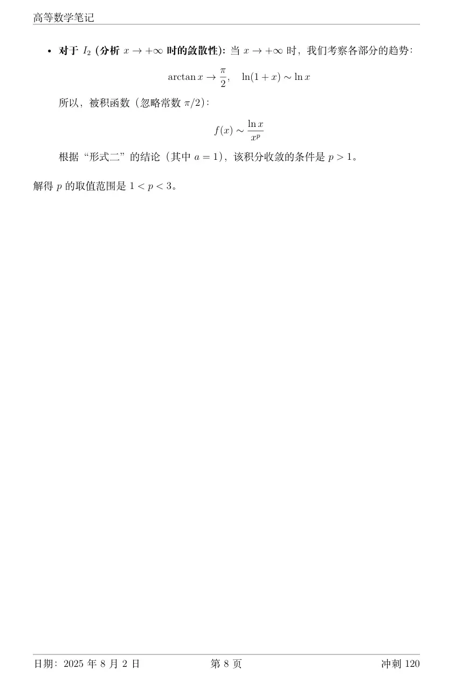

https://www.bilibili.com/video/BV1sr4y1Q7Np?spm_id_from=333.788.videopod.sections&vd_source=00e9babc4deca9e64ec25dd54e7bfe0c&p=2

  
  
    

  

简单来说：**对于趋于 $+\infty$ 的积分，结论完全不变；对于趋于 $0$ 的积分，结论会发生改变。**

下面为您详细拆解原因：

### 1. 针对左侧：无穷区间的反常积分（积分上限为 $+\infty$）

**结论：完全不变。**

**原因分析：**

判定这类积分的敛散性，核心是看当 $x \to +\infty$ 时，被积函数的衰减速度。

当 $x \to +\infty$ 时，常数 $n$ 的影响微乎其微（即等价无穷大）：

- $(x+n)^p \sim x^p$
    
- $\ln(x+n) = \ln\left[x\left(1+\frac{n}{x}\right)\right] = \ln x + \ln\left(1+\frac{n}{x}\right) \sim \ln x$
    

因此，被积函数 $\frac{1}{(x+n)^p \ln^a(x+n)}$ 在 $x \to +\infty$ 时的渐近行为与 $\frac{1}{x^p \ln^a x}$ **完全一样**。只要下限取值避开了瑕点（例如 $x+n > 1$），它的敛散性规律与图片中左侧的结论完全一致。

**举个例子：**

判定 $\int_{2}^{+\infty} \frac{1}{(x+3) \ln^2(x+3)} dx$ 的敛散性。

这里 $p=1, a=2$。根据第三组的规则（当 $p=1$ 且 $a>1$ 时收敛），该积分**收敛**。结论依然适用。

### 2. 针对右侧：瑕积分（积分区间为 $(0, \frac{1}{2}]$）

**结论：会发生改变（甚至可能不再是反常积分）。**

**原因分析：**

右侧积分的特殊性在于 ** $x=0$ 是瑕点**（即分母在这个点趋于 $0$，导致函数值趋于无穷）。

如果你把 $x$ 换成 $(x+n)$，积分区间保持 $(0, \frac{1}{2}]$ 不变，那么瑕点的位置就被移动了，这会彻底改变积分的性质。我们分情况来看（假设 $n$ 为整数）：

- **情况 A：当 $n \ge 2$ 时（例如 $n=2$）**
    
    积分变成 $\int_{0}^{\frac{1}{2}} \frac{1}{(x+2)^p \ln^a(x+2)} dx$。
    
    此时，当 $x \in (0, \frac{1}{2}]$ 时，分母最小也是 $2^p \ln^a 2$，**根本不会趋于 0**。被积函数在这个区间内是连续的，它变成了一个普通的定积分，**必定收敛**。原有的敛散性规则失效。
    
- **情况 B：当 $n = 1$ 时**
    
    积分变成 $\int_{0}^{\frac{1}{2}} \frac{1}{(x+1)^p \ln^a(x+1)} dx$。
    
    当 $x \to 0$ 时，$(x+1)^p \to 1$。而根据等价无穷小，$\ln(x+1) \sim x$。
    
    所以，被积函数在 $x \to 0$ 时等价于 $\frac{1}{1 \cdot x^a} = \frac{1}{x^a}$。
    
    此时，**敛散性仅仅取决于 $a$ **（$a<1$ 收敛，$a \ge 1$ 发散），而与 $p$ 毫无关系！这与图片中的规则完全不同。
    
- **情况 C：当 $n \le -1$ 时（例如 $n=-1$）**
    
    积分变成 $\int_{0}^{\frac{1}{2}} \frac{1}{(x-1)^p \ln^a(x-1)} dx$。
    
    因为 $x \in (0, \frac{1}{2}]$，$(x-1)$ 是负数，对数函数 $\ln(x-1)$ 在实数范围内**无意义**。
    

**总结提示：**

在考研或高等数学做题时，如果你遇到的是**趋于无穷大**的极限或积分，常数加减可以直接忽略，直接套用图片上的 $p, a$ 判别法即可；但如果是**瑕积分**，一定要先找到真正的“瑕点”在哪里（让括号里趋于 $0$ 或 $1$ 的那个 $x$ 值），通过等价无穷小替换后再进行判断，不能生搬硬套公式。  

  

**无论常数 $p$ 和 $a$ 取任何实数值，该反常积分 $\int_0^{+\infty} \frac{1}{x^p \ln^a x} dx$ 在 $(0, +\infty)$ 上恒发散。**

  

要证明这个结论，我们需要对区间进行“全身体检”。这个积分不仅区间无限，内部还藏着多个“瑕点”（导致分母为 0 的点）。具体来说，它在 $x=0$、$x=1$（因为 $\ln 1 = 0$）以及 $x \to +\infty$ 处都存在奇点。

  

为了让整体积分收敛，**必须将其拆分为四段，且每一段都必须同时收敛：**

  

$$\int_0^{+\infty} = \int_0^{1/2} + \int_{1/2}^1 + \int_1^2 + \int_2^{+\infty}$$

只要其中任意一段发散，整体即判为发散。我们逐个击破：

  

### 第一关：无穷远端点 $x \to +\infty$ （区间 $[2, +\infty)$）

这是大名鼎鼎的 **Bertrand 积分（伯特兰积分）** 形式。

对于 $\int_2^{+\infty} \frac{1}{x^p \ln^a x} dx$：

  

- 当 ** $p > 1$ ** 时，无论 $a$ 取何值均收敛（因为 $x^p$ 占据绝对主导地位）。
    
      
    
- 当 ** $p = 1$ ** 时，退化为 $\int_2^{+\infty} \frac{1}{x \ln^a x} dx = \int_{\ln 2}^{+\infty} \frac{1}{u^a} du$，必须要求 ** $a > 1$ ** 才能收敛。
    
      
    
- 当 $p < 1$ 时，恒发散。
    
      
    

**第一关通过条件：** $p > 1$，或者 ($p = 1$ 且 $a > 1$)。

  

### 第二关：零点瑕点 $x \to 0^+$ （区间 $(0, 1/2]$）

我们对 $\int_0^{1/2} \frac{1}{x^p \vert{}\ln x\vert{}^a} dx$ 进行换元，令 $x = \frac{1}{t}$，则 $dx = -\frac{1}{t^2} dt$，且当 $x \to 0^+$ 时，$t \to +\infty$。

代入后积分变为：

  

$$\int_2^{+\infty} \frac{1}{(1/t)^p (\ln t)^a} \frac{1}{t^2} dt = \int_2^{+\infty} \frac{1}{t^{2-p} \ln^a t} dt$$

这再次变成了 Bertrand 积分！只不过 $x$ 的幂次变成了 $(2-p)$。

同理套用结论：

  

- 需要 $2 - p > 1$，即 ** $p < 1$ ** 才能收敛。
    
      
    
- 如果 $2 - p = 1$，即 ** $p = 1$ **，则需要 ** $a > 1$ ** 才能收敛。
    
      
    

**第二关通过条件：** $p < 1$，或者 ($p = 1$ 且 $a > 1$)。

  

### 发现矛盾（绝杀）

我们把第一关和第二关的条件放在一起看：

  

- $+\infty$ 端要求 $p \ge 1$
    
      
    
- $0^+$ 端要求 $p \le 1$
    
      
    

要让首尾两端**同时收敛**，唯一的交集希望只剩下：** $p = 1$ 且 $a > 1$ **。

那么，这最后的希望成立吗？我们来看中间的瑕点。

  

### 第三关：中间瑕点 $x = 1$ （区间 $[1/2, 1)$ 或 $(1, 2]$）

把唯一的希望 $p=1, a>1$ 代入被积函数。

当 $x \to 1$ 时，利用等价无穷小替换：令 $x = 1+t$ (此时 $t \to 0$)。

  

$$\ln x = \ln(1+t) \sim t$$

所以被积函数在 $x=1$ 附近的表现等价于：

  

$$\frac{1}{x \ln^a x} \sim \frac{1}{1 \cdot t^a} = \frac{1}{t^a}$$

根据瑕积分的 $p$-判别法，要使 $\int_{1/2}^1 \frac{1}{t^a} dt$ 收敛，**必须满足 $a < 1$ **。

  

### 最终结论

我们刚才得出，为了保住两头收敛，必须要求 ** $a > 1$ **；但这直接导致在 $x=1$ 处必定发散（因为瑕点收敛需要 ** $a < 1$ **）。

常数 $a$ 不可能既大于 1 又小于 1，矛盾彻底爆发。因此，这三头“神兽”（0, 1, $+\infty$）不可能同时被满足，**该积分在 $(0, +\infty)$ 上永远发散。**