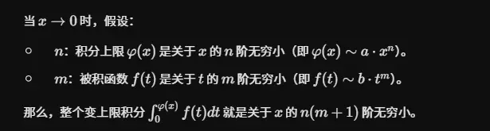
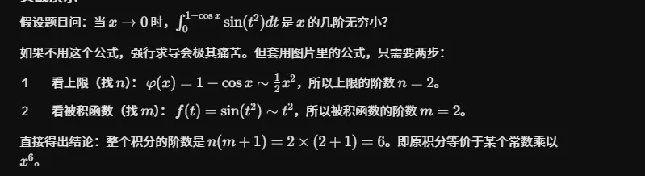
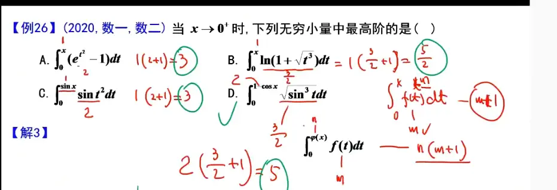
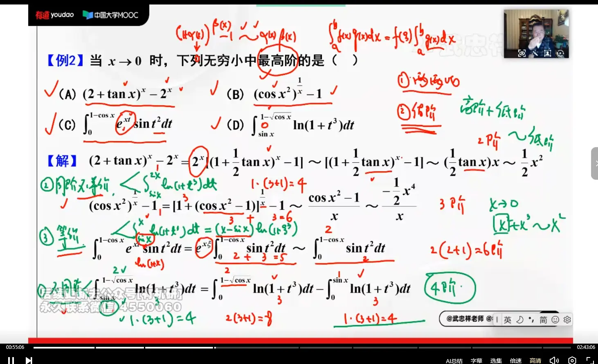

  

  

、  

没问题，为了让这个知识点成为你考研后期冲刺的“即插即用”模块，我为你补充了完整的前提条件、做题步骤以及这张极简表格。你可以直接截图或抄写到你的核心笔记上。

### 变限积分求无穷小阶数核心总结

**【基本设定】**

当 $x \to 0$ 时，研究变限积分 $F(x) = \int_{v(x)}^{u(x)} f(t) dt$ 的无穷小阶数。

- **第一步（看被积函数）**：确定被积函数 $f(t)$ 的阶数。假设当 $t \to 0$ 时，$f(t) \sim a \cdot t^m$（即被积函数为 ** $m$ 阶**无穷小）。
    
- **第二步（看积分上下限）**：确定积分上限 $u(x)$ 和下限 $v(x)$ 的阶数及其关系，对照下表直接出结果。
    

**【核心速记表】**

| **积分限关系类型** | **具体判定条件**                       | **变限积分整体阶数**                    | **核心应对原理**                   |
| ----------- | -------------------------------- | ------------------------------- | ---------------------------- |
| **同阶但不等价**  | $O(u)=O(v)=k,u\nsim{v}$          | ** $k(m+1)$ **                  | 正常计算，不会产生抵消。                 |
| **等价**      | $u\sim{v}$                       | ** $O(u-v)+m$ **                | 上下限相近产生抵消，需使用**积分中值定理**化简。   |
| **不同阶**     | $O(u)=k_1,O(v)=k_2,k_1\neq{k_2}$ | ** $\min(k_1(m+1),k_2(m+1))$ ** | 拆分成两个由 $0$ 开始的积分，**低阶吸收高阶**。 |
|             |                                  |                                 |                              |

**【考场实战避坑指南】**

1. **被积函数的陷阱**：被积函数 $f(t)$ 必须在 $t \to 0$ 时有等价无穷小。如果 $f(t)$ 包含形如 $1+t$ 这种极限不为 $0$ 的部分，必须先把它单独拆开处理，不能直接盲目套用 $m$。
    
2. **上下限等价的二次判定**：遇到 $u \sim v$ 时，不要光顾着背公式，一定要先算一下 $u-v$ 到底是多少阶。如果 $u-v = 0$（上下限完全一样），那积分直接就是 $0$ 了。
    
3. **不同阶的“谁小听谁”**：不同阶的情况最简单，它本质上就是多项式极限里的“抓小”，算出来哪边的阶数小，整个积分的阶数就是多少。