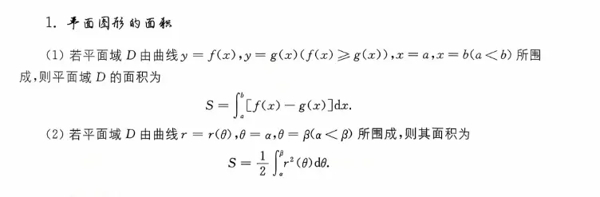
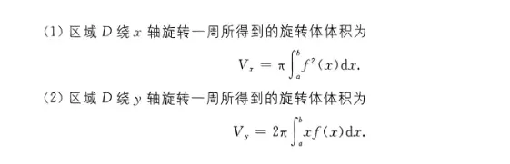
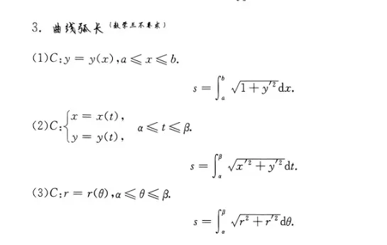
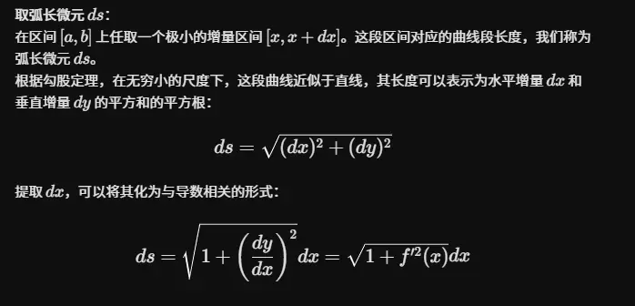
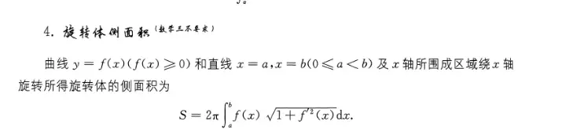

# 平面图形  
[9二重积分](../../9二重积分/9二重积分.md)

利用二重积分推导平面图形的面积，核心的思想是“面积等于被积函数为 $1$ 的二重积分”。

设平面区域为 $D$，其面积为 $S$，面积微元为 $d\sigma$，那么通用的面积公式为：

$$S = \iint_D 1 \,d\sigma$$

下面我们分别在直角坐标系和极坐标系 下，利用这个基本公式来推导图片中的两个结论。
 
### 1. 直角坐标系下的推导（公式 1）                                                                                                           

**已知条件：**

平面区域 $D$ 由曲线 $y = f(x)$（上边界），$y = g(x)$（下边界），以及直线 $x = a$，$x = b$ ($a < b$) 所围成。且在该区间内 $f(x) \ge g(x)$。

**推导过程：**

1. 在直角坐标系中，面积微元为 $d\sigma = dx dy$。
    
2. 根据区域 $D$ 的特征（这是一个典型的 X 型区域），我们可以将其表示为不等式组：
    
    $$a \le x \le b$$
    
    $$g(x) \le y \le f(x)$$
    
3. 将二重积分化为先对 $y$ 积分，再对 $x$ 积分的二次积分：
    
    $$S = \iint_D dx dy = \int_a^b \left( \int_{g(x)}^{f(x)} 1 \,dy \right) dx$$
    
4. 先计算括号内关于 $y$ 的定积分：
    
    $$\int_{g(x)}^{f(x)} 1 \,dy = y \Big|_{g(x)}^{f(x)} = f(x) - g(x)$$
    
5. 将结果代回外层关于 $x$ 的积分中，即可得到定积分形式的面积公式：
    
    $$S = \int_a^b [f(x) - g(x)] dx$$
    

这正是图片中的第一个公式。

### 2. 极坐标系下的推导（公式 2）

**已知条件：**

平面区域 $D$ 由极坐标曲线 $r = r(\theta)$，以及射线 $\theta = \alpha$, $\theta = \beta$ ($\alpha < \beta$) 所围成。

**推导过程：**

1. 在极坐标系中，由于坐标变换 $x = r \cos\theta, y = r \sin\theta$ 所产生的雅可比行列式（Jacobian）为 $r$，因此面积微元变为 $d\sigma = r \,dr \,d\theta$。
    
2. 根据区域 $D$ 的特征，我们可以将其表示为极坐标下的不等式组：
    
    $$\alpha \le \theta \le \beta$$
    
    $$0 \le r \le r(\theta)$$
    
3. 将二重积分化为先对 $r$ 积分，再对 $\theta$ 积分的二次积分：
    
    $$S = \iint_D r \,dr \,d\theta = \int_\alpha^\beta \left( \int_0^{r(\theta)} r \,dr \right) d\theta$$
    
4. 先计算括号内关于 $r$ 的定积分：
    
    $$\int_0^{r(\theta)} r \,dr = \frac{1}{2} r^2 \Big|_0^{r(\theta)} = \frac{1}{2} r^2(\theta) - 0 = \frac{1}{2} r^2(\theta)$$
    
5. 将结果代回外层关于 $\theta$ 的积分中，即可得到极坐标下的面积公式：
    
    $$S = \int_\alpha^\beta \frac{1}{2} r^2(\theta) d\theta = \frac{1}{2} \int_\alpha^\beta r^2(\theta) d\theta$$
    

这正是图片中的第二个公式。

**总结：**

定积分求面积的公式，本质上就是二重积分在不同坐标系下（直角坐标和极坐标）化为累次积分后，**完成内层积分运算后**所留下的外层积分表达式。

# 旋转体体积

这两个体积公式通常使用高等数学中的“微元法”（也称元素法）来推导。

为了推导这两个公式，我们首先明确一个基础的几何设定：假设平面区域 $D$ 是由连续曲线 $y = f(x)$（且 $f(x) \ge 0$）、直线 $x = a$、$x = b$ ($a < b$) 以及 $x$ 轴（$y = 0$）所围成的曲边梯形。

在区间 $[a, b]$ 内任取一个极小的增量区间 $[x, x + dx]$，该区间对应的面积微元可以看作是一个底边宽为 $dx$、高为 $f(x)$ 的细长矩形。我们将考察这个**细长矩形**在绕不同坐标轴旋转时所形成的**体积微元 $dV$ **。

### 1. 绕 $x$ 轴旋转：圆盘法 (Disk Method)

当区域 $D$ 绕 $x$ 轴旋转时，我们观察那个宽为 $dx$、高为 $f(x)$ 的细长矩形。

**推导过程：**

1. **确定旋转体的形状**：这个细长矩形绕 $x$ 轴旋转一周后，会形成一个极薄的**圆盘（或称薄圆柱体）**。
    
2. **计算体积微元 $dV_x$ ：
    
    - 该圆盘的半径就是矩形的高度，即 $r = f(x)$。
        
    - 该圆盘的厚度（高）就是区间宽度，即 $h = dx$。
        
    - 根据圆柱体体积公式 $V = \pi r^2 h$，可以得出这个薄圆盘的体积微元为：
        
        $$dV_x = \pi [f(x)]^2 dx$$
        
3. **积分求总体积**：将所有的体积微元在整个区间 $[a, b]$ 上进行无限累加（即积分），即可得到总的旋转体体积：
    
    $$V_x = \int_a^b dV_x = \int_a^b \pi f^2(x) dx$$
    

将常数 $\pi$ 提取到积分号外，即得到公式（1）：

$$V_x = \pi \int_a^b f^2(x) dx$$

### 2. 绕 $y$ 轴旋转：柱壳法 (Cylindrical Shell Method)

当区域 $D$ 绕 $y$ 轴旋转时，情况会有所不同。我们继续观察那个位于坐标 $x$ 处，宽为 $dx$、高为 $f(x)$ 的细长矩形。

**推导过程：**

1. **确定旋转体的形状**：这个细长矩形绕 $y$ 轴旋转一周后，并不会形成实心的圆盘，而是会形成一个空心的、极薄的**圆柱壳（Cylindrical Shell）**。
    
2. **计算体积微元 $dV_y$ **：为了求这个极薄柱壳的体积，我们可以想象用剪刀将其沿母线剪开并展开。因为它的厚度 $dx$ 极小，展开后它近似于一个长方体薄片：
    
    - 该薄片的**长**等于柱壳的底面周长。因为矩形到 $y$ 轴的距离为 $x$，所以旋转半径为 $x$，周长为 $2\pi x$。
        
    - 该薄片的**宽**（高度）等于矩形的高度，即 $f(x)$。
        
    - 该薄片的**厚度**等于矩形的宽度，即 $dx$。
        
    - 因此，这个圆柱壳的体积微元近似于长方体体积（长 $\times$ 宽 $\times$ 高）：
        
        $$dV_y = 2\pi x \cdot f(x) \cdot dx$$
        
3. **积分求总体积**：将所有这些嵌套在一起的薄圆柱壳体积在区间 $[a, b]$ 上进行积分累加，即可得到总体积：
    
    $$V_y = \int_a^b dV_y = \int_a^b 2\pi x f(x) dx$$
    

将常数 $2\pi$ 提取到积分号外，即得到公式（2）：

$$V_y = 2\pi \int_a^b xf(x) dx$$

### 通用二重积分方法

将旋转轴从坐标轴推广到**任意直线**，是积分求体积中非常经典且更具普适性的问题。

无论是“圆环法”还是“柱壳法”，其核心思想依然是**微元法**。我们可以用**二重积分**给出一个最通用的公式，然后再分别推导在实际做题中最常见的**水平直线**和**垂直直线**这两种特殊情况。

### 1. 最通用情况：绕任意斜直线 $Ax + By + C = 0$ 旋转

假设平面区域 $D$ 不与直线 $L: Ax + By + C = 0$ 相交（或者直线只在区域的边界上），我们要计算区域 $D$ 绕直线 $L$ 旋转一周所得的体积。
                                        
**推导过程（二重积分微元法）：**

1. **取面积微元**：在区域 $D$ 内任取一点 $(x, y)$，构造一个无穷小的面积微元 $d\sigma = dx dy$。
    
2. **确定旋转半径**：当这个面积微元绕直线 $L$ 旋转时，它走过的轨迹是一个圆环。这个圆环的半径 $r(x, y)$，正是点 $(x, y)$ 到直线 $L$ 的垂直距离。根据点到直线的距离公式：
    
    $$r(x, y) = \frac{|Ax + By + C|}{\sqrt{A^2 + B^2}}$$
    
1. **计算体积微元 $dV$ **：根据古尔丁定理（Pappus's Centroid Theorem）的微观形式，这个面积微元旋转一周扫过的体积，等于“面积 $\times$ 其形心走过的周长”：
    
    $$dV = 2\pi \cdot r(x, y) \cdot d\sigma = 2\pi \frac{|Ax + By + C|}{\sqrt{A^2 + B^2}} \,dx\,dy$$
    
2. **积分求总体积**：将所有体积微元在区域 $D$ 上进行二重积分：
    
    $$V = \iint_D 2\pi \frac{|Ax + By + C|}{\sqrt{A^2 + B^2}} \,dx\,dy$$
    

这是最本质、最底层的公式。但在实际计算中，我们遇到最多的往往是绕平行于坐标轴的直线旋转。我们可以把这个通用思想降维成定积分。

这是一个非常棒的数学思维训练！其实，高等数学中的**圆环法（垫圈法）**和**柱壳法**，本质上都只是**二重积分微元法**在特定坐标轴下的“降维”特例。

  

下面我们就从最通用的第一种方法（二重积分）出发，严谨地推导出后面两种一元定积分的公式。

  

### 一、 由“二重积分法”推导“绕水平直线 $y = k$ 旋转（对应一元积分圆环法）”

**1. 确定直线方程与参数**

你要绕的直线是 $L: y = k$，写成标准的一般式方程为：

  

$$0\cdot x + 1\cdot y - k = 0$$

由此可知，$A = 0, B = 1, C = -k$。

  

**2. 代入二重积分的距离公式**

将 $A, B, C$ 代入点到直线的距离公式：

  

$$r(x, y) = \frac{\vert{}0\cdot x + 1\cdot y - k\vert{}}{\sqrt{0^2 + 1^2}} = \vert{}y - k\vert{}$$

因为假设区域 $D$ 在直线 $y = k$ 的上方，即 $y \ge k$，所以绝对值可以直接去掉：$r(x, y) = y - k$。

  

**3. 建立二重积分**

代入第一种方法的二重积分体积公式：

  

$$V = \iint_D 2\pi \cdot r(x, y) \,dxdy = \iint_D 2\pi (y - k) \,dxdy$$

**4. 降维化为累次积分（核心步骤）**

积分区域 $D$ 是由 $y = f(x)$、$y = g(x)$、$x = a$、$x = b$ 围成的 $X$ 型区域。我们先对 $y$ 积分，后对 $x$ 积分：

  

$$V = \int_a^b dx \int_{g(x)}^{f(x)} 2\pi (y - k) dy$$

**5. 计算内层积分**

现在我们只看内层关于 $y$ 的定积分：

  

$$\int_{g(x)}^{f(x)} 2\pi (y - k) dy = 2\pi \left[ \frac{1}{2}(y - k)^2 \right]_{g(x)}^{f(x)}$$

$$= \pi \left[ (f(x) - k)^2 - (g(x) - k)^2 \right]$$

**6. 得出最终公式**

将内层积分的结果代回外层积分，就得到了**推广的圆环法公式**：

  

$$V = \pi \int_a^b \left[ (f(x) - k)^2 - (g(x) - k)^2 \right] dx$$

**推导成功！**

  

### 二、 由“二重积分法”推导“绕垂直直线 $x = h$ 旋转（也可以用一元积分的柱壳法）”

**1. 确定直线方程与参数**

你要绕的直线是 $L: x = h$，写成标准的一般式方程为：

  

$$1\cdot x + 0\cdot y - h = 0$$

由此可知，$A = 1, B = 0, C = -h$。

  

**2. 代入二重积分的距离公式**

将 $A, B, C$ 代入点到直线的距离公式：

  

$$r(x, y) = \frac{\vert{}1\cdot x + 0\cdot y - h\vert{}}{\sqrt{1^2 + 0^2}} = \vert{}x - h\vert{}$$

因为假设区域 $D$ 在直线 $x = h$ 的右侧，即 $x \ge h$，所以绝对值可以直接去掉：$r(x, y) = x - h$。

  

**3. 建立二重积分**

代入第一种方法的二重积分体积公式：

  

$$V = \iint_D 2\pi \cdot r(x, y) \,dxdy = \iint_D 2\pi (x - h) \,dxdy$$

**4. 降维化为累次积分（核心步骤）**

依然将区域 $D$ 看作 $X$ 型区域（即边界为 $y = f(x)$ 和 $y = g(x)$）。为了得到关于 $dx$ 的积分，我们同样先对 $y$ 积分，后对 $x$ 积分：

  

$$V = \int_a^b dx \int_{g(x)}^{f(x)} 2\pi (x - h) dy$$

**5. 计算内层积分**

注意，内层积分是关于 $y$ 的！此时 $2\pi(x - h)$ 中完全没有 $y$，它可以被看作**常数**直接提到积分号外面：

  

$$\int_{g(x)}^{f(x)} 2\pi (x - h) dy = 2\pi (x - h) \int_{g(x)}^{f(x)} 1 \,dy$$

$$= 2\pi (x - h) \left[ y \right]_{g(x)}^{f(x)} = 2\pi (x - h) [f(x) - g(x)]$$

**6. 得出最终公式**

将内层积分的结果代回外层积分，就得到了**推广的柱壳法公式**：

  

$$V = \int_a^b 2\pi (x - h) [f(x) - g(x)] dx$$

**推导成功！**

  

### 总结体会

通过上述推导，你会发现：

  

- **圆环法**，本质上是二重积分先对平行于旋转轴的变量积分（内层积分算出来是一个**平方差**）。
    
      
    
- **柱壳法**，本质上是二重积分先对垂直于旋转轴的变量积分（内层积分算出来是一个**高度差**）。
    
      
    

二重积分就像是一个“上帝视角”，它告诉你只需把每个面积微元 $dxdy$ 乘以它的旋转周长 $2\pi r$。而你在做累次积分时选择“先对 $x$ 积”还是“先对 $y$ 积”，就自然而然地分化出了我们在课本上学到的柱壳法和圆环法。

# 曲线弧长  

  

# 旋转体侧面积  

这个旋转体侧面积的公式，依然是利用微积分中的“微元法”推导出来的。

与前面求体积不同的是，求“侧面积”关注的不再是区域内部的面，而是**边界曲线**在旋转过程中扫过的面积。因此，这里的核心是将曲线分割成无数个极小的**弧长微元**。

### 直角坐标系旋转体 绕 x 轴侧面积公式推导

**已知条件：**

曲线 $y = f(x)$（其中 $f(x) \ge 0$），在区间 $[a, b]$ 内绕 $x$ 轴旋转一周。

**推导过程：**

1. **取弧长微元 $ds$ **：
    
    在区间 $[a, b]$ 上任取一个极小的增量区间 $[x, x + dx]$。这段区间对应的曲线段长度，我们称为弧长微元 $ds$。
    
    根据勾股定理，在无穷小的尺度下，这段曲线近似于直线，其长度可以表示为水平增量 $dx$ 和垂直增量 $dy$ 的平方和的平方根：
    
    $$ds = \sqrt{(dx)^2 + (dy)^2}$$
    
    提取 $dx$，可以将其化为与导数相关的形式：
    
    $$ds = \sqrt{1 + \left(\frac{dy}{dx}\right)^2} dx = \sqrt{1 + f'^2(x)} dx$$
    
2. **确定侧面积微元 $dS$ **：
    
    当这段极短的曲线 $ds$ 绕 $x$ 轴旋转一周时，它扫过的一个极窄的环形曲面。由于 $ds$ 极短，这个微小的曲面可以近似看作是一个**圆台的侧面**，或者近似为一个宽度为 $ds$、半径为 $f(x)$ 的**圆环带**。
    
    - 该圆环带的**旋转半径**为该点对应的函数值，即 $r = y = f(x)$。
        
    - 该圆环带的**周长**为 $2\pi r = 2\pi f(x)$。
        
    - 该圆环带的宽度（斜高）正是弧长微元 $ds$。
        
    
    因此，这个极窄环形带的侧面积微元（周长 $\times$ 宽度）为：
    
    $$dS = 2\pi \cdot f(x) \cdot ds$$
    
1. **代入并积分求总侧面积 $S$ **：
    
    将第一步中求得的 $ds$ 代入面积微元的表达式中：
    
    $$dS = 2\pi f(x) \sqrt{1 + f'^2(x)} dx$$
    
    最后，将所有这些极窄环形带的侧面积在整个区间 $[a, b]$ 上进行积分累加，即可得到旋转体的总侧面积：
    
    $$S = \int_a^b dS = \int_a^b 2\pi f(x) \sqrt{1 + f'^2(x)} dx$$
    

将常数 $2\pi$ 提取到积分号外，就是图片中的最终公式：

$$S = 2\pi \int_a^b f(x) \sqrt{1 + f'^2(x)} dx$$

**核心易错点提示：**

在推导侧面积时，很容易犯的错误是将宽度写成 $dx$（即把面积微元写成 $2\pi f(x) dx$）。这样算出来的是一个个圆柱体侧面的拼凑，完全忽略了曲线本身的**倾斜程度**。只有使用**弧长 $ds$ **，才能真实反映曲线旋转时表面积的实际大小。  

### 直角坐标系下绕 y 轴的旋转体侧面积

**已知条件：** 曲线 $y = f(x)$，在区间 $[a, b]$ 内连续且有连续导数（假设 $0 \le a < b$，即曲线在 $y$ 轴右侧）。该曲线段绕 $y$ **轴**旋转一周。

**公式结论：**

$$S = 2\pi \int_a^b x \sqrt{1 + f'^2(x)} dx$$

 推导与理解逻辑（万能口诀法）

记住我们上一节总结的万能核心公式： $S = \int 2\pi \times (\text{旋转半径}) \times ds$

只要抓住“弧长 $ds$”和“旋转半径 $r$”这两个要素，任何轴都能轻松写出：

1. **弧长微元** $ds$ **绝对不变：** 曲线本身的长度属性是固定的，无论你把它拿去绕谁转，只要你依然用 $x$ 做积分变量，它的弧长微元就永远是：
    
    $$ds = \sqrt{1 + f'^2(x)} dx$$
2. **旋转半径** $r$ **发生改变：**
    
    - 绕 $x$ 轴转时，曲线上的点 $(x, y)$ 到 $x$ 轴的距离是纵坐标 $y$（即 $f(x)$）。
        
    - **绕** $y$ **轴转时**，曲线上的点 $(x, y)$ 到 $y$ 轴的距离变成了**横坐标** $x$。
        
    - 因此，此时的旋转半径 $r = x$。
        
3. **代入组合：** 将 $r = x$ 和 $ds$ 代入万能公式，直接得到结果：
    
    $$S = \int_a^b 2\pi \cdot x \cdot \sqrt{1 + f'^2(x)} dx$$

 考研核心易错点与拓展

**1. 积分变量的“执念”误区** 很多同学觉得：“既然是绕 $y$ 轴旋转，我就必须把原函数反解成 $x = \varphi(y)$，然后对 $y$ 积分！” **这是完全没必要的！** 如上所示，即便绕 $y$ 轴转，我们**完全可以继续对** $x$ **积分**。强行反解 $x = \varphi(y)$ 往往会陷入极其复杂的反三角函数或无理根式运算中。只有当原函数 $y=f(x)$ 极难求导或极难积分，且反解 $x=\varphi(y)$ 非常容易时，我们才会去换成对 $y$ 积分。

**2. 补充：如果真的必须对** $y$ **积分，公式是什么样的？** 如果题目给的曲线天然就是 $x = \varphi(y)$ 的形式（$y \in [c, d]$），且绕 $y$ 轴旋转。 利用同样的推导逻辑：

- 旋转半径 $r = x = \varphi(y)$
    
- 弧长微元 $ds = \sqrt{1 + \varphi'^2(y)} dy$ 公式就变成了高度对称的形式：
    
    $$S = 2\pi \int_c^d \varphi(y) \sqrt{1 + \varphi'^2(y)} dy$$

**总结对比：**

- $y=f(x)$ 绕 $x$ 轴（对 $x$ 积分）：$S = 2\pi \int_a^b \mathbf{f(x)} \sqrt{1 + f'^2(x)} dx$
    
- $y=f(x)$ 绕 $y$ 轴（对 $x$ 积分）：$S = 2\pi \int_a^b \mathbf{x} \sqrt{1 + f'^2(x)} dx$

### 极坐标系下的旋转体侧面积绕 x 轴公式推导

**已知条件：**

极坐标曲线 $r = r(\theta)$，在角度区间 $[\alpha, \beta]$ 内连续且有连续导数。假设曲线在极轴（$x$ 轴）上方（即 $r(\theta)\sin\theta \ge 0$），该曲线段绕极轴（$x$ 轴）旋转一周。

**推导过程：**

1. **取弧长微元 $ds$ ：**
    
    极坐标可以看作一种以 $\theta$ 为参数的特殊参数方程：$x = r(\theta)\cos\theta$，$y = r(\theta)\sin\theta$。
    
    根据参数方程的弧长公式推导，极坐标下的弧长微元有一个极其优美且常用的固定公式：
    
    $$ds = \sqrt{r^2(\theta) + [r'(\theta)]^2} d\theta$$
    
2. **确定侧面积微元 $dS$ ：**
    
    与直角坐标系的逻辑完全一致，这段极短的曲线 $ds$ 绕极轴（$x$ 轴）旋转一周，依然形成一个极窄的圆环带。
    
    - 该圆环带的宽度（斜高）依然是弧长微元 $ds$。
        
    - 该圆环带的**旋转半径**是曲线上该点到 $x$ 轴的垂直距离，也就是它的 $y$ 坐标。在极坐标下，这个半径为 $y = r(\theta)\sin\theta$。
        
    - 因此，这个极窄环形带的侧面积微元（周长 $\times$ 宽度）为：
        
        $$dS = 2\pi \cdot (r(\theta)\sin\theta) \cdot ds$$
        
3. **代入并积分求总侧面积 $S$ ：**
    
    将第一步求得的极坐标 $ds$ 代入面积微元表达式中：
    
    $$dS = 2\pi r(\theta)\sin\theta \sqrt{r^2(\theta) + [r'(\theta)]^2} d\theta$$
    
    最后，将所有极窄环形带在角度区间 $[\alpha, \beta]$ 上进行定积分累加，即可得到最终公式：
    
    $$S = 2\pi \int_{\alpha}^{\beta} r(\theta)\sin\theta \sqrt{r^2(\theta) + [r'(\theta)]^2} d\theta$$
    

### 考研实战补充（极易考的变体）：绕 $y$ 轴旋转

如果你理解了上面的第二步（确定侧面积微元），那么遇到**绕 $y$ 轴（即射线 $\theta = \frac{\pi}{2}$）旋转**的题目就能秒杀：

- 弧长微元 $ds$ **不变**，依然是 $\sqrt{r^2(\theta) + [r'(\theta)]^2} d\theta$（因为曲线本身的长度属性不随旋转轴改变）。
    
- 唯一改变的是**旋转半径**：此时点到 $y$ 轴的距离变成了 $x$ 坐标绝对值，即 $x = r(\theta)\cos\theta$（假设曲线在 $y$ 轴右侧，即 $x \ge 0$）。
    
- 此时公式自然就变成了：
    
    $$S = 2\pi \int_{\alpha}^{\beta} r(\theta)\cos\theta \sqrt{r^2(\theta) + [r'(\theta)]^2} d\theta$$
    

**统一记忆口诀：**

不管是直角、参数还是极坐标，侧面积公式永远是 ** $\int 2\pi \times (\text{旋转半径}) \times ds$ **。

绕谁转，半径就是另一个坐标（绕 $x$ 转半径是 $y$；绕 $y$ 转半径是 $x$）。最后只需要把“坐标”和“$ds$”翻译成当前坐标系下的长相即可！