# 物理学公式  
  
# 物理公式  
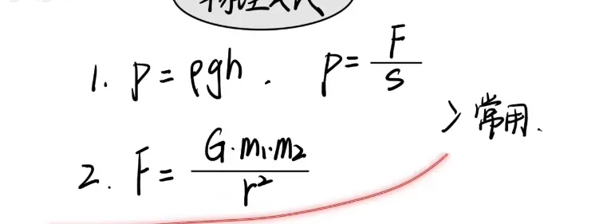  
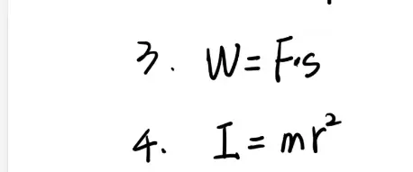  
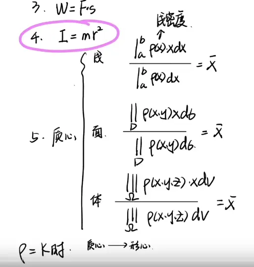  

# 例题  
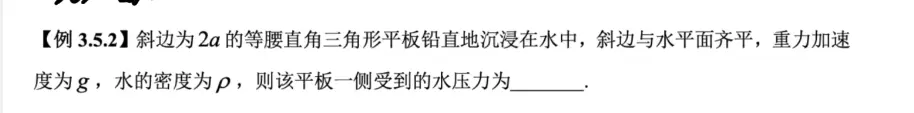
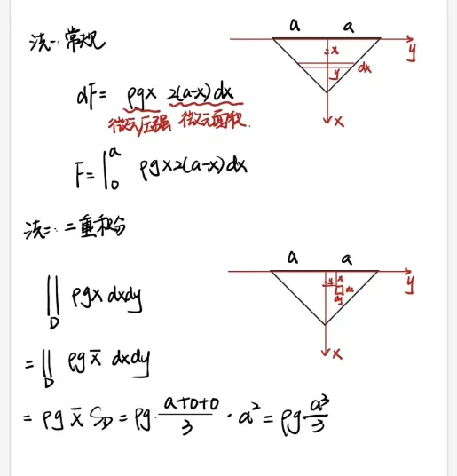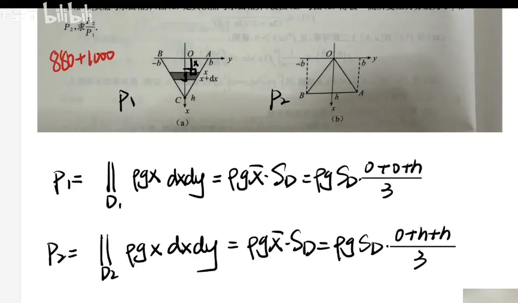  

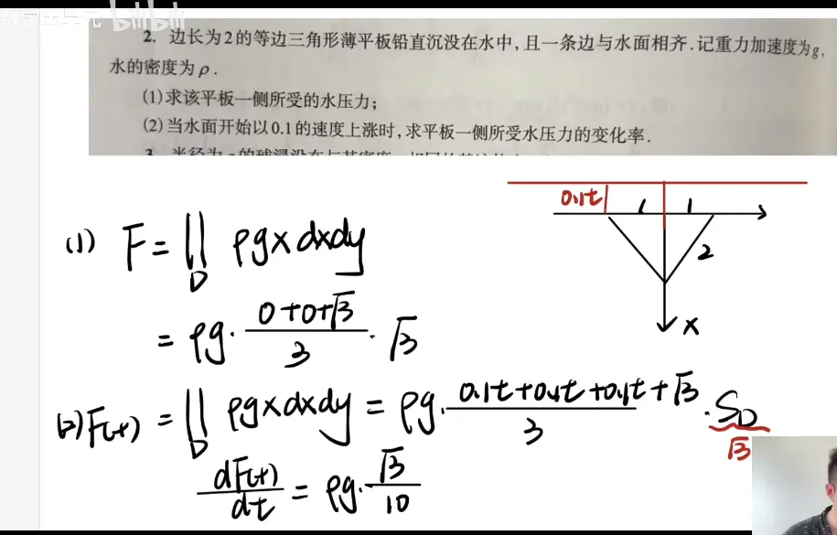  

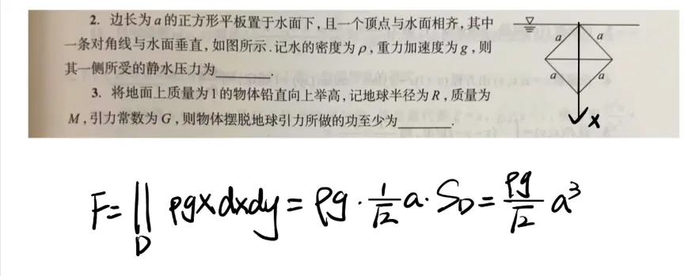  

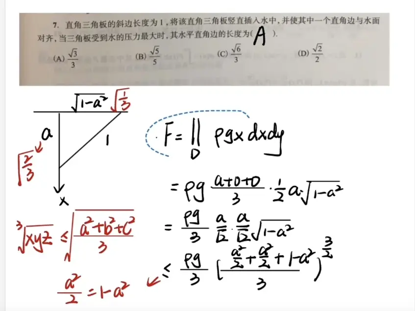  
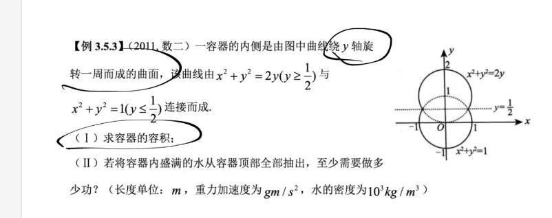

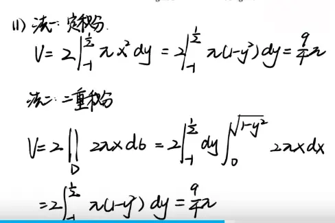

# 讲义上的题使用二重积分的做法（讲义上的是定积分）

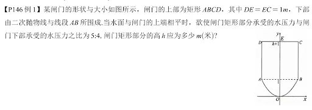

### 1. 从二重积分推导出形心公式

假设水面高度为 $H$（在本题中 $H = h + 1$），我们要计算某个区域 $D$ 受到的总压力。

区域 $D$ 内任意一点 $(x, y)$ 处的压强为 $p = \rho g \cdot (H - y)$。

用二重积分表示总压力 $F$：

$$F = \iint_D \rho g (H - y) \, dxdy$$

利用积分的线性性质，我们将式子拆开并提取常数：

$$F = \rho g \left( H \iint_D 1 \, dxdy - \iint_D y \, dxdy \right)$$

现在，见证奇迹的时刻到了。根据形心的定义，我们知道：

1. $\iint_D 1 \, dxdy = A$ （这就是区域的**面积**）
    
2. $\iint_D y \, dxdy = \bar{y} \cdot A$ （这就是计算形心纵坐标 $\bar{y}$ 的公式变形）
    

将这两个几何量代回原式：

$$F = \rho g (H \cdot A - \bar{y} \cdot A) = \rho g (H - \bar{y}) \cdot A$$

观察括号里的 $(H - \bar{y})$，这正是水面高度减去形心所在的高度，也就是**形心到水面的深度 $z_c$ **！

于是，二重积分完美退化成了我们熟知的物理公式：

$$F = \rho g \cdot z_c \cdot A$$

### 2. 用“二重积分+形心”视角秒杀这道题

现在我们用这个高级视角，重新计算题中的 $F_1$ 和 $F_2$。

#### 对于矩形部分 ($F_1$)

- **面积 $A_1$ **：宽 2，高 $h$，所以 $A_1 = 2h$。
    
- **形心纵坐标 $\bar{y}_1$ **：矩形底部在 $y=1$，顶部在 $y=h+1$，中心自然在 $\bar{y}_1 = 1 + \frac{h}{2}$。
    
- **形心深度 $z_{c1}$ **：水面 $(h+1) - (1 + \frac{h}{2}) = \frac{h}{2}$。
    
- **压力 $F_1$ **：$\rho g \cdot z_{c1} \cdot A_1 = \rho g \cdot (\frac{h}{2}) \cdot (2h) = \mathbf{\rho g h^2}$。
    
    _(这就解释了为什么前面解答 $F_1$ 时可以直接写答案)_
    

#### 对于抛物线部分 ($F_2$)

如果你记住了抛物线图形的面积和形心公式，这部分连微元法都不用写，直接默写二重积分的结果：

- **面积 $A_2$ **：抛物线 $y = x^2$ 在 $y \in [0, 1]$ 围成的面积。根据二重积分 $\iint_{D_2} dxdy = \int_0^1 2\sqrt{y} dy = \mathbf{\frac{4}{3}}$。
    
- **求 $\iint_{D_2} y \, dxdy$ **：
    
    $$\iint_{D_2} y \, dxdy = \int_0^1 y \cdot (2\sqrt{y}) dy = 2 \int_0^1 y^{\frac{3}{2}} dy = 2 \left[ \frac{2}{5}y^{\frac{5}{2}} \right]_0^1 = \mathbf{\frac{4}{5}}$$
    
    _(附带一提，此时抛物线部分的形心纵坐标就是 $\bar{y}_2 = \frac{4/5}{4/3} = \frac{3}{5}$)_
    
- **拼接压力 $F_2$ **：
    
    直接套用推导出的公式 $F_2 = \rho g \left( H \cdot A_2 - \iint_{D_2} y \, dxdy \right)$，其中水面 $H = h+1$：
    
    $$F_2 = \rho g \left( (h+1) \cdot \frac{4}{3} - \frac{4}{5} \right)$$
    
    $$F_2 = \rho g \left( \frac{4}{3}h + \frac{4}{3} - \frac{4}{5} \right) = \rho g \left( \frac{4}{3}h + \frac{8}{15} \right) = \mathbf{\frac{4}{15}\rho g(5h + 2)}$$
    

**总结**
根据题目条件，矩形部分与抛物线部分承受的水压力之比为 $5:4$：

$$\frac{F_1}{F_2} = \frac{5}{4}$$

代入前面求得的 $F_1$ 和 $F_2$（约去公因数 $\rho g$）：

$$\frac{h^2}{\frac{4}{15}(5h + 2)} = \frac{5}{4}$$

将分母移至等号右侧：

$$h^2 = \frac{5}{4} \cdot \frac{4}{15} (5h + 2)$$

$$h^2 = \frac{1}{3} (5h + 2)$$

$$3h^2 - 5h - 2 = 0$$

对该一元二次方程进行因式分解：

$$(3h + 1)(h - 2) = 0$$

解得 $h = -\frac{1}{3}$ 或 $h = 2$。由于高度不能为负数，舍去 $h = -\frac{1}{3}$。

**最终结果：闸门矩形部分的高 $h$ 应为 $2$ 米。**