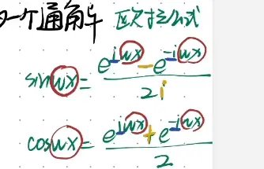

欧拉公式（Euler's formula）经常被赞誉为数学界“最美的公式”，它像是一座桥梁，极其优雅地将看似毫不相干的几个数学领域（指数函数、三角函数、复数）统一在了一起。

它的核心表达极其简洁：

$$e^{i\theta} = \cos\theta + i\sin\theta$$

当我们将 $\theta = \pi$ 代入时，就会得到那个大名鼎鼎的“上帝公式”——欧拉恒等式：

$$e^{i\pi} + 1 = 0$$

这个恒等式把数学里最重要的五个常数：$0$（加法单位元）、$1$（乘法单位元）、$e$（自然对数底数）、$\pi$（圆周率）、$i$（虚数单位）不可思议地编织在了一个等式里。

# 三角函数表示的推论（用于第二类微分方程）  

这两个公式是复变函数和信号处理中极其常用的**欧拉公式的推论**。它们的推导过程非常直接，本质上就是利用欧拉公式进行简单的代数加减。

我们在前面刚讲过欧拉公式的核心表达：

$$e^{i\theta} = \cos\theta + i\sin\theta$$

图片中的公式只是把 $\theta$ 换成了 $wx$。我们来看看具体的推导步骤：

### 第一步：列出正负角度的欧拉公式

首先，将 $\theta = wx$ 代入欧拉公式，得到**方程 (1)**：

$$e^{iwx} = \cos(wx) + i\sin(wx)$$

接着，将 $\theta = -wx$ 代入欧拉公式，得到：

$$e^{-iwx} = \cos(-wx) + i\sin(-wx)$$

根据三角函数的奇偶性，我们知道余弦函数是偶函数（$\cos(-wx) = \cos(wx)$），正弦函数是奇函数（$\sin(-wx) = -\sin(wx)$）。因此，上面的式子可以化简为**方程 (2)**：

$$e^{-iwx} = \cos(wx) - i\sin(wx)$$

### 第二步：推导 $\cos(wx)$ （两式相加）

将**方程 (1)** 和 **方程 (2)** 左右两边分别相加：

$$e^{iwx} + e^{-iwx} = [\cos(wx) + i\sin(wx)] + [\cos(wx) - i\sin(wx)]$$

等式右边的虚数部分 $+i\sin(wx)$ 和 $-i\sin(wx)$ 刚好抵消，剩下：

$$e^{iwx} + e^{-iwx} = 2\cos(wx)$$

两边同除以 $2$，就得到了图片中的第二个公式：

$$\cos(wx) = \frac{e^{iwx} + e^{-iwx}}{2}$$

### 第三步：推导 $\sin(wx)$ （两式相减）

将**方程 (1)** 减去 **方程 (2)** 的左右两边：

$$e^{iwx} - e^{-iwx} = [\cos(wx) + i\sin(wx)] - [\cos(wx) - i\sin(wx)]$$

这次等式右边的实数部分 $\cos(wx)$ 互相抵消，负负得正，剩下：

$$e^{iwx} - e^{-iwx} = 2i\sin(wx)$$

两边同除以 $2i$，就得到了图片中的第一个公式：

$$\sin(wx) = \frac{e^{iwx} - e^{-iwx}}{2i}$$

**总结来说：**

这两个公式巧妙地把实数域里周期波动的**三角函数**，转化成了复数域里的**指数函数**。在数学建模或信号分析（比如傅里叶级数）中，遇到复杂的三角函数相乘或求导时，直接套用这两个公式将其转换成指数形式，能让计算过程大幅简化。