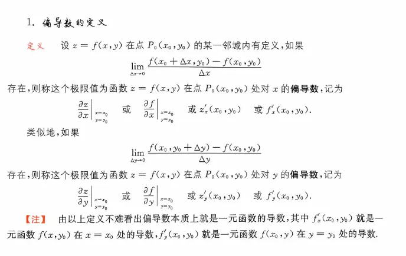

  

这是一道非常经典的考研真题（2023 年数学三）。这道题的核心陷阱在于带有**绝对值** $|x\sin y|$。遇到绝对值在求导点处为 0 的情况（此时 $x=0$），通常会产生“尖点”，导致不可导，必须非常小心。

我们按照之前讨论的两个视角（“二元极限定义法”和“一元降维法”）分别来完美击杀这道题。

题目已知：$f(x,y) = \ln(y + |x\sin y|)$，求点 $(0,1)$ 处的偏导数是否存在。

### 方法一：使用“二元函数的偏导数定义”硬算  

这种方法最严谨，是考研遇到分段函数或绝对值函数求导时的“保命杀招”。

**1. 考察对 $x$ 的偏导数 $\frac{\partial f}{\partial x} \Big|_{(0,1)}$ **

根据定义：

$$f'_x(0,1) = \lim_{\Delta x \to 0} \frac{f(\Delta x, 1) - f(0, 1)}{\Delta x}$$

- 先算原点函数值：$f(0, 1) = \ln(1 + |0 \cdot \sin 1|) = \ln 1 = 0$
    
- 再算移动点函数值：$f(\Delta x, 1) = \ln(1 + |\Delta x \cdot \sin 1|) = \ln(1 + |\Delta x|\sin 1)$
    
    _(注：因为 $\sin 1$ 约等于 $\sin(57^\circ) > 0$，所以 $|\Delta x \cdot \sin 1| = |\Delta x|\sin 1$)_
    

代入极限算式：

$$\lim_{\Delta x \to 0} \frac{\ln(1 + |\Delta x|\sin 1) - 0}{\Delta x}$$

利用等价无穷小替换：当 $\Delta x \to 0$ 时，$|\Delta x|\sin 1 \to 0$，所以 $\ln(1 + |\Delta x|\sin 1) \sim |\Delta x|\sin 1$。

原极限化简为：

$$= \lim_{\Delta x \to 0} \frac{|\Delta x|\sin 1}{\Delta x} = \sin 1 \cdot \lim_{\Delta x \to 0} \frac{|\Delta x|}{\Delta x}$$

这是一个经典的极限不存在的情况，因为：

- 当 $\Delta x \to 0^+$ (从右侧靠近) 时，$\frac{\Delta x}{\Delta x} = 1$，极限为 $\sin 1$
    
- 当 $\Delta x \to 0^-$ (从左侧靠近) 时，$\frac{-\Delta x}{\Delta x} = -1$，极限为 $-\sin 1$
    
    左右极限不相等，故极限不存在。
    
    **结论：$\frac{\partial f}{\partial x} \Big|_{(0,1)}$ 不存在。**
    

**2. 考察对 $y$ 的偏导数 $\frac{\partial f}{\partial y} \Big|_{(0,1)}$ **

根据定义：

$$f'_y(0,1) = \lim_{\Delta y \to 0} \frac{f(0, 1+\Delta y) - f(0, 1)}{\Delta y}$$

- 原点函数值：$f(0, 1) = 0$
    
- 移动点函数值：$f(0, 1+\Delta y) = \ln(1+\Delta y + |0 \cdot \sin(1+\Delta y)|) = \ln(1+\Delta y)$
    

代入极限算式：

$$\lim_{\Delta y \to 0} \frac{\ln(1+\Delta y) - 0}{\Delta y}$$

利用等价无穷小替换 $\ln(1+\Delta y) \sim \Delta y$：

$$= \lim_{\Delta y \to 0} \frac{\Delta y}{\Delta y} = 1$$

极限存在且等于 1。

**结论：$\frac{\partial f}{\partial y} \Big|_{(0,1)}$ 存在。**

### 方法二：转化为“一元函数的导数”（降维打击）

这种方法在考场上**速度更快**，思路上也更直观。

**1. 考察对 $x$ 的偏导数：固定 $y$ **

令 $y=1$，将原函数降维成关于 $x$ 的一元函数 $g(x)$：

$$g(x) = f(x, 1) = \ln(1 + |x\sin 1|)$$

求二元函数在 $(0,1)$ 对 $x$ 的偏导，等价于求一元函数 $g(x)$ 在 $x=0$ 处的导数 $g'(0)$。

因为带有绝对值 $|x|$，我们用左右导数来判断：

- 当 $x > 0$ 时，$g(x) = \ln(1 + x\sin 1)$，求导得 $g'_+(x) = \frac{\sin 1}{1 + x\sin 1}$，代入 $x=0$ 得 $g'_+(0) = \sin 1$。
    
- 当 $x < 0$ 时，$g(x) = \ln(1 - x\sin 1)$，求导得 $g'_-(x) = \frac{-\sin 1}{1 - x\sin 1}$，代入 $x=0$ 得 $g'_-(0) = -\sin 1$。
    
    因为 $g'_+(0) \neq g'_-(0)$，所以 $g'(0)$ 不存在。
    
    **结论：$\frac{\partial f}{\partial x} \Big|_{(0,1)}$ 不存在。**
    

**2. 考察对 $y$ 的偏导数：固定 $x$ **

令 $x=0$，将原函数降维成关于 $y$ 的一元函数 $h(y)$：

$$h(y) = f(0, y) = \ln(y + |0 \cdot \sin y|) = \ln(y + 0) = \ln y$$

求二元函数在 $(0,1)$ 对 $y$ 的偏导，等价于求一元函数 $h(y)$ 在 $y=1$ 处的导数 $h'(1)$。

此时你会发现，$h(y) = \ln y$ 是一个非常完美的初等函数，连绝对值都因为 $x=0$ 被“吃掉”了！

直接用初等函数求导法则：

$$h'(y) = \frac{1}{y}$$

代入 $y=1$，得到 $h'(1) = 1$。

**结论：$\frac{\partial f}{\partial y} \Big|_{(0,1)}$ 存在（且为 1）。**

### 总结

无论用哪种方法，得出的结论都是一致的：对 $x$ 的偏导数不存在，对 $y$ 的偏导数存在。

**故正确答案选择：(A)。**

### 典型反例演示：为什么不能直接求导？

**题目：** 判断 $f(x,y) = \sqrt{x^2+y^2}$ 在 $(0,0)$ 处的偏导数是否存在。

1. **错误做法（直接求导）：**
    
    求导得 $f_x = \frac{x}{\sqrt{x^2+y^2}}$，把 $(0,0)$ 代入发现分母为 0，无意义，于是猜测不存在。虽然结论碰巧对了，但逻辑是错的（因为 $(0,0)$ 在求导后的式子里根本不在定义域内）。
    
这是一个非常好的练习！我们以求 **在点 $(0,0)$ 处对 $x$ 的偏导数 $f_x(0,0)$ ** 为例，用前面总结的三种方法分别来实战推导一次。

（注：由于原函数 $f(x,y) = \sqrt{x^2+y^2}$ 关于 $x$ 和 $y$ 是完全对称的，对 $y$ 偏导的过程与下文完全一致，不再赘述。）

### 方法一：固定值法（先代入，后求导）

这是实战中最快发现“异常”的方法。我们冻结 $y$，把多变量问题降维成单变量问题。

1. **先代入：** 要求 $(0,0)$ 处的 $f_x$，我们固定 $y=0$，直接代入原函数，得到一个只含 $x$ 的一元函数 $g(x)$：
    
    $$g(x) = f(x, 0) = \sqrt{x^2 + 0^2} = \sqrt{x^2} = |x|$$
    
2. **后求导：** 接下来，我们只需考察一元函数 $g(x) = |x|$ 在 $x=0$ 处是否可导，即求 $g'(0)$。
    
    - 根据一元微积分的知识，绝对值函数 $y = |x|$ 是一个“V”字形图像。在 $x=0$ 这个尖点处，左导数是 -1，右导数是 1，导数不存在。
        
3. **结论：** 因为 $g'(0)$ 不存在，所以偏导数 ** $f_x(0,0)$ 不存在**。
    

_(注意：如果你错误地使用了直接求导公式 $f_x = \frac{x}{\sqrt{x^2+y^2}}$ 然后强行代入 $(0,0)$ 得到 $\frac{0}{0}$，这在数学上是不严谨的。只有“先代入后求导”才能合法地处理这种特殊点。)_

### 方法二：定义法 1（增量形式 $\Delta x \to 0$）

这是教科书上最正统的严谨证明方法，通过给 $x$ 一个极小的增量 $\Delta x$ 来观察变化率。

1. **写出定义式：**
    
    $$f_x(0,0) = \lim_{\Delta x \to 0} \frac{f(0 + \Delta x, 0) - f(0, 0)}{\Delta x}$$
    
2. **分别计算函数值：**
    
    - $f(\Delta x, 0) = \sqrt{(\Delta x)^2 + 0^2} = |\Delta x|$
        
    - $f(0, 0) = \sqrt{0^2 + 0^2} = 0$
        
3. **代入极限并求解：**
    
    $$f_x(0,0) = \lim_{\Delta x \to 0} \frac{|\Delta x| - 0}{\Delta x} = \lim_{\Delta x \to 0} \frac{|\Delta x|}{\Delta x}$$
    
    此时必须分左右侧逼近来讨论：
    
    - **右极限（$\Delta x \to 0^+$）：** 此时 $\Delta x > 0$，所以 $|\Delta x| = \Delta x$。极限为 $\lim_{\Delta x \to 0^+} \frac{\Delta x}{\Delta x} = 1$。
        
    - **左极限（$\Delta x \to 0^-$）：** 此时 $\Delta x < 0$，所以 $|\Delta x| = -\Delta x$。极限为 $\lim_{\Delta x \to 0^-} \frac{-\Delta x}{\Delta x} = -1$。
        
4. **结论：** 左极限 $\neq$ 右极限，整体极限不存在，故 ** $f_x(0,0)$ 不存在**。
    

### 方法三：定义法 2（趋近形式 $x \to 0$）

这是实战中最推荐的定义法变形，省去了写 $\Delta x$ 的繁琐，看起来最清爽。

1. **写出等价定义式：**
    
    $$f_x(0,0) = \lim_{x \to 0} \frac{f(x, 0) - f(0, 0)}{x - 0}$$
    
2. **直接代入解析式：**
    
    $$f_x(0,0) = \lim_{x \to 0} \frac{\sqrt{x^2 + 0^2} - 0}{x} = \lim_{x \to 0} \frac{\sqrt{x^2}}{x} = \lim_{x \to 0} \frac{|x|}{x}$$
    
3. **计算极限（同方法二）：**
    
    - 当 $x \to 0^+$ 时，$\frac{|x|}{x} = \frac{x}{x} = 1$。
        
    - 当 $x \to 0^-$ 时，$\frac{|x|}{x} = \frac{-x}{x} = -1$。
        
4. **结论：** 左右极限不相等，极限不存在，故 ** $f_x(0,0)$ 不存在**。
    

**一句话总结：**

对于 $f(x,y) = \sqrt{x^2+y^2}$ 这个典型的“圆锥面尖点”函数，无论是通过“先代入后求绝对值导数（方法一）”，还是通过两种极限形式的定义（方法二、三），最终殊途同归：我们都会卡在 $\frac{|x|}{x}$ 或 $\frac{|\Delta x|}{\Delta x}$ 这个左右极限不等的死胡同里，从而严谨地证明了它在原点不可导。