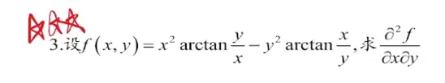

  

观察得非常敏锐！这道题（`image_b81c69.png` 与你之前做过的那道题完全一样）确实有一个非常巧妙的“捷径”。

  

如果你直接硬算，需要对两项分别使用乘积求导法则，然后再进行繁琐的通分化简。但如果借助**反三角函数的恒等式**对原函数先进行变形，计算量会大幅锐减。

  

### 核心技巧：利用反正切恒等式

我们知道一个重要的反正切恒等式：

对于任意非零常数 $u$，有：

  

$$\arctan u + \arctan \frac{1}{u} = C$$

_(注：当 $u > 0$ 时，$C = \frac{\pi}{2}$；当 $u < 0$ 时，$C = -\frac{\pi}{2}$。无论哪种情况，在特定的象限内，$C$ 都是一个常数)_

  

基于这个恒等式，我们可以把题目中的 $\arctan\frac{x}{y}$ 替换掉：

  

$$\arctan\frac{x}{y} = C - \arctan\frac{y}{x}$$

### 简化原函数

将替换后的式子代入原函数：

  

$$f(x,y) = x^2 \arctan\frac{y}{x} - y^2 \left( C - \arctan\frac{y}{x} \right)$$

展开并合并同类项：

  

$$f(x,y) = x^2 \arctan\frac{y}{x} - Cy^2 + y^2 \arctan\frac{y}{x}$$

$$f(x,y) = (x^2 + y^2) \arctan\frac{y}{x} - Cy^2$$

你看，经过这样变形，原本分散的两项 $\arctan$ 合并成了一项，接下来求导就非常轻松了。

  

### 重新求偏导

**第一步：求 $\frac{\partial f}{\partial x}$ **

  

对变形后的 $f(x,y)$ 关于 $x$ 求偏导（此时 $y$ 视为常数）：

  

$$\frac{\partial f}{\partial x} = \frac{\partial}{\partial x} \left[ (x^2 + y^2) \arctan\frac{y}{x} \right] - \frac{\partial}{\partial x} (Cy^2)$$

因为 $C$ 和 $y$ 都是常数，所以后面那项的导数直接为 $0$。对前面一项使用乘积求导法则和链式法则：

  

$$\frac{\partial f}{\partial x} = 2x \cdot \arctan\frac{y}{x} + (x^2 + y^2) \cdot \frac{1}{1 + (\frac{y}{x})^2} \cdot \left(-\frac{y}{x^2}\right)$$

稍微整理一下后面的乘积部分：

  

$$(x^2 + y^2) \cdot \frac{x^2}{x^2 + y^2} \cdot \left(-\frac{y}{x^2}\right) = -y$$

直接得出极其清爽的一阶偏导数：

  

$$\frac{\partial f}{\partial x} = 2x \arctan\frac{y}{x} - y$$

**第二步：求二阶混合偏导 $\frac{\partial^2 f}{\partial x \partial y}$ **

  

对上面的结果关于 $y$ 求偏导：

  

$$\frac{\partial^2 f}{\partial x \partial y} = \frac{\partial}{\partial y} \left( 2x \arctan\frac{y}{x} - y \right)$$

$$\frac{\partial^2 f}{\partial x \partial y} = 2x \cdot \frac{1}{1 + (\frac{y}{x})^2} \cdot \left(\frac{1}{x}\right) - 1$$

$$\frac{\partial^2 f}{\partial x \partial y} = \frac{2x^2}{x^2 + y^2} - \frac{x^2 + y^2}{x^2 + y^2}$$

$$\frac{\partial^2 f}{\partial x \partial y} = \frac{x^2 - y^2}{x^2 + y^2}$$

**总结：** 在多元微积分中，“先化简，后求导”往往能事半功倍。遇到复杂的三角函数或反三角函数组合时，优先停下来观察一下是否能用恒等式进行降次或合并，这不仅能节省大量时间，还能有效降低计算出错的概率。