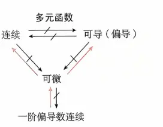

  
- **不连续 $\Rightarrow$ 不可微**
    
- **不可导（偏导数不存在） $\Rightarrow$ 不可微**
    
- **不可微 $\Rightarrow$ 一阶偏导数不连续**

这张图片总结的是**多元函数微分学**中最核心、也是在考研数学等高等数学考试中最容易被绕晕的关系图。

要理解“为什么”，我们必须抓住多元函数（这里以二元函数 $z = f(x,y)$ 为例）和一元函数最大的本质区别：**一元函数趋近于某一点只有左右两个方向，而二元函数在平面上趋近于某一点有无数个方向和无数条路径（直线、抛物线、甚至螺旋线）。**

以下是这张图中每条连线和红叉背后的数学逻辑和原因：

### 1. 连续 $\nLeftrightarrow$ 可导（偏导）

这是多元函数与一元函数最大的不同点（一元函数中，可导必连续）。在多元函数中，它们两者互不推导。

- **为什么“可偏导 $\nrightarrow$ 连续”？（红叉）**
    
    - **原因：** 偏导数 $f_x$ 和 $f_y$ 仅仅反映了函数沿平行于 $x$ 轴和 $y$ 轴**这两个特定方向**的变化率。知道十字交叉的两个方向上函数表现良好，并不能保证在其他无数个方向上（比如沿着 $y=x$ 这条斜线）函数不发生断裂。
        
    - **经典反例：** $f(x,y) = \frac{xy}{x^2+y^2}$（在原点定义为 0）。它在 $(0,0)$ 点沿 $x$ 轴和 $y$ 轴的偏导数都存在且为 0，但沿着 $y=kx$ 趋近原点时，极限值随 $k$ 变化，因此在原点根本不连续。
        
- **为什么“连续 $\nrightarrow$ 可偏导”？（红叉）**
    
    - **原因：** 连续只要求曲面没有破洞和断裂，但曲面上可以有“尖点”或“棱角”。在尖锐的地方，切线是不存在的，偏导数自然也不存在。
        
    - **经典反例：** 圆锥面 $z = \sqrt{x^2+y^2}$。在顶点 $(0,0)$ 处绝对连续（没断开），但这是一个尖点，求偏导时会出现分母为零的情况，偏导不存在。
        

### 2. 可微 $\rightarrow$ 连续，但 连续 $\nrightarrow$ 可微

“可微”的几何意义是：**该点处存在一个完美的切平面**。

- **为什么“可微 $\rightarrow$ 连续”？（红箭头）**
    
    - **原因：** 如果在一个点能找到一个平滑的切平面去“贴合”这个曲面，那这个曲面在这一点附近必定是平滑过渡、没有断裂的。用代数语言说，全微分 $\Delta z = A\Delta x + B\Delta y + o(\rho)$，当 $\Delta x, \Delta y \to 0$ 时，$\Delta z \to 0$，这就是连续的定义。
        
- **为什么“连续 $\nrightarrow$ 可微”？（红叉）**
    
    - **原因：** 和上面一样，连续的曲面可能有“尖点”（比如 $z = \sqrt{x^2+y^2}$）。在尖点处，你无法平稳地放上一个切平面（它会像在针尖上一样摇晃），因此不可微。
        

### 3. 可微 $\rightarrow$ 可偏导，但 可偏导 $\nrightarrow$ 可微

- **为什么“可微 $\rightarrow$ 可偏导”？（红箭头）**
    
    - **原因：** 如果曲面在某一点有一个完美的切平面（可微），那么你在这个切平面上分别沿着 $x$ 轴和 $y$ 轴切两刀，得到的截线必定有确定的斜率。这两个斜率就是偏导数 $f_x$ 和 $f_y$。
        
- **为什么“可偏导 $\nrightarrow$ 可微”？（红叉）**
    
    - **原因：** 偏导数只保证了“十字交叉”的两个方向上有切线。但这就像你用两根铁丝交叉搭建了一个骨架，如果没有蒙上平滑的布，其他方向可能崎岖不平，甚至根本拼凑不出一个完整的切平面。
        

### 4. 一阶偏导数连续 $\rightarrow$ 可微，但 可微 $\nrightarrow$ 一阶偏导数连续

这是判断一个多元函数是否可微最常用的**充分条件**。

- **为什么“一阶偏导连续 $\rightarrow$ 可微”？（红箭头）**
    
    - **原因：** 如果偏导数不仅存在，而且在点附近是**连续变化的**，这说明曲面在各个方向上的斜率变化都很“顺滑”，没有突变。这种顺滑度足以保证各个方向的切线能够编织成一个完美的切平面。这在定理上称为**可微的充分条件**。
        
- **为什么“可微 $\nrightarrow$ 一阶偏导连续”？（红叉）**
    
    - **原因：** 这是一个比较极端的数学情况。函数在某一点确实可以拼凑出一个切平面（可微），但它周围的导数震荡得非常剧烈，导致偏导数在这一点的极限不存在（即偏导数不连续）。虽然少见，但反向推导是不严谨的。
        

**学习与解题建议：**

在复习这部分数学理论时，建议在脑海里建立几何直观映像：

- **连续：** 曲面不断开。
    
- **可偏导：** 顺着 $x$ 和 $y$ 轴看，曲面不尖锐。
    
- **可微：** 曲面极其圆滑，能稳稳地放上一个切平面。
    
- **偏导连续：** 不仅能放上切平面，而且周围一圈的切平面过渡都非常丝滑。

# 逆否命题  
结合刚才我们梳理的逻辑关系，在多元函数微积分中，真正**绝对成立**的逆否命题只有三个。这三个命题是你在做选择题、判断题以及证明题时的“底线”，只要前提条件满足，可以直接得出结论。

以下为你详细梳理这三个逆否命题，以及对应的原命题和实战用法：

### 一、 三大绝对成立的逆否命题

**1. 命题一：如果函数不连续 $\Rightarrow$ 则函数必定不可微**

- **对应的原命题：** 如果函数可微，则函数必定连续。
    
- **实战用法：** 当你拿到一道题，算出该点沿不同路径趋近的极限值不同，或者极限值不等于该点的函数值时（即不连续），你可以直接在选项中秒杀排除“可微”，断定它**不可微**。
    

**2. 命题二：如果偏导数不存在 $\Rightarrow$ 则函数必定不可微**

- **对应的原命题：** 如果函数可微，则该点的偏导数必定存在。
    
- **实战用法：** 当你用定义法求 $x$ 或 $y$ 的偏导数时，发现左右极限不相等，或者极限趋于无穷大（即偏导数不存在），你可以直接断定该函数在这一点**不可微**。
    

**3. 命题三：如果函数不可微 $\Rightarrow$ 则一阶偏导数必定不连续**

- **对应的原命题：** 如果函数的一阶偏导数连续，则函数必定可微（这是可微的充分条件）。
    
- **实战用法（极其重要）：** 这是考研中最爱考的连招！如果题目问你偏导数是否连续，直接求导算极限往往非常复杂。你可以先用“看次数法则”判断全微分的误差极限，如果发现它不可微，就可以直接“降维打击”，得出结论：它的**偏导数一定不连续**。
    

### 二、 考场上极易踩坑的“假命题”（反例合集）

除了上面三个绝对成立的逆否命题，出题人特别喜欢把逻辑反过来（逆命题）或者乱搭线来迷惑你。以下这些命题**全部是错的**，遇到直接打叉：

**❌ 假命题 1：如果函数不可微 $\Rightarrow$ 则函数必定不连续（错！）**

- **真相：** 函数连续但可能不可微。可微的要求比连续高得多。
    
- **打脸反例：** $z = \sqrt{x^2+y^2}$。它在 $(0,0)$ 处是连续的（极限为 0），但在这个“尖角”处不仅不可微，连偏导数都没有。
    

**❌ 假命题 2：如果函数不可微 $\Rightarrow$ 则偏导数必定不存在（错！）**

- **真相：** 偏导数存在仅仅代表沿着 $x$ 轴和 $y$ 轴这两个特定方向有切线，但可微要求四面八方所有的方向都要平滑。
    
- **打脸反例：** 咱们刚才做过的那道题 $f(x,y) = \frac{xy^2}{x^2+y^2}$。它在 $(0,0)$ 处的两个偏导数算出来都是 0（存在），但它不可微。
    

**❌ 假命题 3：如果一阶偏导数不连续 $\Rightarrow$ 则函数必定不可微（错！）**

- **真相：** 偏导数连续是可微的**充分不必要**条件。偏导数就算不连续，函数依然**有可能**可微（只是这种变态函数在基础考试中比较少见）。
    

**❌ 假命题 4：如果不连续 $\Leftrightarrow$ 则偏导数不存在（错！）**

- **真相：** 在多元函数里，“连续性”和“偏导数的存在性”是彻底脱节的两个概念，谁也推不出谁。存在既不连续但偏导存在的奇葩函数，也存在连续但偏导不存在的函数。
    

**总结背诵口诀：**

遇到概念判断题，先默念：**连续和偏导是两个互相独立的低级门槛，只有同时跨过这两个门槛并且四面八方都平滑，才能达到“可微”的终极境界。** 如果连低级门槛（连续、偏导）都没跨过，绝对不可能可微；如果没达到终极境界（不可微），那它肯定拿不到最高级的通行证（偏导数连续）。