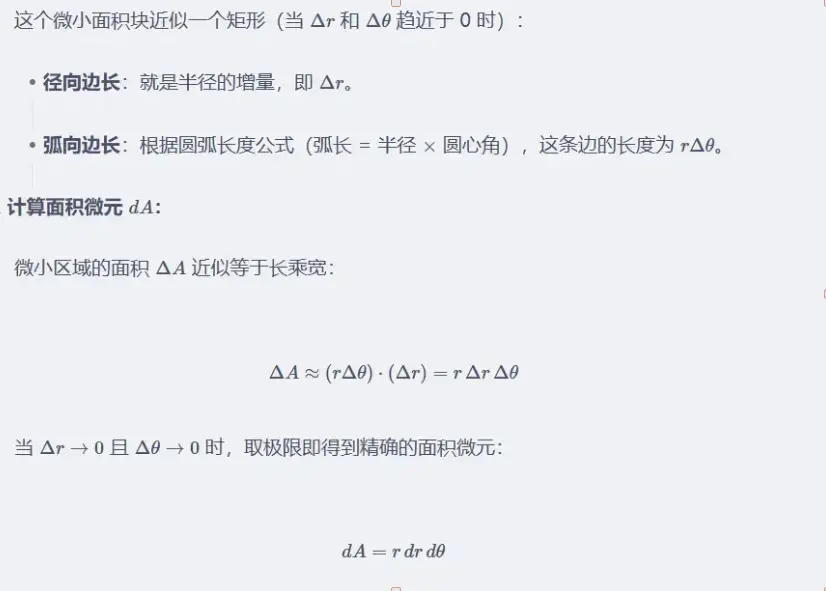
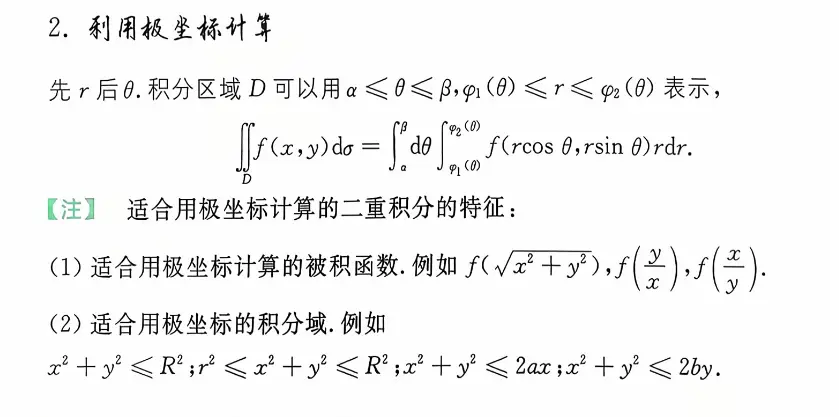
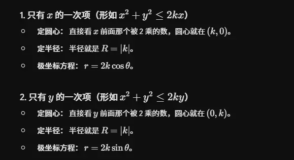

  主要看的是被积函数  

### 1. $x^2 + y^2 \le R^2$ （中心圆盘）

- **图像特征：** 这是一个以原点 $(0,0)$ 为圆心，以 $R$ 为半径的**实心圆**（也就是一个圆盘）。
    
- **极坐标特征：** 在极坐标系下，这个区域极其完美。半径 $r$ 从 $0$ 积分到 $R$，角度 $\theta$ 从 $0$ 积分到 $2\pi$。
    
- **应用场景：** 最基础的极坐标换元区域。
    

### 2. $r^2 \le x^2 + y^2 \le R^2$ （同心圆环）

- **图像特征：** 这是一个**圆环**区域（想象一个甜甜圈）。它是被两个同心圆夹在中间的部分：内圆半径是 $r$，外圆半径是 $R$，圆心都在原点。
    
- **极坐标特征：** 同样非常标准。半径从内圈 $r$ 积分到外圈 $R$，角度 $\theta$ 依然是 $0$ 到 $2\pi$。
    

### 3. $x^2 + y^2 \le 2ax$ （向 $x$ 轴偏移的圆）

这个函数乍一看不太像标准的圆，但只要我们把它稍微变个形：

1. 把 $2ax$ 移到左边：$x^2 - 2ax + y^2 \le 0$
    
2. 对 $x$ 进行配方（加上再减去 $a^2$）：$(x^2 - 2ax + a^2) - a^2 + y^2 \le 0$
    
3. 整理得到： $(x - a)^2 + y^2 \le a^2$ 
    

- **图像特征：** 这是一个**圆心在 $(a, 0)$，半径为 $|a|$ 的实心圆**。
    
    - 如果 $a > 0$，圆心在 $x$ 轴正半轴，圆刚好“靠在” $y$ 轴的右侧（经过原点）。
        
    - 如果 $a < 0$，圆心在 $x$ 轴负半轴，圆靠在 $y$ 轴左侧。
        
- **极坐标转换：** 把 $x = r\cos\theta, y = r\sin\theta$ 代入原式，得到 $r^2 \le 2ar\cos\theta$，即上限为 $r = 2a\cos\theta$。
    

### 4. $x^2 + y^2 \le 2by$ （向 $y$ 轴偏移的圆）

使用和上面完全一样的配方套路：

1. 移项：$x^2 + y^2 - 2by \le 0$
    
2. 对 $y$ 配方：$x^2 + (y^2 - 2by + b^2) - b^2 \le 0$
    
3. 整理得到： $x^2 + (y - b)^2 \le b^2$ 
    

- **图像特征：** 这是一个**圆心在 $(0, b)$，半径为 $|b|$ 的实心圆**。
    
    - 如果 $b > 0$，圆心在 $y$ 轴正半轴，圆刚好“坐在” $x$ 轴的上方（经过原点）。
    - 如果 b<0     在 y负半轴
        
- **极坐标转换：** 代入极坐标公式，得到上限为 $r = 2b\sin\theta$。