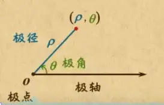
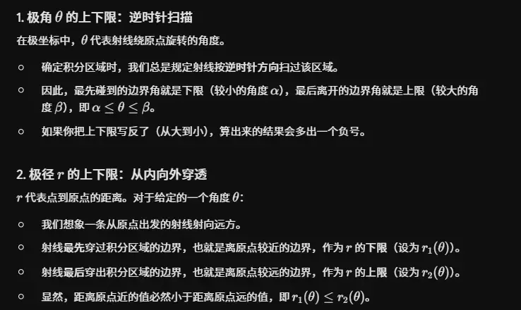
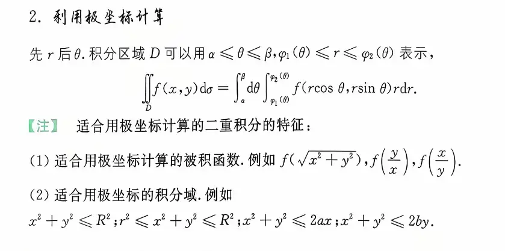
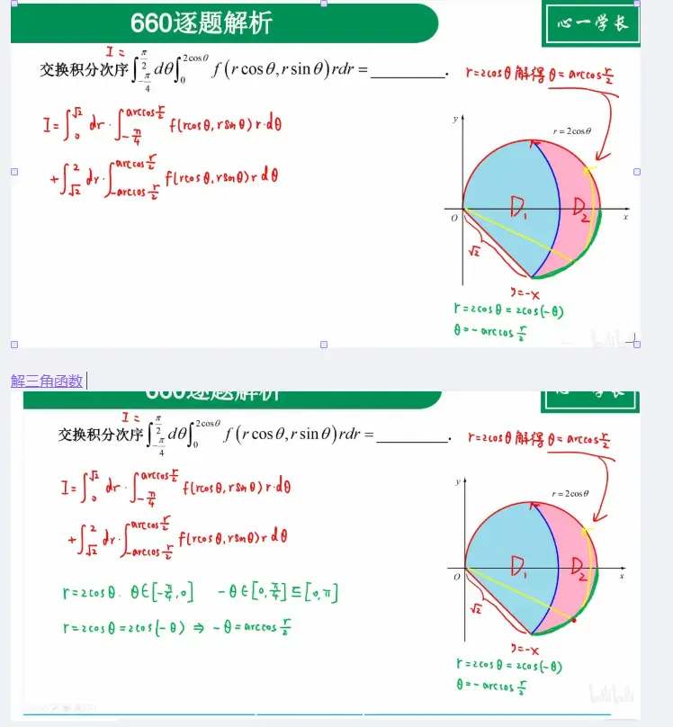
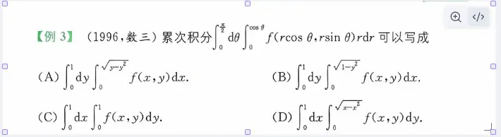
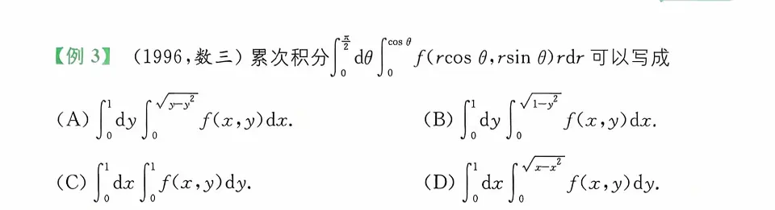

# 直角坐标与极坐标的转换公式  

在进行任何转换之前，这四组等式是必须牢记的“翻译字典”：

- **横坐标转换**：$x = r\cos\theta$
    
- **纵坐标转换**：$y = r\sin\theta$
- y/x=tan
    
- **平方和捷径**：$x^2 + y^2 = r^2$
    
- **面积微元转换**：$\mathrm{d}x\mathrm{d}y = r \mathrm{d}r\mathrm{d}\theta$ （千万不要漏掉这个 $r$）

- 二重积分的转换公式为：
$$ \iint_D f(x,y) \,dx\,dy = \iint_{D'} f(r\cos\theta, r\sin\theta) \,r \,dr\,d\theta $$

                                                                                                                                                                                         
#  使用场景和常见极坐标转换图像
主要看被积函数

### 1. $x^2 + y^2 \le R^2$ （中心圆盘）

- **图像特征：** 这是一个以原点 $(0,0)$ 为圆心，以 $R$ 为半径的**实心圆**（也就是一个圆盘）。
    
- **极坐标特征：** 在极坐标系下，这个区域极其完美。半径 $r$ 从 $0$ 积分到 $R$，角度 $\theta$ 从 $0$ 积分到 $2\pi$。
    
- **应用场景：** 最基础的极坐标换元区域。
    
### 2. $r^2 \le x^2 + y^2 \le R^2$ （同心圆环）

- **图像特征：** 这是一个**圆环**区域（想象一个甜甜圈）。它是被两个同心圆夹在中间的部分：内圆半径是 $r$，外圆半径是 $R$，圆心都在原点。
    
- **极坐标特征：** 同样非常标准。半径从内圈 $r$ 积分到外圈 $R$，角度 $\theta$ 依然是 $0$ 到 $2\pi$。

### 1. 只有 $x$ 的一次项（圆心在 $x$ 轴上的圆）

**区域不等式：** $x^2 + y^2 \le 2kx$ (这里假设 $k > 0$)
- **极坐标边界：** $r = 2k \cos\theta$
- **角度范围：** 圆盘整体位于 $y$ 轴右侧，极角从 $-\frac{\pi}{2}$ 扫到 $\frac{\pi}{2}$。
- **极径范围：** 从极点出发，穿出圆周，即 $0 \le r \le 2k\cos\theta$。
**二重积分表示：**  
$$\iint_D f(x,y) dxdy = \int_0^{2k} dx \int_{-\sqrt{2kx - x^2}}^{\sqrt{2kx - x^2}} f(x,y) dy$$
$$\iint_D f(x,y) dxdy = \int_{-\frac{\pi}{2}}^{\frac{\pi}{2}} d\theta \int_0^{2k\cos\theta} f(r\cos\theta, r\sin\theta) r dr$$
### 2. 只有 $y$ 的一次项（圆心在 $y$ 轴上的圆）  

**区域不等式：** $x^2 + y^2 \le 2ky$ (假设 $k > 0$)
- **极坐标边界：** $r = 2k \sin\theta$
- **角度范围：** 圆盘整体位于 $x$ 轴上方，极角从 $0$ 扫到 $\pi$。
- **极径范围：** 从极点出发，穿出圆周，即 $0 \le r \le 2k\sin\theta$。
**二重积分表示：**

$$\iint_D f(x,y) dxdy = \int_0^{\pi} d\theta \int_0^{2k\sin\theta} f(r\cos\theta, r\sin\theta) r dr$$
### 3. 中心圆盘  

**区域不等式：** $x^2 + y^2 \le R^2$
- **角度范围：** 完整的圆盘，涵盖所有方向，即 $0 \le \theta \le 2\pi$。
- **极径范围：** 从圆心（极点）到边缘，即 $0 \le r \le R$。
**二重积分表示：**
$$\iint_D f(x,y) dxdy = \int_0^{2\pi} d\theta \int_0^R f(r\cos\theta, r\sin\theta) r dr$$
### 4. 同心圆环  

**区域不等式：** $r_0^2 \le x^2 + y^2 \le R^2$
_(注：为了避免与极坐标变量 $r$ 符号冲突，这里将图片中的内圆半径 $r$ 改写为了常数 $r_0$)_
- **角度范围：** 完整的圆环，即 $0 \le \theta \le 2\pi$。
- **极径范围：** 从内圆边缘到外圆边缘，即 $r_0 \le r \le R$。
**二重积分表示：**
$$\iint_D f(x,y) dxdy = \int_0^{2\pi} d\theta \int_{r_0}^R f(r\cos\theta, r\sin\theta) r dr$$
# 极坐标的交换次序  
https://www.bilibili.com/video/BV1TdTvz7E5G/?spm_id_from=333.337.top_right_bar_window_history.content.click&vd_source=00e9babc4deca9e64ec25dd54e7bfe0c
- [ ] 上述视频内容极坐标交换次序 #todo 

[解三角函数](../解三角函数.md)

# 相互转换例题  

## 直角坐标系 $\to$ 极坐标系

当被积函数中含有 $x^2 + y^2$，或者积分区域的边界是圆、圆环、扇形的一部分时，转化为极坐标通常会大幅简化计算。

**转换步骤：**

1. **还原积分区域图**：
    
    根据给定的直角坐标积分上下限（例如 $a \le x \le b$，$y_1(x) \le y \le y_2(x)$），在草稿纸上画出积分区域 $D$ 的几何图形。[圆和球的公式](../../../扩展/高中知识记忆/圆和球的公式.md)
    > 得到 x 和 y 的方程,利用圆的公式表达得到圆心和半径画出图形
    
2. **转换边界方程**：
    
    将区域 $D$ 的所有边界曲线方程中的 $x$ 和 $y$ 替换为 $r\cos\theta$ 和 $r\sin\theta$，化简得到极坐标下的边界方程 $r = r(\theta)$。也可以数形结合
    
3. **确定极角 $\theta$ 的范围**：
    
    观察图形，寻找能将整个区域 $D$ 包含在内的两条由原点发出的射线，确定起始角度 $\alpha$ 和终止角度 $\beta$。
    
4. **确定极径 $r$ 的范围**：
    
    在 $\alpha$ 和 $\beta$ 之间任意画一条从原点出发的射线。观察这条射线**最先穿过**区域的哪条边界（内边界 $r_1(\theta)$），**最后穿出**区域的哪条边界（外边界 $r_2(\theta)$）。如果区域包含原点，则内边界 $r_1(\theta) = 0$。[极坐标 1](极坐标%201.md)
    
5. **组装新的积分式**：
    
    将被积函数 $f(x,y)$ 替换为 $f(r\cos\theta, r\sin\theta)$，将 $\mathrm{d}x\mathrm{d}y$ 替换为 $r \mathrm{d}r\mathrm{d}\theta$。
    

**标准形式：**

$$ \iint_D f(x,y) \mathrm{d}x\mathrm{d}y = \int_{\alpha}^{\beta} \mathrm{d}\theta \int_{r_1(\theta)}^{r_2(\theta)} f(r\cos\theta, r\sin\theta) r \mathrm{d}r $$

**题目要求**：计算直角坐标下的累次积分。当被积函数含有 $x^2+y^2$ 且积分区域与圆相关时，通常转换为极坐标计算更为简便。

**1. 确定直角坐标下的积分区域 $D$ **

根据积分 $\int_0^2 \mathrm{d}x \int_0^{\sqrt{2x-x^2}} \sqrt{x^2+y^2} \mathrm{d}y$，可知积分区域为：

$$ 0 \le x \le 2 $$

$$ 0 \le y \le \sqrt{2x-x^2} $$

**2. 将积分区域转换为极坐标**

将上边界方程 $y = \sqrt{2x-x^2}$ 两边平方得：

$$ y^2 = 2x - x^2 \implies x^2 + y^2 = 2x $$

代入极坐标公式 $x = r\cos\theta$ 和 $x^2+y^2 = r^2$，得到：

$$ r^2 = 2r\cos\theta \implies r = 2\cos\theta $$

由于 $y \ge 0$ 且 $0 \le x \le 2$，积分区域位于第一象限。因此极角 $\theta$ 的范围是：

$$ 0 \le \theta \le \frac{\pi}{2} $$

对于每一个 $\theta$，极径 $r$ 从原点开始，到边界 $r = 2\cos\theta$ 结束：

$$ 0 \le r \le 2\cos\theta $$

**3. 在极坐标下计算积分**

将被积函数 $\sqrt{x^2+y^2}$ 替换为 $r$，面积元素 $\mathrm{d}x\mathrm{d}y$ 替换为 $r \mathrm{d}r\mathrm{d}\theta$。原积分变为：

$$ \iint_D \sqrt{x^2+y^2} \mathrm{d}x\mathrm{d}y = \int_0^{\frac{\pi}{2}} \mathrm{d}\theta \int_0^{2\cos\theta} r \cdot r \mathrm{d}r = \int_0^{\frac{\pi}{2}} \mathrm{d}\theta \int_0^{2\cos\theta} r^2 \mathrm{d}r $$

首先计算内层的关于 $r$ 的定积分：

$$ \int_0^{2\cos\theta} r^2 \mathrm{d}r = \left[ \frac{1}{3}r^3 \right]_0^{2\cos\theta} = \frac{8}{3}\cos^3\theta $$

然后代入外层积分计算关于 $\theta$ 的定积分：

$$ \int_0^{\frac{\pi}{2}} \frac{8}{3}\cos^3\theta \mathrm{d}\theta = \frac{8}{3} \int_0^{\frac{\pi}{2}} \cos^3\theta \mathrm{d}\theta $$

这里可以直接使用华里士公式（点火公式） $\int_0^{\frac{\pi}{2}} \cos^n\theta \mathrm{d}\theta = \frac{n-1}{n} \cdot \frac{n-3}{n-2} \cdots$ ，当 $n=3$ 时：

$$ \int_0^{\frac{\pi}{2}} \cos^3\theta \mathrm{d}\theta = \frac{2}{3} \times 1 = \frac{2}{3} $$

最后得出结果：

$$ \frac{8}{3} \times \frac{2}{3} = \frac{16}{9} $$

**答案填空：$\frac{16}{9}$ **

## 极坐标系 $\to$ 直角坐标系

当极坐标下的被积函数原函数极难求出，或者图形在直角坐标系下其实是非常规则的矩形、多边形时，我们需要将其转回直角坐标系（正如你之前发的那道“例 3”）。

**转换步骤：**

1. **还原积分区域图**：
    
    根据给定的极角范围 $[\alpha, \beta]$ 和极径范围 $[r_1(\theta), r_2(\theta)]$，在坐标系中画出积分区域 $D$ 的形状。
    
2. **转换边界方程**：
    
    将极坐标边界方程两边同乘 $r$ 或者利用三角公式，利用 $r^2 = x^2+y^2$、$r\cos\theta = x$、$r\sin\theta = y$ 等关系，将其还原为直角坐标方程 $y=y(x)$ 或 $x=x(y)$。也可以数形结合
    
3. **选择直角坐标积分顺序**：
    
    观察图形，决定是将其看作 X 型区域（先对 $y$ 积分，再对 $x$ 积分）还是 Y 型区域（先对 $x$ 积分，再对 $y$ 积分）。
    
4. **确定直角坐标的上下限**：
    
    - **外层限**：将区域投影到对应的坐标轴上，找常数界限。
        
    - **内层限**：画平行于另一坐标轴的直线穿过区域，找上下曲线方程。
        
5. **组装新的积分式**：
    
    将被积函数还原为 $x, y$ 的表达式，去掉面积微元中的雅可比行列式 $r$，将 $r \mathrm{d}r\mathrm{d}\theta$ 换回 $\mathrm{d}x\mathrm{d}y$。
    

**标准形式（以 X 型区域为例）：**

$$ \int_{\alpha}^{\beta} \mathrm{d}\theta \int_{r_1(\theta)}^{r_2(\theta)} F(r,\theta) r \mathrm{d}r = \int_{a}^{b} \mathrm{d}x \int_{y_1(x)}^{y_2(x)} f(x,y) \mathrm{d}y $$

**题目要求**：将极坐标下的累次积分转换为直角坐标下的累次积分。

**1. 确定极坐标下的积分区域 $D$ **

根据给定的积分 $\int_0^{\frac{\pi}{2}} \mathrm{d}\theta \int_0^{\cos\theta} f(r\cos\theta, r\sin\theta) r \mathrm{d}r$，可以写出积分区域的不等式表示：

$$ 0 \le \theta \le \frac{\pi}{2} $$

$$ 0 \le r \le \cos\theta $$

**2. 将边界方程转换为直角坐标**

曲线 $r = \cos\theta$ 两边同时乘以 $r$，得到：

$$ r^2 = r\cos\theta $$

利用极坐标与直角坐标的转换关系 $x = r\cos\theta$ 和 $x^2 + y^2 = r^2$，代入上式可得：

$$ x^2 + y^2 = x $$

配方后得到圆的方程：

$$ \left(x - \frac{1}{2}\right)^2 + y^2 = \frac{1}{4} $$

这是一个以 $\left(\frac{1}{2}, 0\right)$ 为圆心，半径为 $\frac{1}{2}$ 的圆。又因为极角 $\theta \in \left[0, \frac{\pi}{2}\right]$，所以该区域位于第一象限（即 $y \ge 0$）。

**3. 确定直角坐标下的积分上下限**

对于第一象限内的上半圆区域（X 型区域），投影到 $x$ 轴上的范围是：

$$ 0 \le x \le 1 $$

在确定的 $x$ 值下，穿过该区域的平行于 $y$ 轴的直线，下边界是 $y=0$，上边界是圆的方程 $y = \sqrt{x - x^2}$（取正号因为在第一象限）。因此：

$$ 0 \le y \le \sqrt{x - x^2} $$

极坐标中的面积元素 $r \mathrm{d}r\mathrm{d}\theta$ 对应直角坐标中的 $\mathrm{d}x\mathrm{d}y$。所以原积分可以写为：

$$ \int_0^1 \mathrm{d}x \int_0^{\sqrt{x-x^2}} f(x,y) \mathrm{d}y $$

对比选项，这与 (D) 完全一致。

**正确答案：(D)**

### 总结对比

|**核心维度**|**直角坐标系 (x,y)**|**极坐标系 (r,θ)**|
|---|---|---|
|**思维方式**|纵横切片（像切豆腐）|雷达扫描（像雨刮器）|
|**边界特点**|常由直线或一般曲线构成|常与圆、弧线直接相关|
|**容易漏掉的坑**|积分顺序弄反导致定限错误|忘记在被积函数里乘上面积微元带来的 ** $r$ **|

在实际做这类转换题的过程中，你是觉得“根据不等式画出积分区域的草图”比较困难，还是“看着草图写出对应的积分上下限”比较容易卡壳呢？

