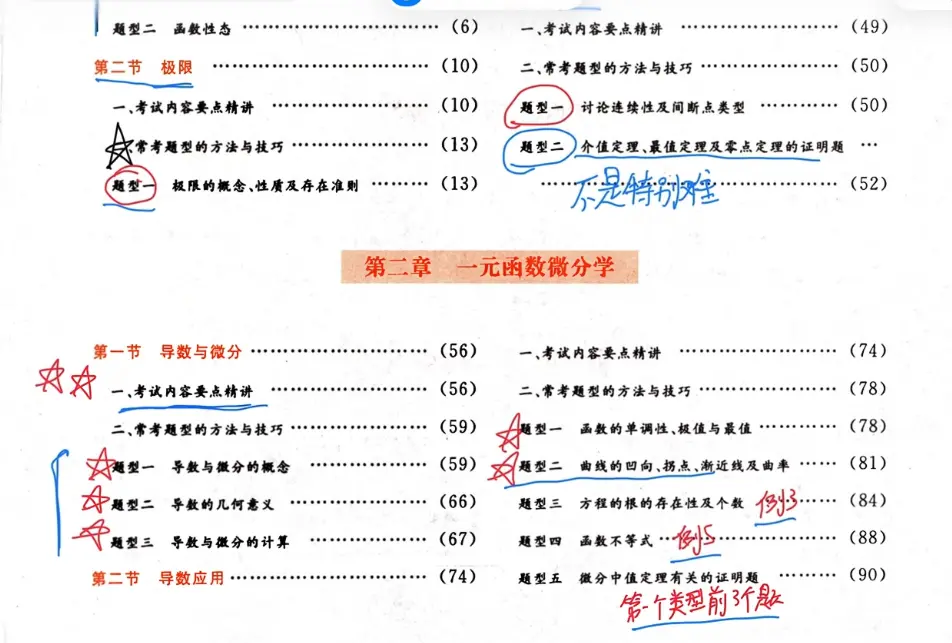

- [ ] 数列的单调有界求极限
- [ ] 方程根的存在性和个数问题
- [ ] 不等式（函数 积分 二重积分）
- [ ] 证明题（介值定理  最值定理  零点定理   微分中值定理）
- [x] 两个未知数 n  x 的极限间断点问题 （分类讨论）
- [x] 有理式的拆分 （极限和积分用的到的） 啊啊啊啊  吧                               
- [ ] 极限泰勒极限的记忆  泰勒公式的使用 （b 站 心一学长）
- [x] n 项和极限（先放缩再求定积分的）  n 项连乘 还需要掌握多点题目
- [ ] 对参数方程  和反函数求导曲率切线法线 基础的题型的计算 做到熟练计算（包括公式和推导 ）
- [ ] 关于导数的应用的这些结论的记忆
- [ ] 关于心形线等参数方程的记忆   b 站杰哥
https://www.bilibili.com/video/BV1Gv4y127BA/?spm_id_from=333.337.search-card.all.click&vd_source=00e9babc4deca9e64ec25dd54e7bfe0c  

