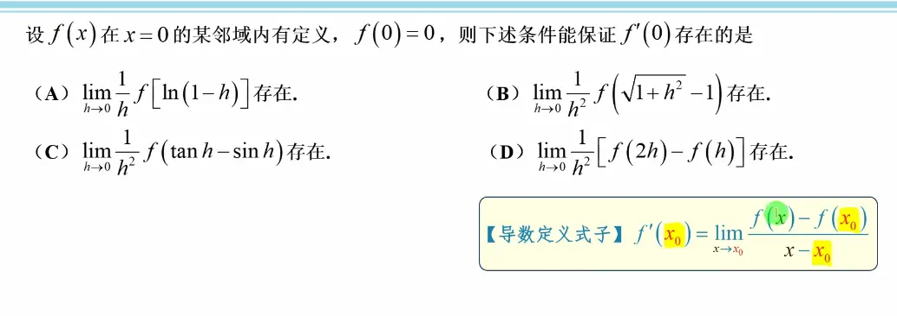
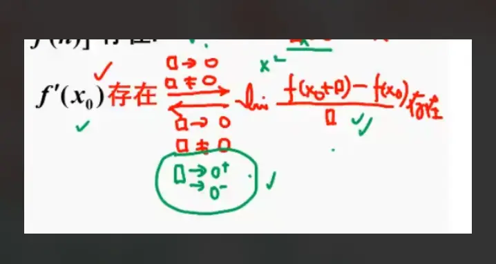
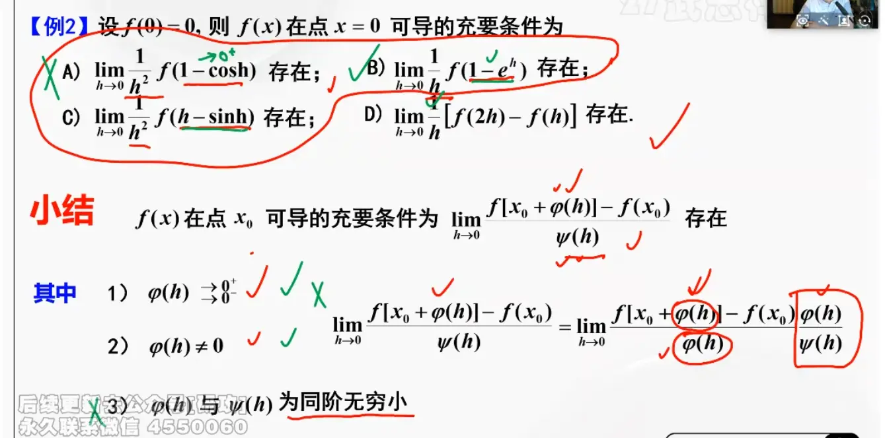

https://www.bilibili.com/video/BV1LP9gY8EnW/?spm_id_from=333.337.search-card.all.click&vd_source=00e9babc4deca9e64ec25dd54e7bfe0c

  
> 第四个不能随便拆 没有说 fx 可导  
> 导数存在  说明极限定义的式子  左右极限相等

左导等于右导  

总结的是考研数学中关于**导数定义的广义化及其充要条件**，特别是利用任意增量（笔记中用框框 $\Box$ 表示）来凑导数定义时的**双侧逼近陷阱**。

我们可以把这张图拆解为“从左推右”和“从右推左”两个方向来理解：

### 1. 从左推右：已知导数存在（上方箭头 $\rightarrow$）

- **逻辑**：如果已知函数在 $x_0$ 处可导（即 $f'(x_0)$ 存在）。
    
- **结论**：那么无论你构造什么样的增量表达式 $\Box$，只要满足 $\Box \to 0$ 且 $\Box \neq 0$，极限 $\lim \frac{f(x_0+\Box) - f(x_0)}{\Box}$ 就一定存在，并且等于 $f'(x_0)$。
    
- **通俗理解**：只要函数是完美平滑的，你怎么去逼近它都可以。这里的 $\Box$ 可以是 $h$、$h^2$、$1-\cos h$、$e^x-1$ 等等任何趋于 0 的式子。
    

### 2. 从右推左：已知极限存在，反推导数存在（下方箭头 $\leftarrow$）

这是考研最爱挖坑的地方！

- **逻辑**：如果我们算出了极限 $\lim \frac{f(x_0+\Box) - f(x_0)}{\Box}$ 存在，能否理直气壮地说 $f'(x_0)$ 也存在？
    
- **核心条件（绿色圈圈）**：**不一定！必须看增量 $\Box$ 的脸色！** 图中绿色的圈强调：只有当这个增量 $\Box$ 能够**同时从正方向（$0^+$）和负方向（$0^-$）趋近于 0** 时，这个极限才能代表完整的导数 $f'(x_0)$ 存在。
    

### 结合上一题秒懂：

这正是为了解释你上一题遇到的疑惑：

在上一个例子中，增量 $\Box = 1 - \cos h$。

- 虽然当 $h \to 0$ 时，$\Box \to 0$ 成立。
    
- 但是，因为 $1 - \cos h > 0$ 恒成立，它**只能满足 $\Box \to 0^+$ **，无法满足绿色圈圈里的 $\Box \to 0^-$。
    
- 因此，右边的极限存在，**无法顺着下方的箭头推回到左边**（推不出 $f'(x_0)$ 存在），只能推导出单侧的右导数 $f'_+(x_0)$ 存在。
    

**一句话总结：**

用广义增量 $\Box$ 凑导数定义时，如果 $\Box$ 自带“非负”或“非正”属性（比如 $\Box = x^2$、$\Box = \vert{}x\vert{}$、$\Box = 1-\cos x$），算出来的极限只能代表单侧导数；只有当 $\Box$ 能正能负（比如 $\Box = x$、$\Box = x^3$、$\Box = \sin x$）时，算出来的极限才能代表双侧导数都存在。