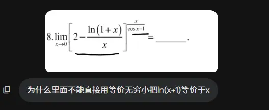
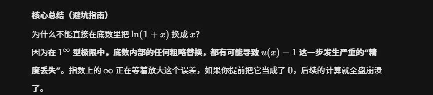

# 开根号
$x^2=a$   ->  $x=\pm \sqrt{ a }$

>   
> 求极限的时候 全是无穷加减  默认分母为 1  往分式上面靠   这样更好求
 对于偶次方根   分式形式的时候  现提出因子  在上下同除  
  对几次方根    上下可以同除  

# 幂指函数转换为 对数或者 e 的指数形式 
1 的无穷形式使用基本极限的方法做
  
  

这里使用 1 的无穷的形式来求,不能直接代指数的等价无穷小  
在高等数学的极限计算中，底数部分包含无穷小时能否进行等价代换，**完全取决于指数是“常数”还是“变量”**。指数式常数可以放心换
无论底数还是指数含有无穷小，遇到 $u(x)^{v(x)}$ 形式的极限，第一步永远是利用对数恒等式将其改写：

$$u(x)^{v(x)} = e^{v(x) \ln u(x)}$$

因为指数函数 $e^x$ 是连续函数，极限符号可以跨过底数 $e$ 移到指数上：

$$\lim u(x)^{v(x)} = e^{\lim [v(x) \ln u(x)]}$$

此时，指数部分变成了 $v(x) \cdot \ln u(x)$ 的**乘积形式**。只要是在乘除法因子中，你就可以放心地使用等价无穷小替换了。

# 极坐标与直角坐标的面积相消性  
你总结到了最核心的实用规律！在**计算平面图形面积**这个具体场景下，确实是“直角坐标的代数和容易相消，而极坐标的公式天然不会相消”。

不过在考研高数的实战中，我们把这个概念再挖深一点点：**决定会不会发生相消的，其实不是“坐标系”本身，而是你积分公式里的“被积函数”。**

### 现象背后的数学本质

我们对比一下两种坐标系下的面积积分公式，就能看出端倪：

- **直角坐标的面积积分：$\int y dx$ **
    
    这里的被积函数就是 $y$（即 $f(x)$）。因为 $y$ 的值在 $x$ 轴上方为正，在下方为负，所以积分出来的结果叫作“代数和”，天然带有方向性，必然会发生正负相消。为了算出真实的几何面积，我们需要强行人加一个绝对值，变成 $\int |f(x)| dx$，或者看图分段积分。
    
- **极坐标的面积积分：$\frac{1}{2}\int r^2 d\theta$ **
    
    这里的被积函数是 $r^2$。关键就在这个**平方**上！无论你的极径 $r$ 算出来是正是负，经过平方之后，被积函数永远是 $\ge 0$ 的。它就像是给直角坐标里的 $f(x)$ 自动套上了一个绝对值一样，强制让每一丝微小的面积都是正数，因此永远都在累加，不会相消。
    

### 极坐标真的“绝对不相消”吗？

并不是。极坐标下会不会相消，同样取决于你在积什么。

如果你不是在求面积，而是在做**二重积分**或者求**物理量（如重心、力矩）**，极坐标照样会发生完美的正负相消。

比如，计算一个关于 $x$ 轴上下对称的区域 $D$ 的二重积分 $\iint_D y dxdy$。

转换成极坐标后，式子变成：

$$\iint_D (r\sin\theta) \cdot r dr d\theta = \iint_D r^2 \sin\theta dr d\theta$$

在这个式子里，被积函数包含了 $\sin\theta$。当区域包含第一象限（$\sin\theta > 0$）和第四象限（$\sin\theta < 0$）时，积分出来的结果就会**完美相消为 0**。

### 做题总结口诀

在处理高数题目时，你可以这样记：

1. **算面积时：** 直角坐标看正负（防相消，要分段或加绝对值），极坐标直接套公式（自带平方 $r^2$，一路狂加不相消）。
    
2. **算二重积分/曲线积分时：** 无论直角还是极坐标，“对称性与奇偶性”永远成立。只要区域对称且函数表现出奇特性，该相消为 0 还是得相消为 0。
### 核心结论

如果题目只是纯粹的数学计算题（例如题目明确写着“计算定积分 $\int_{a}^{b} f(x) dx$”），你**绝对不能**擅自给函数加绝对值，也不需要因为图形在 x 轴下方就去变号。

### 纯计算题 vs. 几何应用题 的根本区别

为了让你在做题时肌肉记忆般地反映出来，我们可以把这两种题型做个对比：

|**对比维度**|**纯计算题（求定积分）**|**几何应用题（求面积）**|
|---|---|---|
|**题目字眼**|“计算 $\int_{a}^{b} f(x) dx$”|“求由曲线...与...围成的面积”|
|**几何意义**|代数和（净面积），**可以为负，可以为零**。|真实物理面积，**必然 $\ge 0$ **。|
|**处理法则**|直接找原函数 $F(x)$，套用牛顿-莱布尼茨公式：$F(b) - F(a)$。|必须令 $f(x)=0$ 找交点，按 x 轴上下方**分段积分，下方变号**。|
|**举例**|计算 $\int_{0}^{2\pi} \sin x dx = 0$ |求 $\sin x$ 在 $[0, 2\pi]$ 的面积 $= 4$ |

### ⚠️ 特殊情况：什么时候“纯计算题”也必须分段拆分？

虽然普通的纯计算题不需要管 x 轴上下方，但如果**被积函数本身的数学表达式**具有特殊性，你在“纯计算”时依然必须拆分区间。作为备考计算机 408 或考研数学的选手，你需要对以下三种“自带防御属性”的函数保持高度警惕：

**1. 被积函数自带绝对值**

例如：计算 $\int_{-1}^{2} |x| dx$

- **做法：** 这里的绝对值是题目给的，不是你为了算面积加的。你必须去掉绝对值符号才能积分，因此要在 $x=0$ 处拆分：$\int_{-1}^{0} (-x) dx + \int_{0}^{2} x dx$。
    

**2. 分段函数**

例如：$f(x) = \begin{cases} x^2, & x < 1 \\ 2x, & x \ge 1 \end{cases}$，求 $\int_{0}^{2} f(x) dx$

- **做法：** 因为函数在 $x=1$ 两边的解析式不同，必须拆分为 $\int_{0}^{1} x^2 dx + \int_{1}^{2} 2x dx$。
    

**3. 取大 / 取小函数 (Max / Min)**

例如：计算 $\int_{0}^{2} \max(x, x^2) dx$

- **做法：** 你需要先判断在 $[0, 2]$ 区间内，什么时候 $x$ 更大，什么时候 $x^2$ 更大。在 $[0, 1]$ 时 $x \ge x^2$；在 $[1, 2]$ 时 $x^2 \ge x$。所以必须拆分为：$\int_{0}^{1} x dx + \int_{1}^{2} x^2 dx$。
    

**总结一句话：**

计算定积分时，**忠于题目给定的表达式**。题目没给绝对值，闭着眼睛直接积（正负抵消是合法的）；题目给定的表达式如果跨区间发生了改变（自带绝对值、分段函数），为了能写出原函数，才需要拆分区间。  

# 函数与函数关系  
### 2. 唯一性（一个 $x$ 只能对应唯一一个 $y$）

**对于定义域中的每一个 $x$，只能对应唯一确定的一个 $y$。**

- **通俗解释：** 一对一可以，多对一也可以（比如 $2^2=4$ 且 $(-2)^2=4$，不同的原料可以做出相同的产品）。但是，**绝对不能一对多**。同一个原料放进去，不能这回吐出产品 A，下回吐出产品 B。
    
- **图像检验（垂直线测试）：** 在平面直角坐标系中，如果你画任何一条垂直于 $x$ 轴的直线，这条直线与图形的交点**最多只能有一个**。
    
- **反例辨析：** 比如圆的方程 $x^2 + y^2 = 1$。当输入 $x = 0$ 时，$y$ 的结果可以是 $1$，也可以是 $-1$。在图像上，垂直线 $x=0$ 与圆有两个交点。因此，**圆的完整方程不是一个标准函数**（它只是一种方程关系）。在微积分计算中，如果遇到这种情况，我们必须将其拆分为上半圆 $y = \sqrt{1-x^2}$ 和下半圆 $y = -\sqrt{1-x^2}$ 两个独立的单值函数来处理。

