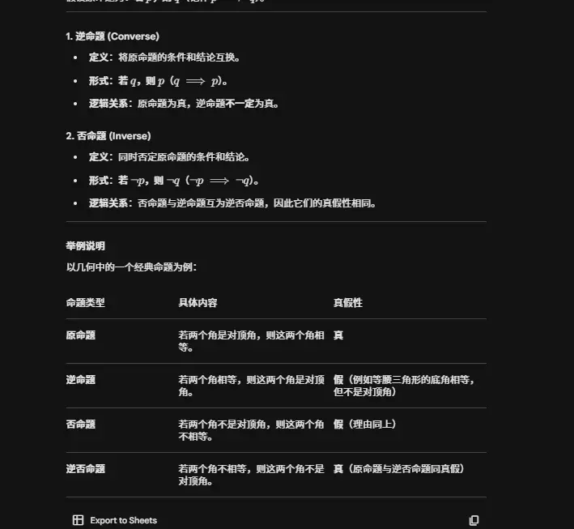

# 命题

#  反证法  
|命题类型|形式|对应内容|真假性|
|---|---|---|---|
|原命题|A⟹B|若 f(x)g(x) 无界，则 f(x),g(x) 至少一个无界|✅ 真|
|逆命题|B⟹A|若 f(x),g(x) 至少一个无界，则 f(x)g(x) 无界|❌ 假（反例：f(x)=x 无界，g(x)=0 有界，乘积为 0）|
|否命题|¬A⟹¬B|若 f(x)g(x) 有界，则 f(x),g(x) 都有界|❌ 假（反例：f(x)=x 无界，g(x)=1/x 有界，乘积为 1 有界）|
|逆否命题|¬B⟹¬A|若 f(x),g(x) 都有界，则 f(x)g(x) 有界|✅ 真（这就是我们反证法用到的等价命题）|
💡 关键结论：**原命题和逆否命题的真假性永远相同**。所以我们证明了逆否命题为真，就等价于证明了原命题为真。

如果原命题是“若 A 则 B”（记作 $A \Rightarrow B$），那么“若非 B 则非 A”（记作 $\neg B \Rightarrow \neg A$）被称为原命题的**逆否命题**。

逻辑学中有一个极其重要的基本定律：**原命题与其逆否命题同真同假。** 也就是说，只要原命题是对的，它的逆否命题绝对是对的。

