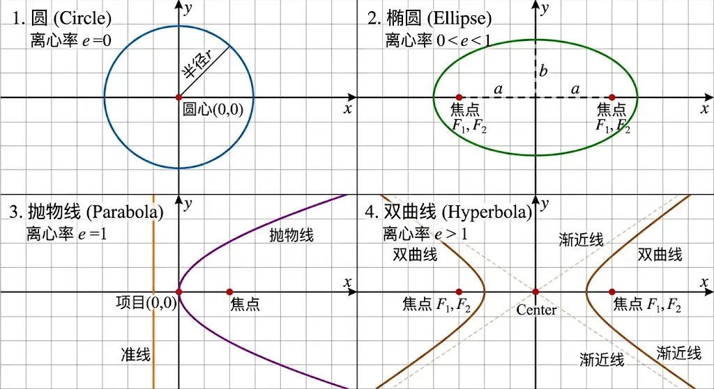

### 1. 圆 (Circle)

- **3 D 几何截法：** 当截面**垂直于**圆锥的中轴线时，得到的截口就是一个圆。
    
- **2 D 平面定义：** 平面上到一个定点（圆心）距离等于定长（半径）的所有点的集合。
    
- **离心率：** $e = 0$。圆是圆锥曲线中最完美、最对称的形态，没有发生任何“偏心”。
    
- **标准方程：**
    
    $$x^2 + y^2 = r^2$$
    

### 2. 椭圆 (Ellipse)

- **3 D 几何截法：** 将截面稍微倾斜，只要倾斜的角度**小于**圆锥母线的倾斜角（即平面仍然只切割圆锥的一个半侧且闭合），截口就被拉长成椭圆。圆其实是椭圆的一种特例。
    
- **2 D 平面定义：** 平面上到两个定点（焦点）的距离之和等于常数（大于两焦点间距离）的所有点的集合。
    
- **离心率：** $0 < e < 1$。$e$ 越接近 0，椭圆越圆；$e$ 越接近 1，椭圆越扁。
    
- **标准方程：**
    
    $$\frac{x^2}{a^2} + \frac{y^2}{b^2} = 1 \quad (a > 0, b > 0)$$
    

### 3. 抛物线 (Parabola)

- **3 D 几何截法：** 这是一个临界状态。当截面的倾斜角**刚好等于**圆锥母线的倾斜角（即平面平行于圆锥边缘的一条线）时，截口不再闭合，一直延伸到无穷远，形成抛物线。
    
- **2 D 平面定义：** 平面上到一个定点（焦点）和一条定直线（准线）距离相等的所有点的集合。
    
- **离心率：** $e = 1$。这是从闭合曲线（椭圆）走向开放曲线（双曲线）的严格分界点。
    
- **标准方程：**
    
    $$y^2 = 2px \quad \text{或} \quad x^2 = 2py \quad (p > 0)$$
    

### 4. 双曲线 (Hyperbola)

- **3 D 几何截法：** 当截面的倾斜角**大于**母线倾斜角（例如平行于圆锥的中轴线直接垂直切下）时，平面会同时切割到上下两个对顶的圆锥，形成两支完全分离且对称的曲线。
    
- **2 D 平面定义：** 平面上到两个定点（焦点）的距离之差的绝对值等于常数（小于两焦点间距离且不为零）的所有点的集合。
    
- **离心率：** $e > 1$。
    
- **标准方程：**
    
    $$\frac{x^2}{a^2} - \frac{y^2}{b^2} = 1 \quad (a > 0, b > 0)$$

