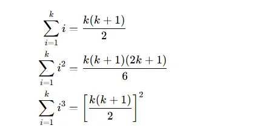
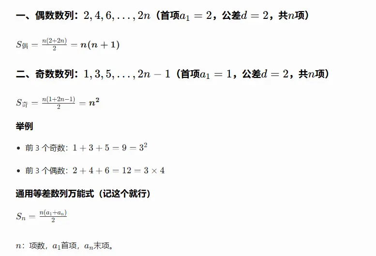
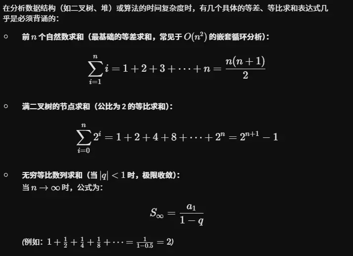

### 一、 等差数列 (Arithmetic Sequence)

等差数列是指从第二项起，每一项与它的前一项的差等于同一个常数的一种数列。这个常数称为**公差**（常以 $d$ 表示）。

- **通项公式：**
    
    $$a_n = a_1 + (n-1)d$$
    
- **前 $n$ 项和公式：**
    
    $$S_n = \frac{n(a_1 + a_n)}{2} = na_1 + \frac{n(n-1)}{2}d$$
    
- **核心性质：**
    
    - **等差中项：** 如果 $a, b, c$ 成等差数列，那么 $2b = a + c$。
        
    - **下标性质：** 若 $m + n = p + q$ （$m, n, p, q \in \mathbb{N}^*$），则 $a_m + a_n = a_p + a_q$。
        
    - $S_n, S_{2n} - S_n, S_{3n} - S_{2n}$ 依然组成等差数列。
        

### 二、  等比数列 (Geometric Sequence)

等比数列是指从第二项起，每一项与它的前一项的比值等于同一个常数的一种数列。这个常数称为**公比**（常以 $q$ 表示，且 $q \neq 0$）。

- **通项公式：**
    
    $$a_n = a_1 q^{n-1}$$
    
- **前 $n$ 项和公式：**
    
    当 $q = 1$ 时：
    
    $$S_n = na_1$$
    
    当 $q \neq 1$ 时：
    
    $$S_n = \frac{a_1(1-q^n)}{1-q} = \frac{a_1 - a_n q}{1-q}$$
    
- **核心性质：**
    
    - **等比中项：** 如果 $a, b, c$ 成等比数列，那么 $b^2 = a \cdot c$。
        
    - **下标性质：** 若 $m + n = p + q$ （$m, n, p, q \in \mathbb{N}^*$），则 $a_m \cdot a_n = a_p \cdot a_q$。
        
    - 在 $q \neq -1$ 等前提下，$S_n, S_{2n} - S_n, S_{3n} - S_{2n}$ 依然组成等比数列。

