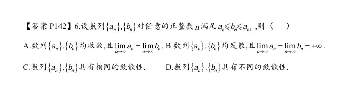

  
  
、  

  

  
这道题考察的是**数列的单调性**、夹逼定理（两边夹法则）以及单调数列极限存在的判定。

  

正确答案是 **C**。

  

下面为你详细推导和分析：

  

### 1. 挖掘隐含条件：推导单调性

已知对任意正整数 $n$，满足不等式：

  

$$a_n \le b_n \le a_{n+1}$$

我们观察不等式的两端，直接可以得出：

  

$$a_n \le a_{n+1}$$

这说明数列 $\{a_n\}$ 是一个**单调不减**（递增）数列。

  

同理，我们将不等式中的 $n$ 替换为 $n+1$，可以得到下一个相邻的不等式：

  

$$a_{n+1} \le b_{n+1} \le a_{n+2}$$

结合前一个不等式中的 $b_n \le a_{n+1}$，我们可以将其串联起来：

  

$$b_n \le a_{n+1} \le b_{n+1}$$

这就得出了：

  

$$b_n \le b_{n+1}$$

这说明数列 $\{b_n\}$ 也是一个**单调不减**数列。

  

对于单调数列而言，它的敛散性非常明确：**要么有界收敛，要么无界发散趋于无穷**。

  

### 2. 分析敛散性关系

既然知道这两个数列都是单调不减的，我们分情况讨论它们的敛散性关系：

  

**情况一：假设 $\{a_n\}$ 收敛**

如果 $\{a_n\}$ 收敛，设极限为 $\lim_{n \to \infty} a_n = A$。

那么它的子列（或平移后的数列）的极限也必然相同，即 $\lim_{n \to \infty} a_{n+1} = A$。

根据题设 $a_n \le b_n \le a_{n+1}$，我们可以使用**夹逼定理**：

不等式两端数列的极限都是 $A$，因此中间的数列 $\{b_n\}$ 也必然收敛，且极限为 $\lim_{n \to \infty} b_n = A$。

（结论：若 $\{a_n\}$ 收敛，则 $\{b_n\}$ 也收敛。）

  

**情况二：假设 $\{a_n\}$ 发散**

因为 $\{a_n\}$ 单调不减，如果它发散，必然是因为它没有上界，即 $\lim_{n \to \infty} a_n = +\infty$。

根据题设不等式的左半部分：$b_n \ge a_n$。

根据极限的保号性（或比较判别法），既然较小的 $a_n$ 都趋于正无穷了，比它大的 $b_n$ 必然也被“推”向无穷大，即 $\lim_{n \to \infty} b_n = +\infty$。

（结论：若 $\{a_n\}$ 发散，则 $\{b_n\}$ 也发散。）

  

**反向推导同理成立：**

  

- 若 $\{b_n\}$ 收敛于 $B$，由 $a_n \le b_n$ 可知 $\{a_n\}$ 有上界。单调有界必收敛，故 $\{a_n\}$ 收敛。
    
      
    
- 若 $\{b_n\}$ 发散于 $+\infty$，由 $a_{n+1} \ge b_n$ 可知 $\{a_{n+1}\}$ 也趋于无穷，故 $\{a_n\}$ 发散。
    
      
    

### 3. 选项判定

- **A 错误**：选项断言两者**必定收敛**。我们可以轻易构造反例，例如令 $a_n = n, b_n = n$，满足 $n \le n \le n+1$，但这两个数列都是发散的。
    
      
    
- **B 错误**：选项断言两者**必定发散**。我们可以构造反例，例如令 $a_n = 1, b_n = 1$，满足 $1 \le 1 \le 1$，这两个数列都是收敛的常数数列。
    
      
    
- **C 正确**：通过上面的严密推导，只要其中一个收敛，另一个必收敛；其中一个发散，另一个必发散。它们同生共死，即**具有相同的敛散性**。
    
      
    
- **D 错误**：与结论 C 完全相反。