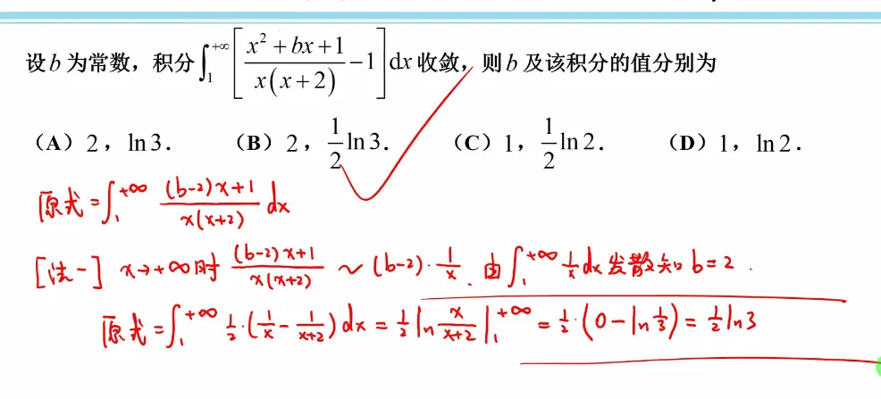
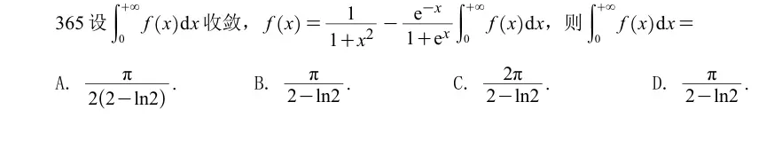

# 判断收敛性  
  

  

  

反常积分拆分后的收敛  才可以合并消除

不会的题  第一次  
  

发散+发散  是不确定   这个时候看不出来   需要算一下
这里也可以用泰勒  

  

  

> ### 题目
> 
> 设 $\displaystyle A=\int_{0}^{+\infty} f(x)\mathrm{d}x$，$A$ 是常数， $$ f(x)=\frac{1}{1+x^2}-\frac{e^{-x}}{1+e^{x}}A $$ 两边从 $0\to+\infty$ 积分： $$ A=\int_{0}^{+\infty}\frac{1}{1+x^2}\mathrm{d}x - A\int_{0}^{+\infty}\frac{e^{-x}}{1+e^{x}}\mathrm{d}x $$
> 
> 1. 计算第一个积分： $$ \int_{0}^{+\infty}\frac{1}{1+x^2}\mathrm{d}x=\arctan x\Big|_{0}^{+\infty}=\frac{\pi}{2} $$
> 2. 计算第二个积分： $$ \int_{0}^{+\infty}\frac{e^{-x}}{1+e^{x}}dx =\int_{0}^{+\infty}\frac{1}{e^{x}(1+e^{x})}dx =\int_{0}^{+\infty}\left(\frac1{e^x}-\frac1{1+e^x}\right)dx $$ $$ \int_{0}^{+\infty}\big(e^{-x}-\frac1{1+e^x}\big)dx =\Big[-e^{-x}-\ln(1+e^x)\Big]_{0}^{+\infty} $$ $x\to+\infty$： $-e^{-x}-\ln(e^x(1+e^{-x}))=-e^{-x}-x-\ln(1+e^{-x})\sim -x$ 换元更简单：令 $u=e^x,\mathrm{d}u=e^x dx\Rightarrow dx=\dfrac{\mathrm{d}u}{u}$ $$ \int_{0}^{+\infty}\frac{e^{-x}}{1+e^x}dx =\int_{1}^{+\infty}\frac{1}{u(1+u)}\cdot\frac{\mathrm{d}u}{u} =\int_{1}^{+\infty}\left(\frac1{u^2}-\frac1u+\frac1{u+1}\right)du $$ $$ =\left(-\frac1u-\ln u+\ln(u+1)\right)\bigg|_{1}^{+\infty} =\left(-\frac1u+\ln\frac{u+1}{u}\right)\bigg|_{1}^{+\infty} $$ $$ =0-\left(-1+\ln2\right)=1-\ln2 $$
> 
> 带回方程： $$ A=\frac{\pi}{2}-A(1-\ln 2) $$ $$ A+A(1-\ln2)=\frac{\pi}{2} $$ $$ A\cdot\big(2-\ln2\big)=\frac{\pi}{2} $$ $$ A=\boldsymbol{\frac{\pi}{2(2-\ln 2)}} $$
> 
> ✅答案：**A**
# 判断参数  

  

# 反常积分的计算（一般会变出现趋向于无穷为定值的函数  分布积分）

  

  

  

  

三角换元  

这里是把 sect=根号 2 x  
