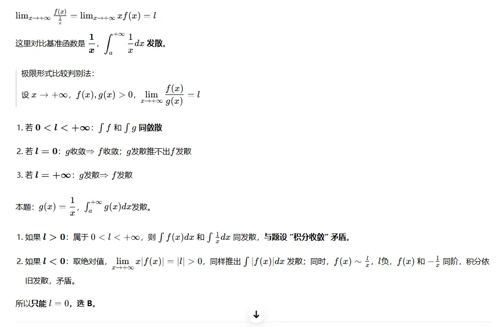
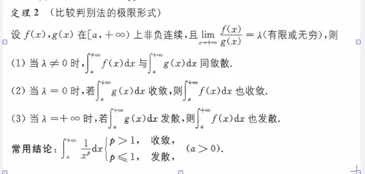

# 判断收敛性  
  

  

  

反常积分拆分后的收敛  才可以合并消除

# 判断参数  

  

# 反常积分的计算（一般会变出现趋向于无穷为定值的函数  分布积分）

  

  

  

  

三角换元  

这里是把 sect=根号 2 x  

## 难题
不会的题  第一次  
  

发散+发散  是不确定   这个时候看不出来   需要算一下
这里也可以用泰勒  
> # 题目
> 
> $$ \int_{1}^{2}\left[\frac{1}{x\ln^{2}x}-\frac{k}{(x-1)^2}\right]dx $$ 瑕点：$x\to1^+$，令 $t=x-1$，$t\to0^+$，$(x=1+t)$。 $$ \ln x=\ln(1+t)=t-\frac{t^2}{2}+o(t^2) $$ $$ \ln^2 x = t^2-t^3+o(t^3) $$ $$ \begin{aligned} \frac{1}{x\ln^2x} &=\frac{1}{(1+t)\left(t^2-t^3+o(t^3)\right)}\ &=\frac1{t^2}(1-t+o(t))(1+t+o(t))\ &=\frac1{t^2}-1+o(1) \end{aligned} $$ 被积函数： $$ \frac{1}{x\ln^2x}-\frac{k}{(x-1)^2}=\frac{1-k}{t^2}-1+o(1) $$
> 
> 反常积分 $\displaystyle\int_{0^+}\frac{1}{t^p}dt$：
> 
> - $p\ge1$：发散；$(p<1)$：收敛。
> 
> 1. ** $k\neq1$ **：主项 $\dfrac{1-k}{t^2}$，$(p=2>1)$，积分发散。B错。
> 2. ** $(k=1)$ **：$\dfrac{1-k}{t^2}=0$，被积函数 $\sim -1+o(1)$，瑕点附近有界，积分收敛。A正确。
> 3. ** $(k=0)$ **：被积函数 $\sim\dfrac1{t^2}$，发散。C错。
> 4. ** $k\neq0$ **，若 $k\neq1$ 仍然发散。D错。
> 
> ✅答案：**A**
> 
> ---  

> 

> 
> ### 题目
> 
> $$ \varphi(x)=\frac{2}{\sqrt{\pi b}}\int_{0}^{x}e^{-\frac{t^2}{b}}dt,\quad b>0 $$ 求：$\displaystyle I=\int_{0}^{+\infty}\big[1-\varphi(x)\big]dx$，已知 $\displaystyle\int_{0}^{+\infty}e^{-t^2}dt=\frac{\sqrt{\pi}}{2}$。
> 
> 1. 先看极限： $$ \lim_{x\to+\infty}\varphi(x)=\frac{2}{\sqrt{\pi b}}\int_{0}^{+\infty}e^{-\frac{t^2}{b}}dt $$ 换元：令 $u=\frac{t}{\sqrt b}\Rightarrow t=u\sqrt b,\ dt=\sqrt b du$ $$ \int_{0}^{+\infty}e^{-\frac{t^2}{b}}dt=\sqrt b\int_{0}^{+\infty}e^{-u^2}du=\sqrt b\cdot\frac{\sqrt\pi}{2} $$ $$ \lim_{x\to+\infty}\varphi(x)=\frac{2}{\sqrt{\pi b}}\cdot \sqrt b\cdot\frac{\sqrt\pi}{2}=1 $$ 所以 $1-\varphi(+\infty)=0$，适合**分部积分**。
> 
> $$ I=\int_{0}^{+\infty}\big[1-\varphi(x)\big]dx $$ 设 $u=1-\varphi(x),\ dv=dx$ $$ du=-\varphi'(x)dx,\quad v=x $$ 分部积分公式：$\displaystyle \int_{0}^{+\infty} u,dv = uv\big|_{0}^{+\infty}-\int_{0}^{+\infty}v,du$
> 
> 边界项： $$ uv\big|_{0}^{+\infty}=x\big(1-\varphi(x)\big)\Big|_{0}^{+\infty} $$
> 
> - $(x=0)$：$0\cdot(1-\varphi(0))=0$
> - $x\to+\infty$：$1-\varphi(x)\sim \text{指数衰减}$，$x(1-\varphi(x))\to0$，边界项整体为 0。
> 
> $$ I=0-\int_{0}^{+\infty}x\cdot\big(-\varphi'(x)\big)dx=\int_{0}^{+\infty}x,\varphi'(x)dx $$
> 
> 求导： $$ \varphi'(x)=\frac{2}{\sqrt{\pi b}} e^{-\frac{x^2}{b}} $$
> 
> $$ I=\int_{0}^{+\infty} x\cdot \frac{2}{\sqrt{\pi b}} e^{-\frac{x^2}{b}}dx $$ 凑微分：令 $u=\dfrac{x^2}{b},\ du=\dfrac{2x}{b}dx \Rightarrow xdx=\dfrac b2 du$ $$ \begin{aligned} I&=\frac{2}{\sqrt{\pi b}}\int_{0}^{+\infty}e^{-u}\cdot \frac b2 du\ &=\frac{2}{\sqrt{\pi b}}\cdot\frac b2 \int_{0}^{+\infty}e^{-u}du\ &=\frac{b}{\sqrt{\pi b}}\cdot 1\ &=\boldsymbol{\sqrt{\frac{b}{\pi}}} \end{aligned} $$
> 
> ✅答案：**C**

> ### 题目
> 
> 设 $\displaystyle A=\int_{0}^{+\infty} f(x)\mathrm{d}x$，$A$ 是常数， $$ f(x)=\frac{1}{1+x^2}-\frac{e^{-x}}{1+e^{x}}A $$ 两边从 $0\to+\infty$ 积分： $$ A=\int_{0}^{+\infty}\frac{1}{1+x^2}\mathrm{d}x - A\int_{0}^{+\infty}\frac{e^{-x}}{1+e^{x}}\mathrm{d}x $$
> 
> 1. 计算第一个积分： $$ \int_{0}^{+\infty}\frac{1}{1+x^2}\mathrm{d}x=\arctan x\Big|_{0}^{+\infty}=\frac{\pi}{2} $$
> 2. 计算第二个积分： $$ \int_{0}^{+\infty}\frac{e^{-x}}{1+e^{x}}dx =\int_{0}^{+\infty}\frac{1}{e^{x}(1+e^{x})}dx =\int_{0}^{+\infty}\left(\frac1{e^x}-\frac1{1+e^x}\right)dx $$ $$ \int_{0}^{+\infty}\big(e^{-x}-\frac1{1+e^x}\big)dx =\Big[-e^{-x}-\ln(1+e^x)\Big]_{0}^{+\infty} $$ $x\to+\infty$： $-e^{-x}-\ln(e^x(1+e^{-x}))=-e^{-x}-x-\ln(1+e^{-x})\sim -x$ 换元更简单：令 $u=e^x,\mathrm{d}u=e^x dx\Rightarrow dx=\dfrac{\mathrm{d}u}{u}$ $$ \int_{0}^{+\infty}\frac{e^{-x}}{1+e^x}dx =\int_{1}^{+\infty}\frac{1}{u(1+u)}\cdot\frac{\mathrm{d}u}{u} =\int_{1}^{+\infty}\left(\frac1{u^2}-\frac1u+\frac1{u+1}\right)du $$ $$ =\left(-\frac1u-\ln u+\ln(u+1)\right)\bigg|_{1}^{+\infty} =\left(-\frac1u+\ln\frac{u+1}{u}\right)\bigg|_{1}^{+\infty} $$ $$ =0-\left(-1+\ln2\right)=1-\ln2 $$
> 
> 带回方程： $$ A=\frac{\pi}{2}-A(1-\ln 2) $$ $$ A+A(1-\ln2)=\frac{\pi}{2} $$ $$ A\cdot\big(2-\ln2\big)=\frac{\pi}{2} $$ $$ A=\boldsymbol{\frac{\pi}{2(2-\ln 2)}} $$
> 
> ✅答案：**A**