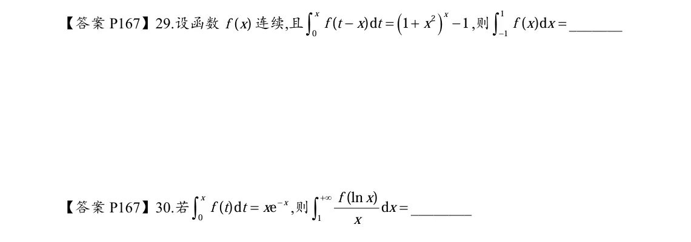
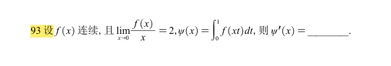
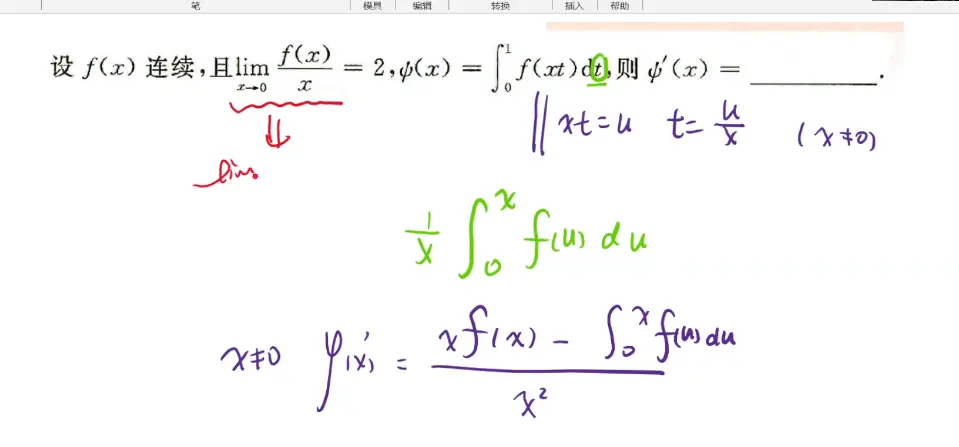
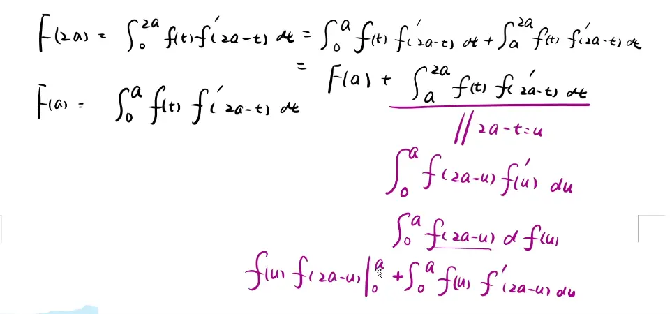
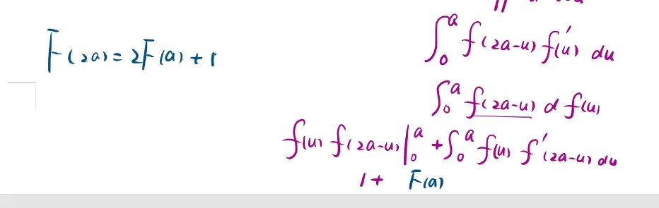
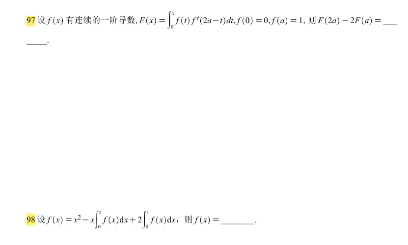
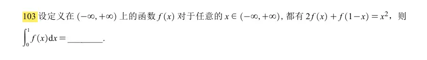
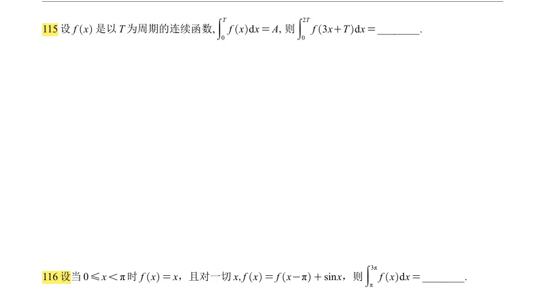
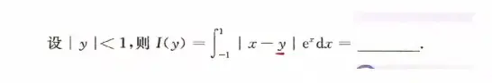
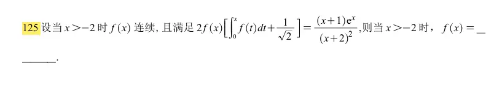

  

  
  

#  绝对值  拆不了的函数最小数值问题  
>   
> ## 题目
> 
> $$(f(x))=\int_{x}^{x+1}\big|t(t^2-1)\big|,dt$$ 求 $(f(x))$ 的最小值。
> 
> ### 步骤 1：变上下限积分求导
> 
> 公式：$\displaystyle \frac{d}{dx}\int_{u(x)}^{v(x)}g(t)dt = g(v(x))v'-g(u(x))u'$ $$ f'(x)=\big|(x+1)\big((x+1)^2-1\big)\big|\cdot 1-\big|x(x^2-1)\big|\cdot 1 $$ 化简里面表达式： $$(x+1)\big[(x+1)^2-1\big]=(x+1)(x^2+2x)=x(x+1)(x+2)$$ 于是 $$ \boldsymbol{f'(x)=\big|x(x+1)(x+2)\big|-\big|x(x-1)(x+1)\big|} $$
> 
> > $(f(x))$ 的含义：**长度恒为 1 的区间 $([x,x+1])$ 上，$|t(t^2-1)|$ 的积分；移动区间端点 $x$，找积分最小。** 被积函数 $g(t)=|t(t^2-1)|=|t(t-1)(t+1)|$，零点：$t=-1,0,1$。
> 
> ### 步骤 2：找驻点 $f'(x)=0$
> 
> $$ |x(x+1)(x+2)| = |x(x+1)(x-1)| $$ $(x(x+1)=0)$ 时，$(x=0)$ 或 $x=-1$，导数为 0，是候选； 若 $x(x+1)\neq0$，两边约去绝对值 $|x(x+1)|$： $$|x+2|=|x-1|$$ 平方：$(x+2)^2=(x-1)^2 \Rightarrow x^2+4x+4=x^2-2x+1 \Rightarrow 6x=-3 \Rightarrow \boldsymbol{x=-\dfrac12}$。
> 
> 候选驻点：$\boldsymbol{x=-1,\ x=-\dfrac12,\ (x=0)}$。
> 
> ### 步骤 3：分别代入计算 $(f(x))$
> 
> 1. $x=-1$，积分区间 $[-1,0]$ $$ f(-1)=\int_{-1}^{0}\big|t(t^2-1)\big|dt $$ $t\in[-1,0],\ t(t^2-1)=t^3-t>0$，绝对值可去掉 $$ \int_{-1}^{0}(t^3-t)dt=\left[\frac{t^4}{4}-\frac{t^2}{2}\right]_{-1}^0=0-\left(\frac14-\frac12\right)=\frac14 $$
> 2. $(x=0)$，积分区间 $([0,1])$ $$ f(0)=\int_{0}^{1}\big|t(t^2-1)\big|dt=\int_{0}^{1}t(1-t^2)dt=\int_{0}^{1}(t-t^3)dt=\left[\frac{t^2}{2}-\frac{t^4}{4}\right]_0^1=\frac12-\frac14=\boldsymbol{\frac14} $$
> 3. $\boldsymbol{x=-\dfrac12}$，积分区间 $\boldsymbol{\left[-\dfrac12,\dfrac12\right]}$ $$ f\left(-\frac12\right)=\int_{-\frac12}^{\frac12}\big|t(t^2-1)\big|dt $$ 被积函数是偶函数： $$ =2\int_{0}^{\frac12} t(1-t^2)dt =2\int_{0}^{\frac12}(t-t^3)dt =2\left[\frac{t^2}{2}-\frac{t^4}{4}\right]_0^{\frac12} $$ $$ =2\left(\frac{1}{8}-\frac{1}{4\cdot16}\right)=2\left(\frac18-\frac{1}{64}\right)=2\cdot\frac{7}{64}=\boldsymbol{\frac{7}{32}} $$
> 
> 比较数值： $\dfrac7{32}=0.21875,\quad \dfrac14=0.25$，$\dfrac{7}{32}<\dfrac14$。
> 
> ### 结论
> 
> 最小值为 $\boldsymbol{\dfrac{7}{32}}$。
> 
> ---
> 
> ### 小结思路
> 
> 4. 变限求导，得到 $f'(x)$；
> 5. 解方程 $f'(x)=0$，得到全部驻点；
> 6. 分别计算每个驻点对应的定积分；
> 7. 比较大小得到最小值 $\boldsymbol{\dfrac{7}{32}}$。
> 
> > 直观理解：区间长度固定为 1，把区间放在 $[-\frac12,\frac12]$，刚好跨过原点，避开 $t=\pm1$，被积函数整体更小，积分取得最小。  

# 换元转换  

  

97 难题  
  

  

  区间再现

  

>   
> # 题目
> 
> 设 $|y|<1$，计算 $$I(y)=\int_{-1}^{1}|x-y|e^x dx$$
> 
> 绝对值拆分界点：$(x=y)$，把积分拆成 $\displaystyle\int_{-1}^{y}(y-x)e^x dx+\int_{y}^{1}(x-y)e^x dx$。
> 
> 需要公式： $$ \begin{aligned} \int xe^x dx &= xe^x-e^x +C=(x-1)e^x+C\ \int e^x dx &= e^x+C \end{aligned} $$
> 
> ## 第一部分：$I_1=\displaystyle\int_{-1}^{y}(y-x)e^x dx$
> 
> $$ \begin{aligned} I_1&=y\int_{-1}^{y}e^x dx-\int_{-1}^{y}xe^x dx\ &=\left.ye^x\right|_{-1}^{y}-\left.(x-1)e^x\right|_{-1}^{y}\ &=y(e^y-e^{-1})-\Big[(y-1)e^y - (-1-1)e^{-1}\Big]\ &=ye^y-ye^{-1}-(y-1)e^y -2e^{-1}\ &=ye^y-ye^{-1}-ye^y+e^y-2e^{-1}\ &=e^y - e^{-1}(y+2) \end{aligned} $$
> 
> ## 第二部分：$I_2=\displaystyle\int_{y}^{1}(x-y)e^x dx$
> 
> $$ \begin{aligned} I_2&=\int_{y}^{1}xe^x dx - y\int_{y}^{1}e^x dx\ &=\left.(x-1)e^x\right|_{y}^{1}-\left.ye^x\right|_{y}^{1}\ &=\big[(1-1)e^1-(y-1)e^y\big]-y(e^1-e^y)\ &=0-(y-1)e^y -ye +ye^y\ &=-ye^y+e^y-ye+ye^y\ &=e^y - ye \end{aligned} $$
> 
> ## 合并 $I(y)=I_1+I_2$
> 
> $$ \begin{aligned} I(y)&=\Big[e^y-e^{-1}(y+2)\Big]+\Big[e^y-ye\Big]\ &=2e^y -ey -\frac{y+2}{e} \end{aligned} $$
> 
> 整理： $$ \boldsymbol{I(y)=2e^y-\left(e+\frac1e\right)y-\frac{2}{e}} $$
> 
> ✅最终答案： $$\boxed{2e^y-\left(e+\dfrac1e\right)y-\dfrac{2}{e}}$$
> 
> ---
> 
> ### 验算小检查
> 
> 对 $y$ 求导： $I'(y)=2e^y-\left(e+\dfrac1e\right)$，也符合含绝对值积分求导公式，结果正确。  

