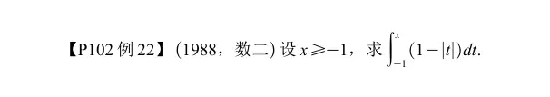
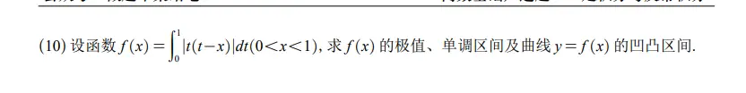

# 分段函数求变上限积分函数（分类讨论 必连续）  

> # 题目
> 
> 设函数 $$ (f(x))=\int_{0}^{1}|t(t-x)|\mathrm dt,\quad (0<x<1) $$ 求 $(f(x))$ 的极值、单调区间、曲线 $y=(f(x))$ 的凹凸区间。
> 
> > 绝对值里面零点：$(t=0)$ 和 $\boldsymbol{(\boldsymbol{t=x})}$，积分区间 $t\in[0,1]$，$(0<x<1)$，所以把积分拆成两段：$([0,x])$ 和 $([x,1])$
> 
> 当 $t\in([0,x])$：$t-x\le 0 \implies |t(t-x)|=t(x-t)$ 当 $t\in([x,1])$：$t-x\ge 0 \implies |t(t-x)|=t(t-x)$
> 
> $$ \begin{aligned} (f(x))&=\int_{0}^{x}t(x-t)dt+\int_{x}^{1}t(t-x)dt \end{aligned} $$
> 
> ### 计算第一个积分
> 
> $$ \begin{aligned} \int_{0}^{x}(xt-t^2)dt &=\left.\left(\frac{x}{2}t^2-\frac13t^3\right)\right|_{0}^{x}\ &=\frac{x^3}{2}-\frac{x^3}{3}=\frac16x^3 \end{aligned} $$
> 
> ### 计算第二个积分
> 
> $$ \begin{aligned} \int_{x}^{1}(t^2-xt)dt &=\left.\left(\frac13t^3-\frac x2 t^2\right)\right|_{x}^{1}\ &=\left(\frac13-\frac x2\right)-\left(\frac{x^3}{3}-\frac{x^3}{2}\right)\ &=\frac13-\frac x2+\frac16x^3 \end{aligned} $$
> 
> ### 合并得到 $(f(x))$
> 
> $$ \begin{aligned} (f(x))&=\frac16x^3+\frac13-\frac x2+\frac16x^3 \ &=\boldsymbol{\frac13x^3-\frac12x+\frac13},\quad (0<x<1) \end{aligned} $$
> 
> ---
> 
> ## 求一阶导数（单调、极值）
> 
> $$ f'(x)=x^2-\frac12 $$ 令 $f'(x)=0$，$x^2=\dfrac12 \Rightarrow \boldsymbol{x=\dfrac{\sqrt2}{2}}$（$(0<x<1)$，舍去负根）
> 
> - $0<x<\dfrac{\sqrt2}{2}$：$f'(x)<0$，$\boldsymbol{(f(x))(\boldsymbol{f(x)单调递减})}$
> - $\dfrac{\sqrt2}{2}<x<1$：$f'(x)>0$，$\boldsymbol{(f(x))(\boldsymbol{f(x)单调递增})}$
> 
> **极小值在 $x=\dfrac{\sqrt2}{2}$，无极大值** $$ \begin{aligned} f\left(\frac{\sqrt2}{2}\right) &=\frac13\left(\frac{\sqrt2}{2}\right)^3-\frac12\cdot\frac{\sqrt2}{2}+\frac13 \ &=\frac13\cdot\frac{2\sqrt2}{8}-\frac{\sqrt2}{4}+\frac13\ &=\frac{\sqrt2}{12}-\frac{3\sqrt2}{12}+\frac13\ &=\boldsymbol{\frac13-\frac{\sqrt2}{6}} \end{aligned} $$
> 
> ## 二阶导数（凹凸区间）
> 
> $$ f''(x)=2x>0,\quad \forall,x\in(\boldsymbol{(0,1)}) $$ $f''(x)$ 恒大于 0：
> 
> - 整个区间 $\boldsymbol{(\boldsymbol{(0,1)})}$ 为**凹区间**，没有凸区间，无拐点。
> 
> ---
> 
> # 汇总结果
> 
> 1. **单调区间**
> 
> - (\boldsymbol{f(x)单调递减})区间：$\boldsymbol{\left(0,\dfrac{\sqrt2}{2}\right)}$
> - (\boldsymbol{f(x)单调递增})区间：$\boldsymbol{\left(\dfrac{\sqrt2}{2},1\right)}$
> 
> 2. **极值**
> 
> - 极小值：$\boldsymbol{f\left(\dfrac{\sqrt2}{2}\right)=\dfrac13-\dfrac{\sqrt2}{6}}$，无极大值。
> 
> 3. **凹凸区间**
> 
> - 凹区间：$\boldsymbol{(\boldsymbol{(0,1)})}$；无凸区间，无拐点。
> 
> > 小技巧：带绝对值的含参定积分，**先按绝对值零点拆分积分，去掉绝对值，把 $(f(x))$ 显式求出来，再求导研究性态**，不要直接对带绝对值积分求导。
> 
> 要不要我帮你整理这类「含绝对值含参数定积分」的做题模板？