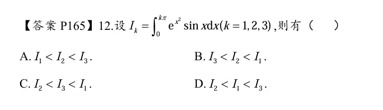

# 可积与原函数存在（两个不同的概念）

# 性态  (比大小画图分析) （连续型 可导性  奇偶性  都受被积函数的影响）

  

  不需要加上 c   是一个函数

强化

## 周期性  

## 反函数  

## 比大小  

  

> # 题目
> 
> $$ M=\int_{-\frac{\pi}{2}}^{\frac{\pi}{2}}\frac{(1+x)^2}{1+x^2}dx,\quad N=\int_{-\frac{\pi}{2}}^{\frac{\pi}{2}}\frac{1+x}{e^x}dx,\quad K=\int_{-\frac{\pi}{2}}^{\frac{\pi}{2}}\big(1+\sqrt{\cos x}\big)dx $$ 比较大小。
> 
> ---
> 
> ## 1. 化简 M
> 
> $$ \frac{(1+x)^2}{1+x^2}=\frac{1+2x+x^2}{1+x^2}=1+\frac{2x}{1+x^2} $$ $\dfrac{2x}{1+x^2}$ 是奇函数，对称区间积分=0 $$ M=\int_{-\frac{\pi}{2}}^{\frac{\pi}{2}}1,dx+0=\pi $$
> 
> ## 2. 化简 N，利用公式 $\int_{-a}^{a}f(x)dx=\int_{0}^{a}\big[f(x)+f(-x)\big]dx$
> 
> $$ f(x)=\frac{1+x}{e^x},\quad f(-x)=\frac{1-x}{e^{-x}}=(1-x)e^x $$ $$ f(x)+f(-x)=\frac{1+x}{e^x}+(1-x)e^x $$ 令 $$ (g(x))=\frac{1+x}{e^x}+(1-x)e^x,;x\in[0,\frac{\pi}{2}] $$ $$ g'(x)=-xe^{-x}-xe^{x}=-x(e^{-x}+e^{x})<0,;(x>0) $$ $(g(x))$ 在 $(x>0)$ 严格递减，$g(0)=\frac{1}{1}+1\cdot1=2$，故 $(x>0)$ 时 $(g(x))<2$。 $$ N=\int_{0}^{\frac{\pi}{2}}(g(x))dx<\int_{0}^{\frac{\pi}{2}}2dx=\pi $$
> 
> ## 3. 化简 K
> 
> $$ K=\int_{-\frac{\pi}{2}}^{\frac{\pi}{2}}1dx+\int_{-\frac{\pi}{2}}^{\frac{\pi}{2}}\sqrt{\cos x},dx $$ $\sqrt{\cos x}$ 是偶函数： $$ K=\pi+2\int_{0}^{\frac{\pi}{2}}\sqrt{\cos x},dx $$ $\displaystyle\int_{0}^{\frac{\pi}{2}}\sqrt{\cos x},d(x>0)$，所以 $\boldsymbol{K>\pi}$。
> 
> > 小结：
> 
> - $K>\pi$
> - $M=\pi$
> - $N<\pi$
> 
> 得到：$\boldsymbol{(\boldsymbol{K>M>N})}$，选 **C**。
> **对称区间，函数非奇非偶，拆成 0 到 a 的积分，不用算负半轴，用来放缩、比大小非常好用**。
> ---
> 
> **答案：C**
> 
> > 核心技巧：对称区间积分，拆奇偶函数 / 使用 $\int_{-a}^a f=\int_0^a [f(x)+f(-x)]dx$，不用算出具体数值，只比大小。

# fx 的连续性   决定积分上限函数的可导性

  

# fx可积 其积分上限函数连续  

# 证明选择题  

## 强化的题  (一开始都不会做   对于题目  看到被积函数导数 求定积分  一般想到 定积分的分布积分)

分布积分做
  

# 变上限积分的估阶  

  

# 定积分的保号性  
  
（从图像上就可以进行分析）  

# 函数极值单调性 凹凸区间（绝对值的处理）  

