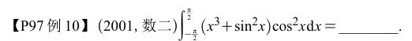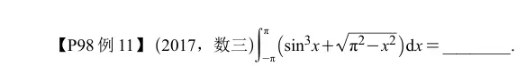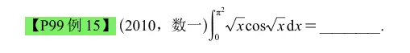  

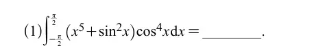  
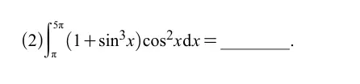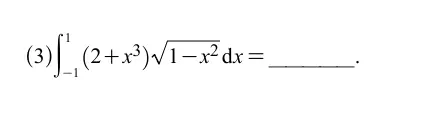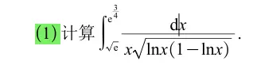  
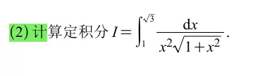  

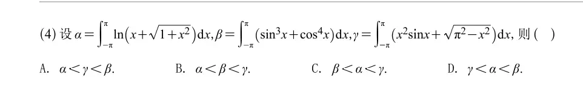

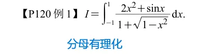观察分母  发现分母有理化之后是可以消 1 的
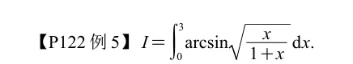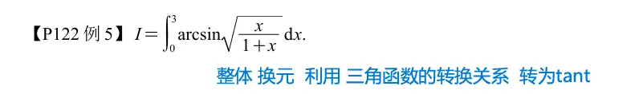  

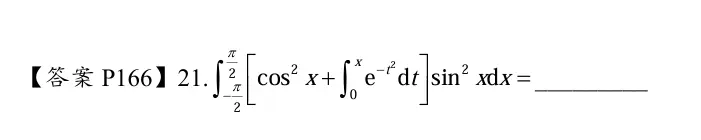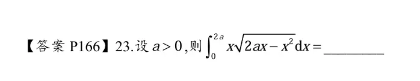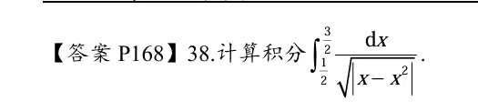找到分界点 分为两部分来算  
  

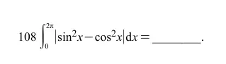里面是 cos 2 x 的倍角公式  

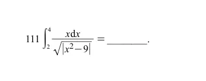对于绝对值找分界点  

  

**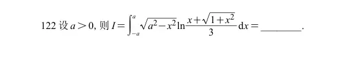**

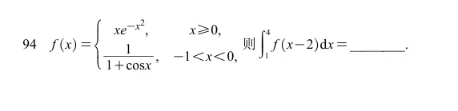

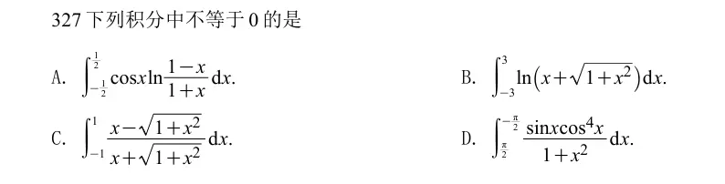

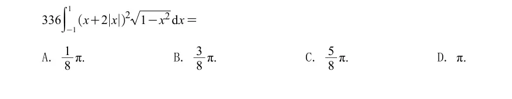  
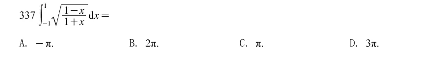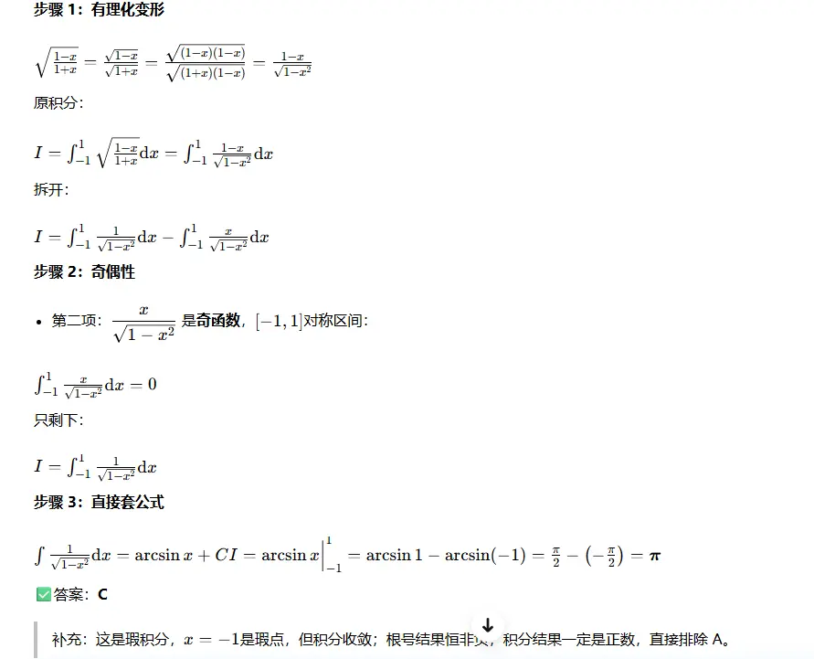

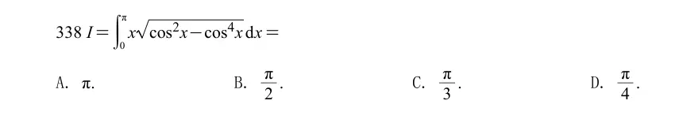

# 区间再现  

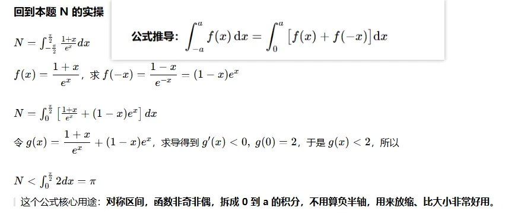
> # 推导 $\displaystyle \int_{-a}^{a} (f(x))\mathrm{d}x=\int_{0}^{a}\big[(f(x))+f(-x)\big]\mathrm{d}x$
> 
> 第一步：定积分区间拆分 $$ \int_{-a}^{a} (f(x))\mathrm{d}x =\int_{-a}^{0} (f(x))\mathrm{d}x+\int_{0}^{a} (f(x))\mathrm{d}x $$
> 
> 对**第一个积分 $\displaystyle\int_{-a}^{0} (f(x))\mathrm{d}x$**做变量代换： 令 $\boldsymbol{x=-t}$，则
> 
> - $x=-a \Rightarrow t=a$
> - $x=0 \Rightarrow t=0$
> - $\mathrm{d}x=-\mathrm{d}t$
> 
> 代入： $$ \begin{aligned} \int_{-a}^{0} (f(x))\mathrm{d}x &=\int_{a}^{0} f(-t),(-\mathrm{d}t)\ &=\int_{0}^{a} f(-t),\mathrm{d}t \end{aligned} $$ 定积分哑元可以换字母，$t$ 改回 $x$： $$ \int_{-a}^{0} (f(x))\mathrm{d}x=\int_{0}^{a} f(-x)\mathrm{d}x $$
> 
> 代回拆分式： $$ \begin{aligned} \int_{-a}^{a}(f(x))\mathrm{d}x &=\underbrace{\int_{-a}^0 (f(x))dx}_{=\int_0^a f(-x)dx}+\int_{0}^{a}(f(x))dx\ &=\int_{0}^{a}f(-x)\mathrm{d}x+\int_{0}^{a}(f(x))\mathrm{d}x\ &=\boldsymbol{\int_{0}^{a}\Big[(f(x))+f(-x)\Big]\mathrm{d}x} \end{aligned} $$ ✅推导完成。
> 
> ---
> 
> ## 推论（奇偶函数）
> 
> 1. 若 $(f(x))$ 是偶函数：$f(-x)=(f(x))$ $$ \int_{-a}^a (f(x))dx=\int_0^a \big[(f(x))+(f(x))\big]dx=\boldsymbol{2\int_0^a (f(x))dx} $$
> 2. 若 $(f(x))$ 是奇函数：$f(-x)=-(f(x))$ $$ \int_{-a}^a (f(x))dx=\int_0^a\big[(f(x))-(f(x))\big]dx=\boldsymbol{0} $$
> 
> ## 考研典型使用场景
> 
> 被积函数本身**非奇非偶**，但是 $(f(x))+f(-x)$ 会极大化简（就像刚才那道 $e^x/(1+e^x)$ 的题）： $$ (f(x))=\frac{e^x}{1+e^x}g(x),\ g\text{偶函数} $$ $$ (f(x))+f(-x)=\frac{e^x}{1+e^x}g(x)+\frac{1}{1+e^x}g(x)=g(x) $$ 直接把复杂分式消掉，这就是这个公式的实战价值。
> 
> > 记忆口诀：对称区间积分，搬一半到0到a，把 $x$ 换成 $-x$ 加原函数再积分。

  

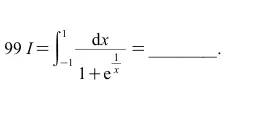  
