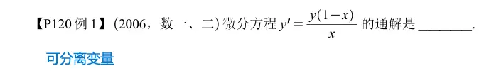

# 一阶微分方程  

## 可分离变量  

### 基础讲义  

### 基础严选  

### 强化讲义  

### 强化严选  

### 660 填空  

### 660 选择  

## 齐次   
### 基础讲义  

### 基础严选  

### 强化讲义  

### 强化严选  

### 660 填空  

### 660 选择  

##  一阶线性  

### 基础讲义  

### 基础严选  

### 强化讲义  

### 强化严选  

### 660 填空  

### 660 选择  
#  高阶微分方程  

## y 二阶有 x 型  

### 基础讲义  

### 基础严选  

### 强化讲义  

### 强化严选  

### 660 填空  

### 660 选择  
## y 二阶无 x 型  

### 基础讲义  

### 基础严选  

### 强化讲义  

### 强化严选  

### 660 填空  

### 660 选择  

# 高阶线性微分方程  

## 常系数齐次  
### 基础讲义  

### 基础严选  

### 强化讲义  

### 强化严选  

### 660 填空  

### 660 选择  

## 常系数非齐次  

### 基础讲义  

### 基础严选  

### 强化讲义  

### 强化严选  

### 660 填空  

### 660 选择  
