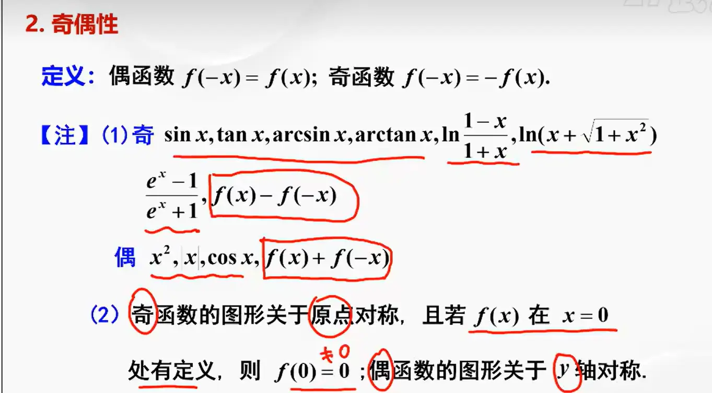
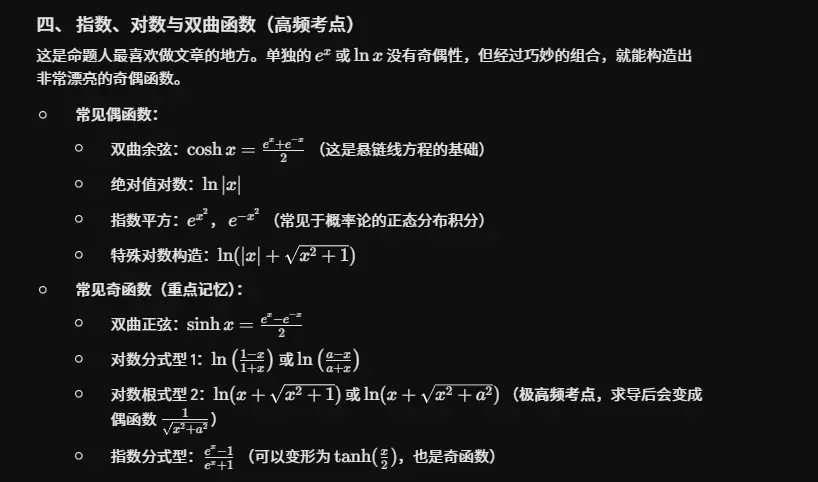
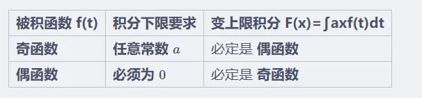

# 常见的奇偶函数

  

  

# 函数的奇偶性和导数的关系  

判断变上限积分函数的奇偶性，有一套非常干脆利落的对应法则。核心原则是观察**被积函数 $f(t)$ 的奇偶性**，以及**积分下限的值**。

你可以直接通过以下对照表和“下限陷阱”来进行秒杀判定：

### 1. 核心判定法则（速查表）

|**被积函数 f(t)**|**积分下限要求**|**变上限积分 F(x)=∫ax​f(t)dt**|
|---|---|---|
|**奇函数**|**任意常数 $a$ **|必定是 **偶函数**|
|**偶函数**|**必须为 $0$ **|必定是 **奇函数**|

### 2. 警惕“下限陷阱”（考研高频易错点）

在综合考试中，出题人最喜欢在积分下限上挖坑，请务必牢记以下两个推论：

- **奇函数的积分绝对“耐造”：** 如果被积函数是奇函数，不管下限 $a$ 是 $0, 1, -\pi$ 还是任何乱七八糟的常数，积出来的 $F(x)$ **永远是偶函数**。
    
- **偶函数的积分非常“娇贵”：** 如果被积函数是偶函数，**只有当积分下限为 0 时**，积出来的 $F(x)$ 才是奇函数。如果下限 $a \neq 0$（例如 $\int_{1}^{x} t^2 dt$），算出来的结果是一个奇函数加上一个常数，它**既不是奇函数也不是偶函数**。
    

### 3. 万能推导法（如何自己证？）

如果在考场上忘记了规律，或者遇到没有明确奇偶性的抽象函数，你可以随时掏出“万能代数推导法”来原生地判断它。

判断 $F(x)$ 奇偶性的唯一标准就是计算 ** $F(-x)$ ** 并观察它与 $F(x)$ 的关系。

**第一步：写出 $F(-x)$ 的表达式**

$$F(-x) = \int_{0}^{-x} f(t) dt$$

**第二步：令 $t = -u$ 进行换元（固定动作）**

既然积分上限有负号，我们就通过换元把它翻转过来。

令 $t = -u$，则微分 $dt = -du$。

更新积分限：当 $t = 0$ 时 $u = 0$；当 $t = -x$ 时 $u = x$。

将这些代入式子中：

$$F(-x) = \int_{0}^{x} f(-u) (-du) = -\int_{0}^{x} f(-u) du$$

**第三步：根据被积函数的性质下结论**

此时，我们只需要看 $f(-u)$ 会变成什么：

- **如果 $f$ 是偶函数：** $f(-u) = f(u)$。
    
    此时式子变为：$F(-x) = -\int_{0}^{x} f(u) du = -F(x)$。
    
    得出结论：$F(x)$ 是**奇函数**。
    
- **如果 $f$ 是奇函数：** $f(-u) = -f(u)$。
    
    此时式子的负号被抵消：$F(-x) = -\int_{0}^{x} (-f(u)) du = \int_{0}^{x} f(u) du = F(x)$。
    
    得出结论：$F(x)$ 是**偶函数**。
    

_(注：计算过程中最后的哑变量 $u$ 和 $t$ 是等价的，可以直接替换看待。)_