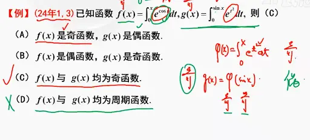

# 常见的奇偶函数

  

  

# 函数的奇偶性和导数的关系  

被积函数 $f(x)$ 与其变上限积分函数 $\Phi(x) = \int_a^x f(t) dt$ 之间的奇偶性关系，是微积分中的一个核心考点。

这两者之间的奇偶性转化非常有规律，但**最容易踩坑的地方在于“积分下限 $a$”的取值**。

以下是核心结论与详细剖析：

### 核心结论速记

1. **若 $f(x)$ 是奇函数** $\implies$ $\int_a^x f(t) dt$ 永远是 **偶函数**（无论下限 $a$ 取什么常数）。
    
2. **若 $f(x)$ 是偶函数** $\implies$ $\int_0^x f(t) dt$ 是 **奇函数**（⚠️ **下限必须为 $0$ **，若 $a \neq 0$，则既不是奇函数也不是偶函数）。
    

### 深入剖析与几何直观

#### 1. 当被积函数 $f(x)$ 为奇函数时

- **原理解释：** 奇函数的图像关于原点中心对称。由于积分代表代数面积，当你从任意一个常数 $a$ 积分到 $x$ 和 $-x$ 时，多出来的面积总是完美对称的。在代数推导上，奇函数求不定积分（即求原函数）会升幂或转变为偶次项（例如 $x \to \frac{1}{2}x^2$，$\sin x \to -\cos x$），而**任何偶函数加上一个常数 $C$，依然是偶函数**。
    
- **结论：** 奇函数的所有原函数都是偶函数。所以不管积分下限 $a$ 是多少，$\Phi(x) = \int_a^x f(t) dt$ 一定是偶函数。
    

#### 2. 当被积函数 $f(x)$ 为偶函数时（陷阱多发区）

- **原理解释：** 偶函数的图像关于 $y$ 轴对称。它的不定积分会变成“奇函数 + 常数 $C$”（例如 $x^2 \to \frac{1}{3}x^3 + C$，$\cos x \to \sin x + C$）。
    
    - 只有当 $C = 0$ 时，“奇函数 + 0” 才是纯正的奇函数。
        
    - $\Phi(x) = \int_a^x f(t) dt$ 的几何意义要求 $\Phi(a) = 0$。如果 $a = 0$，那么 $\Phi(0) = 0$（图像过原点），此时它是一个**奇函数**。
        
    - 如果 $a \neq 0$（比如 $a=1$），$\Phi(x)$ 就相当于把一个奇函数的图像**上下平移**了。奇函数一旦上下平移，就不再关于原点对称了，因此它**既非奇函数也非偶函数**。
        

  

这是一道非常经典的考研真题（2024 年数学一、数学三的考点）。这道题完美地把我们前面讨论过的“变上限积分的奇偶性”和“周期性”结合在了一起。

截图里老师的板书已经给出了核心思路，我们把这些密密麻麻的笔记拆解开来，一步步还原整个秒杀过程：

### 第一步：判断 $f(x)$ 的奇偶性（基础法则应用）

已知 $f(x) = \int_{0}^{x} e^{\cos t} dt$。

1. **看被积函数：** 设 $h(t) = e^{\cos t}$。因为 $\cos(-t) = \cos t$，所以 $e^{\cos(-t)} = e^{\cos t}$，即 $h(-t) = h(t)$。这说明被积函数是一个**偶函数**。
    
2. **看下限：** 积分下限是 $0$。
    
3. **下结论：** 根据我们之前的速查表“偶函数的变上限积分（下限为 0）必定是奇函数”，直接得出结论：** $f(x)$ 是奇函数**。
    

### 第二步：判断 $g(x)$ 的奇偶性（复合函数剥洋葱）

已知 $g(x) = \int_{0}^{\sin x} e^{t^2} dt$。

这个式子的上限不是简单的 $x$，而是 $\sin x$，所以它是一个**复合函数**。老师右边的板书就是为了破解这个复合结构：

1. **构造外层函数：** 令 $\varphi(u) = \int_{0}^{u} e^{t^2} dt$。
    
    - 分析外层：被积函数 $e^{t^2}$ 显然是偶函数，且下限为 $0$。所以外层函数 $\varphi(u)$ 是一个**奇函数**。
        
2. **代入内层函数：** 原式其实就是 $g(x) = \varphi(\sin x)$。
    
    - 分析内层：内层函数 $u = \sin x$ 是一个**奇函数**。
        
3. **判断复合奇偶性：**
    
    - $g(-x) = \varphi(\sin(-x)) = \varphi(-\sin x)$
        
    - 因为外层 $\varphi$ 也是奇函数，所以负号可以继续提出来：$= -\varphi(\sin x) = -g(x)$。
        
    - 这就是老师板书里写的“奇 + 奇 = 奇”（准确地说是“奇函数嵌套奇函数等于奇函数”）。
        
    - 得出结论：** $g(x)$ 是奇函数**。
        

此时，(A) 和 (B) 已经被排除了，正确答案在 (C) 和 (D) 之间。

### 第三步：判断周期性（防坑判定）

选项 (D) 说它们都是周期函数，我们用之前总结的“周期性核心判定定理”来检验一下 $f(x)$ 就知道了。

- 对于 $f(x) = \int_{0}^{x} e^{\cos t} dt$：
    
    1. 被积函数 $e^{\cos t}$ 确实是周期函数，周期 $T = 2\pi$。
        
    2. **致命一击（算定积分）：** 我们需要检查它在一个周期内的积分 $\int_{0}^{2\pi} e^{\cos t} dt$ 是否等于 $0$。
        
    3. 因为自然指数函数 $e^{任何数}$ 永远是大于 $0$ 的！所以 $e^{\cos t} > 0$ 恒成立。
        
    4. 一个恒大于 $0$ 的函数，在一段区间上的积分面积绝对是正数，**绝对不可能等于 $0$ **。
        

**结论：** 因为 $\int_{0}^{2\pi} e^{\cos t} dt \neq 0$，所以 $f(x)$ **不是**周期函数（它的图像会随着 $x$ 的增大，不断向上累加抬升）。

至此，(D) 选项错误。这道题完美锁定正确答案为 **(C)**。

_