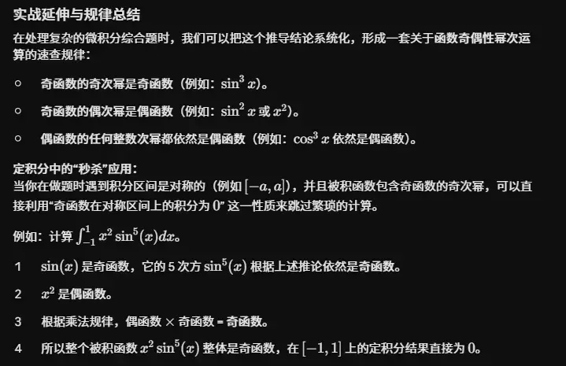
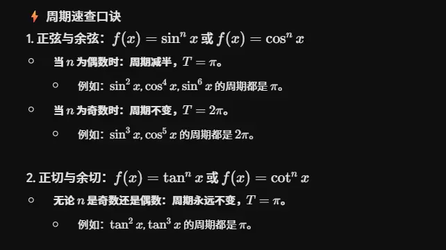
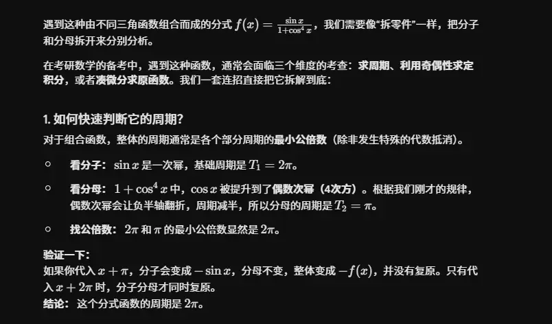

| **变换类型**       | **对自变量操作 (括号内)**                                                                                                                                                               | **对因变量操作 (括号外)**                                                                                                                                                             |
| -------------- | ------------------------------------------------------------------------------------------------------------------------------------------------------------------------------ | ---------------------------------------------------------------------------------------------------------------------------------------------------------------------------- |
| **代数表达**       | $y = f(\text{操作 } x)$                                                                                                                                                          | $y = \text{操作 } f(x)$                                                                                                                                                        |
| **作用方向**       | **水平方向** (左右)                                                                                                                                                                  | **垂直方向** (上下)                                                                                                                                                                |
| **1. 取反 (符号)** | **$y = f(-x)$**      图像关于 **$y$ 轴**对称翻转。                                                                                                                           | **$y = -f(x)$**      图像关于 **$x$ 轴**对称翻转。                                                                                                                         |
| **2. 加减 (平移)** | **$y = f(x \pm a)$** $(a > 0)$      “左加右减”。      $+a$：整体向**左**平移 $a$ 个单位。      $-a$：整体向**右**平移 $a$ 个单位。      _(注：水平平移常常是反直觉的)_ | **$y = f(x) \pm a$** $(a > 0)$      “上加下减”。      $+a$：整体向**上**平移 $a$ 个单位。      $-a$：整体向**下**平移 $a$ 个单位。      _(注：垂直平移是顺直觉的)_ |
| **3. 绝对值**     | **$y = f(\vert x \vert)$**      保留 **$y$ 轴右侧** ($x \ge 0$) 的图像，擦除左侧图像，然后将右侧图像关于 $y$ 轴对称复制到左侧。      _(结果必然是一个偶函数)_                                      | **$y = \vert f(x) \vert$**      保留 **$x$ 轴上方** ($y \ge 0$) 的图像，将 $x$ 轴下方 ($y < 0$) 的图像关于 $x$ 轴翻折到上方。      _(结果的函数值永远非负)_                             |

为了方便记忆和在解题时快速判断，我们可以将这些性质的运算规律提炼为几句核心口诀和高频推论：

### 一、 奇偶性：乘除看符号，复合看内层

- **乘除口诀**：“同号得偶，异号得奇”。（类似正负数的乘除：正正得正，负负得正，正负得负）。
    
- **复合口诀**：“内偶则偶，内奇同外”。
    
    - 只要内层函数是偶函数，整个复合函数必定被“吞没”变成偶函数（例如 $f(x^2)$ 必定是偶函数）。
        
    - 如果内层是奇函数，复合函数的奇偶性与外层函数保持一致（例如 $\sin(x^3)$ 是奇函数，$\cos(x^3)$ 是偶函数）。

## 对称性

| **内层函数 g(x) 的对称性** | **外层函数 f(x) 的对称性** | **复合函数 f[g(x)] 的最终对称性** | **记忆口诀拓展**   |
| ------------------ | ------------------ | ----------------------- | ------------ |
| **有对称轴 $x=a$**     | (任意)               | **有对称轴 $x=a$**          | **内轴则同轴**    |
| **有对称中心 $(a,b)$**  | 在 $x=b$ 有对称轴       | **有对称轴 $x=a$**          | **内变外轴，终成轴** |
| **有对称中心 $(a,b)$**  | 在 $(b,c)$ 有对称中心    | **有对称中心 $(a,c)$**       | **内变外心，终成心** |

### 二、 单调性：复合看方向，乘除需谨慎

- **复合口诀**：“同增异减”。
    
    - 内外层单调性相同（增增、减减），复合后为增函数。
        
    - 内外层单调性相反（增减、减增），复合后为减函数。
        
- **加减直觉**：同向叠加依旧同向（增加增=增，减加减=减）。增减去减等于增（因为减去一个减函数等于加上一个增函数）。
    
- **防错提醒**：不要想当然地认为“增乘增=增”。乘除法的单调性必须结合函数的**正负号**（例如 $f(x)=x$ 是增函数，但 $f(x) \cdot f(x) = x^2$ 在 $x<0$ 时是减函数）。
    

### 三、 可导性：好坏相加必坏，其余皆看造化

这里把“可导”视为好（性质优良），“不可导”视为坏。

- **加减口诀**：“好 + 坏 = 必坏”。
    
    - **可导 $\pm$ 不可导 = 必定不可导**。这是一个非常确定的结论，常用来做选择题排除法。
        
- **不确定项**：“坏 + 坏 = 不确定”，“好 $\times$ 坏 = 不确定”。
    
    - 不可导 $\pm$ 不可导，结果可能“负负得正”变成可导（例如 $y=|x|$ 与 $y=-|x|$ 相加为 $0$，处处可导）。
- **复合链式法则：** 若 $g(x)$ 在 $x_0$ 可导，且 $f(u)$ 在 $u_0 = g(x_0)$ 可导，则 $f(g(x))$ 在 $x_0$ **必可导**。
    - 若其中一个不可导，复合函数的结果一般**不确定**。
- **高频考点（好乘坏）**：可导函数乘不可导函数，在不可导点处，如果可导函数的**函数值为 0**，则乘积**极有可能**变得可导（例如 $y=x|x|$ 在 $x=0$ 处可导）。
    

### 四、 有界性：加乘保封闭，复合看外层

- **封闭规律**：有界性的底子很好，“有界 $+$ 有界 $=$ 有界”，“有界 $\times$ 有界 $=$ 有界”。
    
- **强弱规律**：“有界 $\pm$ 无界 $=$ 必无界”。无界函数的拉扯能力极强，有界函数无法将其拽回来。
    
- **复合规律**：“外层决定论”。只要外层函数是有界的（例如 $\sin(u), \cos(u), \arctan(u)$），不管内层塞进去什么怪物（哪怕是无界函数），复合后的结果**必定有界**。例如 $\sin(e^x + x^3)$ 依然在 $[-1, 1]$ 内。  
- 有界函数乘以无界函数，结果无法确定（例如常数零乘以任何无界函数都有界，但正弦函数乘以 x 则无界）。

### 五、   周期性 (Periodicity)

周期性的组合运算在三角函数综合题中极为常见。    

有理运算
- 若两个函数分别具有周期 $T_1$ 和 $T_2$。如果两周期之比为有理数，则它们的四则运算结果通常是周期函数，公共周期为两者的最小公倍数。
    
- 如果两周期之比为无理数，则组合后的函数通常为非周期函数。

- 复合运算
- **内层周期：** 如果内层函数具有周期 $T$，则复合函数也必然具有周期 $T$（但需要注意 $T$ 不一定是最小正周期）。
    
- **线性复合：** 如果外层函数具有周期 $T$，且内层为线性函数 $ax+b$，则复合函数的周期为 $\frac{T}{|a|}$。
两个周期函数 $f(x)$ 和 $g(x)$ 进行四则运算（加、减、乘、除）后得到的新函数 $F(x)$，其周期性**完全取决于这两个原函数的周期之比是否为有理数**。

假设 $f(x)$ 的周期为 $T_1$，$g(x)$ 的周期为 $T_2$，以下是具体的判定和计算规则：

### 1. 周期之比为“有理数”：是周期函数

如果 $\frac{T_1}{T_2}$ 是一个有理数，那么四则运算后的新函数 $F(x)$ **一定是周期函数**。此时，新函数的一个公共周期 $T$ 是 $T_1$ 和 $T_2$ 的**最小公倍数**。

**具体计算方法（分数求公倍数）：**

将 $T_1$ 和 $T_2$ 表示为最简分数形式，即 $T_1 = \frac{a}{b}$， $T_2 = \frac{c}{d}$（其中 $a, b, c, d$ 均为整数）。那么公共周期 $T$ 的计算公式为：

$$T = \frac{\text{lcm}(a, c)}{\gcd(b, d)}$$

_(即：分子的最小公倍数除以分母的最大公约数)_

> **举例：**
> 
> $f(x)$ 周期 $T_1 = \frac{2\pi}{3}$，$g(x)$ 周期 $T_2 = \frac{\pi}{2}$。
> 
> 分子 $2\pi$ 和 $\pi$ 的最小公倍数是 $2\pi$。
> 
> 分母 $3$ 和 $2$ 的最大公约数是 $1$。
> 
> 它们的公共周期就是 $T = \frac{2\pi}{1} = 2\pi$。

### 2. 周期之比为“无理数”：非周期函数

如果 $\frac{T_1}{T_2}$ 是一个无理数，那么经过四则运算后的新函数 $F(x)$ **通常不是周期函数**。

> **举例：**
> 
> $F(x) = \sin(x) + \sin(\pi x)$
> 
> 这里 $T_1 = 2\pi$，$T_2 = 2$。周期之比 $\frac{2\pi}{2} = \pi$，这是一个无理数。
> 
> 因此，$F(x) = \sin(x) + \sin(\pi x)$ 不是周期函数，它的图像永远不会完全重复。

### ⚠️ 核心考点易错提醒：公共周期不等于“最小正周期”

利用上述方法求出的 $T$ 只是函数的一个公共周期。在进行乘法、除法或者某些特殊的加减法时，**函数的最小正周期可能会缩小，甚至退化**。

- **周期缩小的例子：**
    
    $f(x) = \sin(x)$ 周期为 $2\pi$；$g(x) = \cos(x)$ 周期为 $2\pi$。
    
    如果进行乘法运算：$F(x) = \sin(x)\cos(x)$。
    
    根据三角函数倍角公式，$F(x) = \frac{1}{2}\sin(2x)$。此时新函数的最小正周期变成了 $\pi$，而不是 $2\pi$。
    
- **退化为常数的例子：**
    
    $f(x) = \sin^2(x)$ 周期为 $\pi$；$g(x) = \cos^2(x)$ 周期为 $\pi$。
    
    如果进行加法运算：$F(x) = \sin^2(x) + \cos^2(x) = 1$。
    
    新函数变成了常数函数，任意非零实数都是它的周期，因此它**没有最小正周期**。
    

**总结结论：** 遇到两个周期函数的四则运算求周期时，先通过“求最小公倍数”找到公共周期，然后一定要观察函数解析式，看看是否可以通过**降幂公式、辅助角公式或倍角公式**进一步化简，以确定真正的最小正周期。

