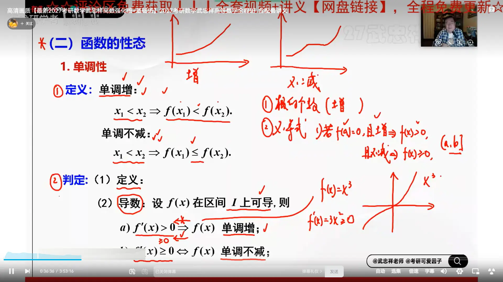

# 单调性  （单调增（严格单调）和单调不减）  

# 单调性和导数关系  
这是一个非常敏锐的问题！反过来推导，正是微积分考试中最常见、最容易踩空的“陷阱”。

简单直接的结论是：**反过来不完全成立。单调递增推不出导数严格大于 0，而是推导数“大于等于 0”。**

为了严谨，我们把“导数推单调性”和“单调性推导数”作一个对比：

### ## 1. 顺着推（导数 $\to$ 单调性）

- 若在区间内恒有 $f'(x) > 0$，则 $f(x)$ 在该区间**严格单调递增**。
    
- （这是**充分条件**：只要导数大于 0，函数一定是一直上升的。）
    

### ## 2. 反着推（单调性 $\to$ 导数）

- 若已知 $f(x)$ 在区间内**严格单调递增**，你能得出 $f'(x) > 0$ 吗？
    
- **不能！** 正确的结论是：** $f'(x) \ge 0$ **。
    

### ## 为什么会多出一个“等于 0”？（经典反例）

为了理解为什么不能丢掉等于号，我们来看微积分中最经典的“反例大使”：

**函数 $f(x) = x^3$ **

1. **看原函数：** 无论 $x$ 取什么值，$x$ 越大，$x^3$ 就越大。所以它在整个实数轴 $(-\infty, +\infty)$ 上是**严格单调递增**的。
    
2. **看导函数：** 它的导数是 $f'(x) = 3x^2$。
    
3. **矛盾点：** 当 $x = 0$ 时，$f'(0) = 0$。
    

**几何意义：** 如果你沿着 $f(x) = x^3$ 爬山，你一直在往上走。但是当你走到 $x = 0$ 这个点（原点）时，脚下的坡度**在这一瞬间**变成了完全水平的（切线斜率为 0，这是一个驻点）。虽然这一瞬间是平的，但你并没有往下走，跨过这个点后你又继续往上爬了。

所以，函数即使是严格单调递增的，它的导数也允许在**个别（孤立）的点**上等于 0。

### ## 严谨的数学结论（考点总结）

如果你在做判断题或证明题，请牢记以下充要条件：

函数 $f(x)$ 在区间内**严格单调递增**的充要条件是：

1. 在该区间内，** $f'(x) \ge 0$ **。
    
2. 并且，导数等于 0 的点只能是**孤立的点**（即导函数 $f'(x)$ 不能在任何一段小区间内恒等于 0，否则那一段就变成完全平坦的直线了，不能叫“严格”递增）。
    

> **一句话速记：**
> 
> “导数大于 0” 保证了“单调递增”；但“单调递增”只保证了“导数不小于 0”。  

