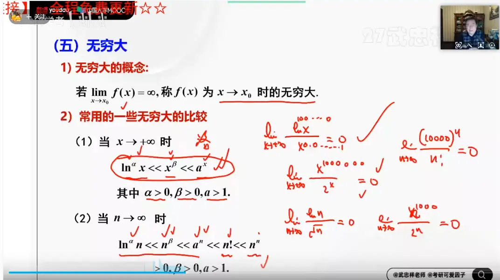
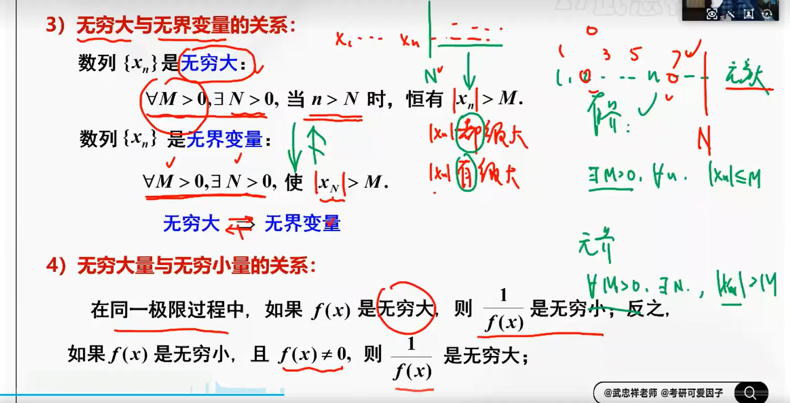

# 极限的概念
## 数列的极限
  
## 函数极限  

  

这是一个非常敏锐的观察！在函数极限的定义中，特意加上 ** $0 <$ ** 这个条件，是极限理论中极其核心的一个细节。

我们可以从以下几个维度来理解这个 ** $0 < \vert{}x - x_0\vert{}$ ** 的本质区别：

### 1. 数学含义：强制要求 $x \neq x_0$

在函数极限 $\lim_{x \to x_0} f(x) = A$ 的 $\varepsilon-\delta$ 定义中，$0 < \vert{}x - x_0\vert{} < \delta$ 这个不等式实际上包含了两个要求：

- $\vert{}x - x_0\vert{} < \delta$：表示 $x$ 必须落在 $x_0$ 附近的一个极小的 $\delta$ 邻域内。
    
- ** $0 < \vert{}x - x_0\vert{}$ **：这个不等式等价于说明 ** $x$ 不能等于 $x_0$ **。它相当于在 $x_0$ 的领域中“挖”掉了一个点，构成了图中所画的“去心邻域”。
    

### 2. 核心思想：极限只看“趋势”，不管“该点”

为什么一定要把 $x_0$ 这个点挖掉呢？因为**极限研究的是函数在一个点“附近”的无限逼近趋势，而完全不关心函数在该点本身是否有定义、或者取值是多少**。

加上 $0 <$ 后，允许了微积分中非常普遍的几种情况：

- **该点无定义**：例如经典的重要极限 $\lim_{x \to 0} \frac{\sin x}{x}$。当 $x = 0$ 时，分母为 0，函数没有定义。但因为极限过程 $x \to 0$ 伴随着 $x \neq 0$（即 $0 < \vert{}x - 0\vert{}$），所以我们只看 $x$ 无限靠近 0 时的趋势，从而得出极限值为 1。
    
- **该点的函数值与极限值不相等**：假设有个函数 $f(x)$，在 $x \neq 1$ 时 $f(x) = 2x$，但在 $x = 1$ 时单独定义 $f(1) = 100$。当 $x \to 1$ 时，极限仍然是 2。因为我们根本不去碰 $x=1$ 那个点，那个游离的 $f(1) = 100$ 完全不参与极限运算。
    

### 3. 为什么数列极限不需要这个？

对比数列极限 $\lim_{n \to \infty} x_n = a$ 的定义，其条件是当 $n > N$ 时。

- 数列极限考察的是 $n \to \infty$ 时的行为。
    
- 无穷大（$\infty$）是一个概念，不是一个具体的数。因为 $n$ 只能一直递增去靠近无穷，它**永远不可能等于无穷大**，所以天然就不存在“取到目标点”的问题，自然也就不需要去刻意设计一个数学符号（像 $0 <$ 那样）来防止自变量“碰到”目标点了。
    

**总结：** 函数极限定义中的 $0 <$ 是为了**剔除 $x = x_0$ 本身的影响**，确保极限纯粹是在研究“靠近”的动态过程。数列极限因为目标是永远达不到的无穷大，所以不需要这个防范机制。

## 题目

## 左右极限  

# 极限的保号性和保序性（zzz）
    
# 极限存在准则（zzzz）

  

#  无穷小  

  

# 无穷大  

  

# 无穷大与无界  

